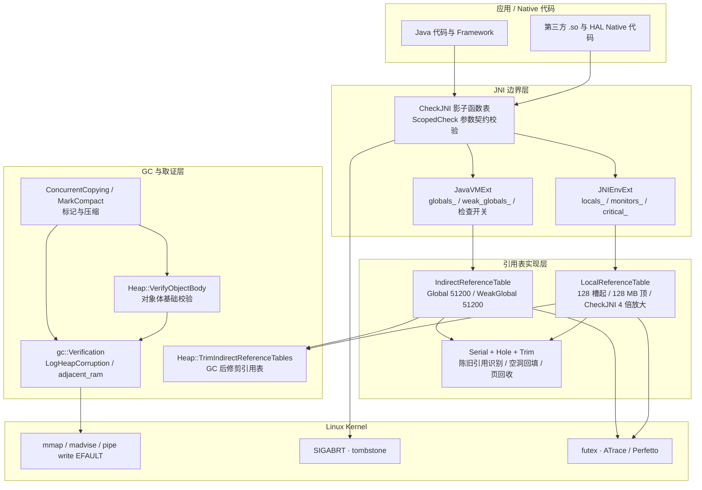
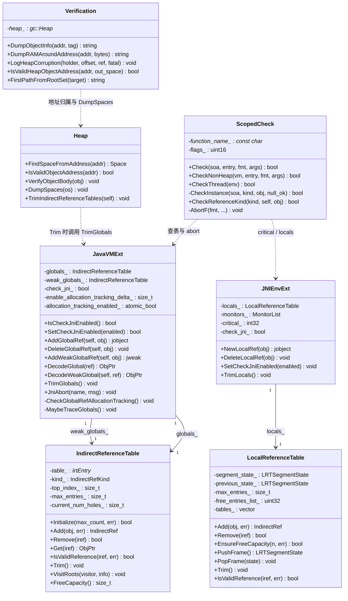
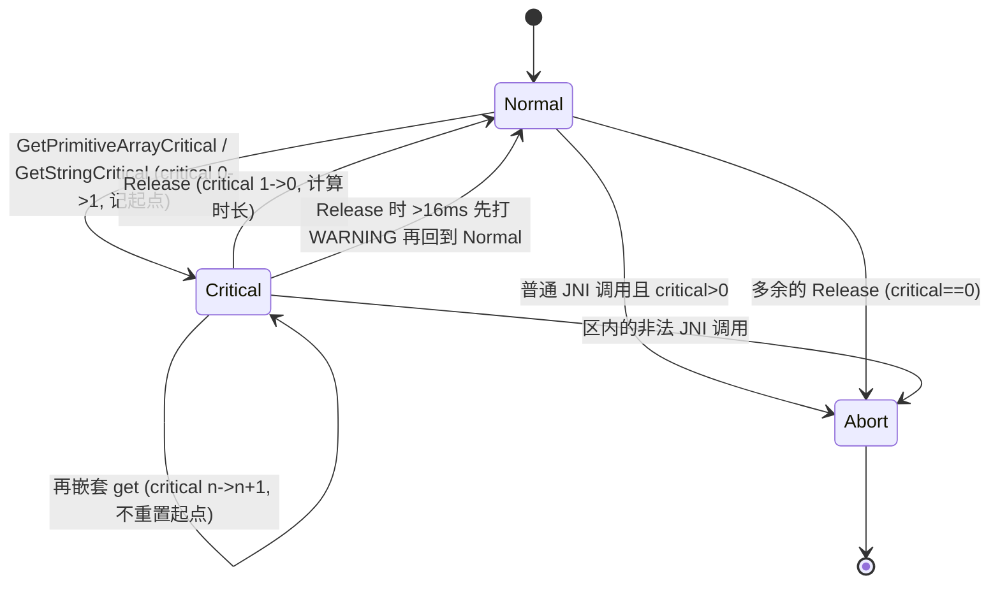
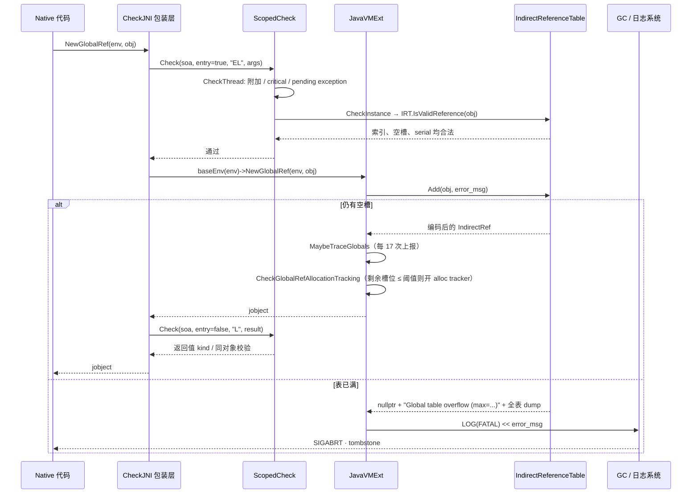
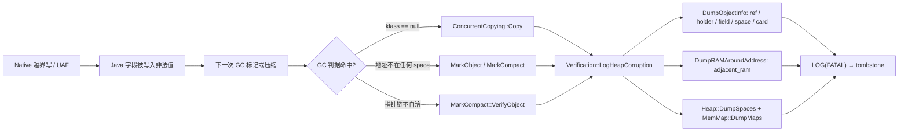

# 15 · CheckJNI 契约校验、JNI 引用表防漏与堆踩踏取证

> [!IMPORTANT]
> **一句话核心结论**：ART 把 JNI 稳定性治理拆成三道互相咬合的防线——`CheckJNI` 用一张影子函数表在**每次 JNI 调用边界**重放参数类型、引用种类与线程归属的契约校验，把「静默未定义行为」变成带 Java 栈与 tombstone 的确定性 abort；`IndirectReferenceTable` / `LocalReferenceTable` 用「kind + serial + index」编码的伪指针管理引用生命周期，Global/WeakGlobal 固定 51200 槽、Local 可倍增到 128 MB，并用 3 bit 序列号识别「删除后复用」的陈旧引用；当野指针真的活到 GC，`Verification::LogHeapCorruption` 会把 holder、字段偏移/字段名、引用地址以及该地址前后各 32 字节的原始 RAM 一起打进 FATAL 日志，让「GC 里莫名崩溃」变成可反推的踩踏现场。

| 项目 | 内容 |
| :--- | :--- |
| **机制定位** | JNI API 边界契约校验；Local / Global / WeakGlobal 三张引用表的生命周期与容量治理；GC 标记/压缩阶段的堆踩踏取证 |
| **源码模块（相对 `qssi/art/`）** | `runtime/jni/check_jni.cc`、`runtime/jni/java_vm_ext.cc`、`runtime/jni/indirect_reference_table.cc`、`runtime/gc/verification.cc`、`runtime/verify_object.cc` |
| **配套源码** | `runtime/jni/java_vm_ext.h`、`runtime/jni/indirect_reference_table.h`、`runtime/jni/indirect_reference_table-inl.h`、`runtime/jni/local_reference_table.cc`、`runtime/jni/jni_env_ext.cc`、`runtime/jni/reference_table.cc`、`runtime/gc/verification.h`、`runtime/gc/verification-inl.h`、`runtime/verify_object.h`、`runtime/verify_object-inl.h`、`runtime/gc/heap.cc` |
| **核心类 / 入口** | `art::ScopedCheck`、`art::CheckJNI`、`art::JavaVMExt`、`art::JNIEnvExt`、`art::IndirectReferenceTable`、`art::jni::LocalReferenceTable`、`art::gc::Verification` |
| **关键函数** | `ScopedCheck::Check` / `CheckThread` / `CheckInstance` / `CheckReferenceKind`；`JavaVMExt::AddGlobalRef` / `DeleteGlobalRef` / `CheckGlobalRefAllocationTracking` / `JniAbort`；`IndirectReferenceTable::Add` / `Remove` / `Trim` / `IsValidReference`；`LocalReferenceTable::Add` / `EnsureFreeCapacity`；`Verification::LogHeapCorruption` / `DumpRAMAroundAddress` / `DumpObjectInfo` |
| **关键启动参数** | `-Xcheck:jni`、`-XX:GlobalRefAllocStackTraceLimit=<N>`、`-Xjnitrace:<substring>`、`-verbose:third-party-jni`、`-Xjniopts:forcecopy` |
| **关键观察点** | ATrace 计数器 `JNI Global Refs` / `JNI Weak Global Refs`；SIGQUIT 输出中的 `JNI: CheckJNI is on; globals=N (plus M weak)` |
| **源码基线** | `/home/voyah/workspace/8397/qssi/art`（Android 15/16 主线级 QSSI，只读） |

## 1. What：机制是什么？

### 1.1 三条防线各自的职责边界

这三个机制经常被笼统地称为「JNI 检查」，但它们守的是三个不同的关口，失败模式也完全不同。

**第一道：CheckJNI，守 API 边界。** 开启后，`JavaVMExt` 把 `JNIEnv` 的 `functions` 指针从「不检查的原生函数表」换成 `GetCheckJniInvokeInterface()` 返回的影子表。影子表里的每一个函数都遵循同一套模板：先 `CHECK_ATTACHED_THREAD`，再构造 `ScopedObjectAccess`，再用一个**格式字符串**声明本次调用各参数的类型（如 `NewGlobalRef` 是 `"EL"`，`GetFieldID` 是 `"Ecuu"`），由 `ScopedCheck::Check()` 逐个解码校验，通过后才转发给真正的 `baseEnv(env)->Xxx()`。它负责回答四个问题：

1. 这个线程附加到 VM 了吗？`JNIEnv*` 是不是本线程的？（`CheckThread`）
2. 这个 `jobject` 的 kind 对不对？它还在表里吗？serial 对得上吗？（`CheckInstance`）
3. 这个 `jclass` / `jstring` / `jthrowable` / `jarray` 类型对吗？`jfieldID` / `jmethodID` 与目标匹配吗？
4. 当前是否处在不允许的 critical 区？是否还有未清理的 pending exception？

**第二道：引用表，守生命周期。** `Global` / `WeakGlobal` 共用 `IndirectReferenceTable` 的同一份实现，各有一张固定 51200 槽的表；`Local` 走 `LocalReferenceTable`，初始是一块 512 字节（128 槽）的小表，按需倍增，硬顶 128 MB。表项不是裸指针，而是 `{serial, GcRoot}` 或压缩引用条目；返回给 native 的 `jobject` 是一个把「表索引 + 序列号 + kind」编码进指针位的伪指针。它负责回答：

1. 引用删除后又被使用，能不能识别？（serial 不匹配 → stale reference）
2. 表满了怎么办？（Local 扩容；Global/WeakGlobal 直接 FATAL 并 dump 全表）
3. 表里长期不用的页能不能还给内核？（`Trim()` 用 `madvise(MADV_DONTNEED)`）

**第三道：堆踩踏取证，守 GC 现场。** 当 native 代码越界写坏了某个 Java 字段，问题不会在写入点暴露，而会在下一次 GC 标记/压缩读到那个字段时暴露。`Verification::LogHeapCorruption` 是这条链路的最后一道记录器：它不负责修复，只负责在进程死亡前把「谁持有这个坏引用、字段叫什么、坏地址周围 64 字节长什么样、它落在哪个 space、页表映射如何」一次性写进 FATAL 日志。

三者关系可以一句话概括：**CheckJNI 是边界上的合同审查员，引用表是合同有效期登记处，Verification 是事故现场的法医。** CheckJNI 的校验本身也要查引用表（`IsValidReference`），所以第一道与第二道天然耦合；第三道则完全在 GC 线程侧独立触发。

### 1.2 核心术语表

| 术语 | 含义 | 源码锚点 |
| :--- | :--- | :--- |
| `IndirectRef` / `jobject` | 不是真实对象地址，而是编码了 kind、serial、表索引的伪指针；`nullptr` 就是 JNI null | [indirect_reference_table.h](file:///home/voyah/workspace/8397/qssi/art/runtime/jni/indirect_reference_table.h#L47-L62) |
| `IndirectRefKind` | 低 2 位：`0` JNI transition、`1` Local、`2` Global、`3` WeakGlobal | [indirect_reference_table.h](file:///home/voyah/workspace/8397/qssi/art/runtime/jni/indirect_reference_table.h#L64-L74) |
| serial（序列号） | Global/WeakGlobal 每槽 3 bit；Local 每 4 槽一组的首槽存 2 bit 序列号；用于识别槽位复用后的陈旧引用 | [indirect_reference_table.h](file:///home/voyah/workspace/8397/qssi/art/runtime/jni/indirect_reference_table.h#L118-L120) |
| hole（空洞） | 从表中间删除留下的空槽；Global 表用 `current_num_holes_` 计数并在 Add 时回填 | [indirect_reference_table.cc](file:///home/voyah/workspace/8397/qssi/art/runtime/jni/indirect_reference_table.cc#L149-L155) |
| CheckJNI chunk | Local 表在 CheckJNI 下的 4 槽分组：1 槽存序列号，其余 3 槽轮转，同一时刻只有 1 个活跃引用 | [local_reference_table.h](file:///home/voyah/workspace/8397/qssi/art/runtime/jni/local_reference_table.h#L116-L135) |
| Critical 区 | `GetPrimitiveArrayCritical` / `GetStringCritical` 与对应 Release 之间的区间；期间不得调用其他 JNI、GC 无法移动对象 | [check_jni.cc](file:///home/voyah/workspace/8397/qssi/art/runtime/jni/check_jni.cc#L96-L105) |
| `kObjectAlignment` | 对象对齐 8 字节（`1u << 3`）；堆踩踏 Hex Dump 的半径 `4 * kObjectAlignment = 32` 字节 | [runtime_globals.h](file:///home/voyah/workspace/8397/qssi/art/runtime/runtime_globals.h#L122-L123) |
| `adjacent_ram` | `DumpRAMAroundAddress` 输出的「地址前后原始内存」字段，用 `|` 标出目标地址位置 | [verification.cc](file:///home/voyah/workspace/8397/qssi/art/runtime/gc/verification.cc#L33-L61) |
| `kVerifyObjectSupport` | 编译期对象校验等级；本源码树 `kDefaultVerifyFlags == kVerifyNone`，故 `VerifyObject()` 默认等价空操作 | [verify_object.h](file:///home/voyah/workspace/8397/qssi/art/runtime/verify_object.h#L32-L64) |

### 1.3 架构定位



这张图的读法是「自上而下是调用方向，自右向左是证据回收方向」：应用侧的任何一次 JNI 调用都要先穿过 CheckJNI；引用一旦被创建，就落在某张表里；表在 GC 之后被修剪；若 GC 在表或堆里读到不合法引用，则由 `Verification` 产出证据并终止进程。

## 2. Why：为什么需要它？

### 2.1 五类真实事故与朴素实现的失效

**事故一：删除后使用（use-after-delete）。** native 代码 `DeleteLocalRef` 后又拿旧 `jobject` 调 `CallObjectMethod`。没有 CheckJNI 时，这个伪指针要么指向已置空的槽，要么——更糟——该槽已被新的引用复用，于是代码「成功地」操作了另一个对象。表现是数据错乱而非崩溃，定位成本极高。引用表的 serial 位就是为这一类事故准备的：每次槽位复用 serial 自增，陈旧引用解码出的 serial 与槽内值不一致，`IsValidReference` 直接报 `stale reference with serial number X v. current Y`，见 [indirect_reference_table-inl.h](file:///home/voyah/workspace/8397/qssi/art/runtime/jni/indirect_reference_table-inl.h#L36-L61)。

**事故二：引用种类错用。** 把 `jclass` 传给 `NewGlobalRef` 之后又用 `DeleteLocalRef` 删它；或把 `jweak` 当普通 `jobject` 长期持有。没有 CheckJNI 时，`IndirectReferenceTable::Remove` 只会打一条含义模糊的 warning，源码里甚至留了 TODO 承认这一点（[indirect_reference_table.cc](file:///home/voyah/workspace/8397/qssi/art/runtime/jni/indirect_reference_table.cc#L241-L243)）。CheckJNI 的 `CheckReferenceKind` 会在删除前比对期望 kind 与实际 kind，不符直接 abort。

**事故三：Local 引用泄漏。** 一个 native 循环里 `NewStringUTF` 创建局部引用却从不 `DeleteLocalRef`，或 `PushLocalFrame` 之后忘了 `PopLocalFrame`。GC 会把整张 Local 表当根扫描，于是每轮循环都让根集膨胀，最终表现为「Java 堆没涨多少，但 GC 越来越慢、native 内存持续上涨」。Local 表虽然可扩容，但扩容本身是内存与扫描成本；`EnsureFreeCapacity` 失败会抛 `OutOfMemoryError`，而单次 `Add` 到硬顶则直接 FATAL，见 [local_reference_table.cc](file:///home/voyah/workspace/8397/qssi/art/runtime/jni/local_reference_table.cc#L365-L389)。

**事故四：Global 引用泄漏到耗尽。** Global 表固定 51200 槽。一个每帧 `NewGlobalRef` 却忘记 `DeleteGlobalRef` 的 native 模块，可以在几分钟内把表打满；打满后不是抛 Java 异常，而是 `LOG(FATAL)`。更麻烦的是，默认的溢出 dump 只告诉你「表里有哪些对象」，不告诉你「这些对象是谁在哪一行创建的」。这就是 `-XX:GlobalRefAllocStackTraceLimit` 与按需开启分配追踪的动机：在剩余槽位跌破阈值时提前打开 alloc tracker，让溢出 dump 能附带 `Allocated at:` 的 Java 分配栈。

**事故五：野指针踩踏 Java 字段。** native 代码越界写、或把已 free 的 native 指针误当 `jobject` 写进 Java 字段，写入瞬间不会崩。下一次 GC 标记该字段时读到非法地址，如果只做 `CHECK`，现场只剩一句「GC 崩了」。`Verification::LogHeapCorruption` 的设计目标就是：**在进程死之前，把「哪个对象、哪个字段、字段名、字段地址、周围 64 字节、所在 space、进程映射」全部留下**。

### 2.2 方案对比矩阵

| 方案 | 能发现的问题 | 发现时机 | 性能成本 | 现场信息 | 适用阶段 |
| :--- | :--- | :--- | :--- | :--- | :--- |
| 无任何检查 | 几乎为零，靠 SIGSEGV 碰运气 | 不确定 | 最低 | 几乎无 | 绝不可用于稳定性攻坚 |
| CheckJNI | 类型/kind/serial/线程/pending exception/critical 违规 | 每次 JNI 调用 | 显著（每调用一次解析 + 查表） | Java 栈 + `JNI DETECTED ERROR...` + tombstone | debug/eng、灰度、单模块排查 |
| ASan / HWASan | native 堆越界、UAF、栈溢出 | 访存瞬间 | 很高（插桩） | 分配/释放栈 | 研发构建、压测 |
| GWP-ASan | 采样到的 native 堆错误 | 访存瞬间 | 低（采样） | 采样分配栈 | 线上抽样 |
| 引用表 serial | 引用表内的旧引用复用 | JNI 调用查表 | 极低（位运算） | 索引与 serial 对比 | 始终开启 |
| `Verification::LogHeapCorruption` | 已污染到 Java 堆的引用 | GC 标记/压缩 | 仅异常路径 | holder/字段/`adjacent_ram`/spaces/maps | 异常兜底 |

这张表要说明的核心取舍是：**没有任何单一手段能覆盖全部**。CheckJNI 抓不到 native 内部越界，ASan 抓不到「合法地址但语义错误」的 JNI 误用，引用表 serial 只能证明「这个槽被复用过」，取证模块只能做事后记录。工程上应把它们按成本分层：serial 与容量上限永远开；CheckJNI 在 debug/灰度开；sanitizer 在研发构建开；取证模块作为最后兜底。

### 2.3 能力边界：CheckJNI 不做什么

第一，**它不检查引用指向的对象体是否完好**。`CheckInstance` 最终只调用 `Heap::IsValidObjectAddress(obj)`，其实现是「8 字节对齐 + 落在某个 space 内」，见 [heap.cc](file:///home/voyah/workspace/8397/qssi/art/runtime/gc/heap.cc#L1763-L1768)。它不会验证 `obj->GetClass()` 是否可读、klass 的 klass 是否自洽。后者属于 `Heap::VerifyObjectBody` 的职责，而该函数受 `verify_object_mode_` 门控，本源码树默认 `kVerifyObjectSupport == kVerifyObjectModeDisabled`，因此常规构建里 `VerifyObject()` 是编译期空操作。**不要把「CheckJNI 通过」误解为「对象体一定健康」。**

第二，**它不拦截 native 代码内部的错误**。CheckJNI 只在值穿过 JNI 边界时校验；native 自己拿 `GetPrimitiveArrayCritical` 返回的裸指针越界写，它看不见。

第三，**它不能消除 weak global 的固有竞态**。源码明确注释：`IsValidReference()` 检查非空之后，另一个线程仍可能删除该 global/weak global，甚至对象可能已被 weak 清理，见 [check_jni.cc](file:///home/voyah/workspace/8397/qssi/art/runtime/jni/check_jni.cc#L905-L925)。CheckJNI 把「大概率」的误用变成确定性 abort，但不能把 JNI 引用变成线程安全的共享对象。

第四，**它的性能成本是真实的**。每个 JNI 调用都要走一次类型串解析、引用解码与表查询；`-Xcheck:jni` 只适合定位问题，不适合作为量产常开配置。源码在 `JavaVMExt` 构造时甚至对 debug 构建强制开启（`kIsDebugBuild`），这本身也说明它被定位为「研发期护栏」。

## 3. How：源码级实现原理深度剖析

### 3.1 核心数据结构与内存布局

#### 3.1.1 `IndirectRef`：把三样东西塞进一个指针

`IndirectRef` 就是 `void*`，但它从不指向对象。Global/WeakGlobal 的编码在 [indirect_reference_table.h](file:///home/voyah/workspace/8397/qssi/art/runtime/jni/indirect_reference_table.h#L258-L305) 中定义：

```text
 63                                                          5 4  2 1 0
+-------------------------------------------------------------+----+-----+
|                   table index (59 bit)                      |ser |kind |
+-------------------------------------------------------------+----+-----+
                                                                 |    |
                                                                 |    +-- 00 kJniTransition
                                                                 |        01 kLocal
                                                                 |        10 kGlobal
                                                                 |        11 kWeakGlobal
                                                                 +------- 3 bit serial (0..7)
                                                                          仅 Global / WeakGlobal 使用
```

编码公式是 `EncodeIndex(index) | EncodeSerial(serial) | EncodeIndirectRefKind(kind)`，其中索引左移 `kKindBits(2) + kIRTSerialBits(3) = 5` 位，serial 左移 2 位。解码时先取低 2 位判 kind，再右移 5 位取索引。这样设计的直接收益是：

- **O(1) 解码**：不需要查任何全局映射表，纯位运算。
- **kind 可先验**：`GetIndirectRefKind()` 只看低 2 位，`CheckInstance` 在解引用之前就能判断该走 Local 表还是 Global 表。
- **serial 可验**：同一个索引被复用时，旧 `jobject` 的 serial 与槽内 serial 不同，可确定性地拒绝。
- **`jobject` 与 `jref` 可区分**：`GetGlobalOrWeakGlobalMask()` 取 `kGlobal` 的位（bit 1），Local/JNI transition 的 bit 1 恒为 0，因此 `IsGlobalOrWeakGlobalReference()` 只需一次与运算。

代价是：`jobject` 不是可解引用的地址，任何 native 代码若把它当对象指针读写，必然踩坏内存——这本身就是一类常见事故，而 CheckJNI 的 `CheckInstance` 正是靠 kind 解码把这类误用拦在表查询之前。

#### 3.1.2 `IrtEntry`：8 字节的全局槽位

```text
 IrtEntry（LP64，8 字节；static_assert(sizeof(IrtEntry) == 2 * sizeof(uint32_t))）
 偏移   大小   字段          说明
 0      4      serial_       uint32_t；每次槽位复用自增，达到 kIRTMaxSerial(7) 后回绕 0
 4      4      reference_    GcRoot<mirror::Object>；32 位压缩引用，GC 可见的强/弱根
 ----   ----
 8      8      合计
```

对应源码在 [indirect_reference_table.h](file:///home/voyah/workspace/8397/qssi/art/runtime/jni/indirect_reference_table.h#L122-L147)。两个 `static_assert` 不是装饰：`sizeof == 8` 保证一个槽恰好是两个 32 位字，`IsPowerOfTwo(sizeof)` 保证后续页对齐与 `MemMap` 计算成立。

`IrtEntry::Add` 的序列号推进逻辑只有四行（[indirect_reference_table-inl.h](file:///home/voyah/workspace/8397/qssi/art/runtime/jni/indirect_reference_table-inl.h#L102-L108)）：

```cpp
inline void IrtEntry::Add(ObjPtr<mirror::Object> obj) {
  ++serial_;
  if (serial_ == kIRTMaxSerial) {
    serial_ = 0;
  }
  reference_ = GcRoot<mirror::Object>(obj);
}
```

注意这里**先自增再检查**：序列号在 1..6 之间循环，7 被跳过并回绕到 0。由于 `EncodeSerial` 只保证 3 bit，0..7 都能编码；真正用于「辨认陈旧引用」的是「旧 iref 的 serial 与当前槽内 serial 是否相等」，而不是序列号本身的绝对值。

#### 3.1.3 `LrtEntry` 与 CheckJNI chunk：4 字节槽位里的三种身份

Local 表不使用 `GcRoot + serial` 的 8 字节结构，而是把「引用 / 空闲链 / 序列号」三种状态压进一个 4 字节字（[local_reference_table.h](file:///home/voyah/workspace/8397/qssi/art/runtime/jni/local_reference_table.h#L116-L135)）：

```text
 31                                                              3 2 1 0
+----------------------------------------------------------------+-------+
|         payload: reference / next_free_index / serial          |  tag  |
+----------------------------------------------------------------+-------+
   000  reference   —— 低 3 位为 0，因为 Java 对象 8 字节对齐
   x01  free        —— 高位是下一条空闲槽的索引
   x10  serial      —— CheckJNI 序列号条目，取值 1..3
   其余              —— 未使用 / 已修剪
```

CheckJNI 开启时，Local 表按 **4 槽一组** 工作：

```text
 16 字节对齐的 CheckJNI chunk（同一时刻只有 1 个活跃引用）
 +---------------+---------------+---------------+---------------+ 
 | slot 0        | slot 1        | slot 2        | slot 3        |
 | serial 条目   | 候选槽 A      | 候选槽 B      | 候选槽 C      |
 | 值 ∈ [1,3]    |               |               |               |
 +---------------+---------------+---------------+---------------+ 
                        ^ 活跃槽 = serial_entry + serial_number
```

每次 `Add` 时 `IncrementSerialNumber()` 在 1..3 之间轮转，选中的槽写入引用，其余槽保持空闲或旧值；`Remove` 时该槽被标记 free。好处是**同一个逻辑槽位在连续三次分配中会落在不同物理槽**，因此「删除后立刻新建一个引用」不会让旧 `jobject` 恰好指向新对象，`IsValidReference` 里的 serial 比对才能稳定命中。代价是 CheckJNI 下每个引用占 4 个槽：`Initialize()` 会把请求的容量乘以 `kCheckJniEntriesPerReference = 4`，但**总字节上限仍是 128 MB**，所以 CheckJNI 下可容纳的引用数只有非 CheckJNI 的 1/4，见 [local_reference_table.h](file:///home/voyah/workspace/8397/qssi/art/runtime/jni/local_reference_table.h#L388-L398)。

#### 3.1.4 类关系



### 3.2 CheckJNI 的装配：一次函数表替换，所有调用改道

CheckJNI 的开关落点在 `JavaVMExt` 构造函数与 `SetCheckJniEnabled()`：

```cpp
// runtime/jni/java_vm_ext.cc:548（节选）
SetCheckJniEnabled(runtime_options.Exists(RuntimeArgumentMap::CheckJni) || kIsDebugBuild);

// runtime/jni/java_vm_ext.cc:804-812（节选）
bool JavaVMExt::SetCheckJniEnabled(bool enabled) {
  bool old_check_jni = check_jni_;
  check_jni_ = enabled;
  functions = enabled ? GetCheckJniInvokeInterface() : unchecked_functions_;
  MutexLock mu(Thread::Current(), *Locks::thread_list_lock_);
  runtime_->GetThreadList()->ForEach(ThreadEnableCheckJni, &check_jni_);
  return old_check_jni;
}
```

两个细节值得注意：

1. **`kIsDebugBuild` 强制开启**：debug（eng）构建即使没有 `-Xcheck:jni` 也会开。user/userdebug 上则由 framework 的 `debug.checkjni` 属性驱动 Zygote 晚开启（见下），所以同一段 JNI 误用在 debug 构建上会直接 abort，在普通 user 版本上可能「看起来正常」。
2. **逐线程同步**：`functions` 是 `JavaVMExt` 级别的指针，但每个 `JNIEnvExt` 也缓存了一份 `functions`；`ThreadEnableCheckJni` 负责把新状态刷到每个已存在线程的 `JNIEnvExt`。因此**运行中开关 CheckJNI 是允许的**，但已经创建的 Local 引用会保留旧的槽位组织方式，源码在 `LocalReferenceTable` 注释里明确说明「切换后旧条目校验更弱」，见 [local_reference_table.h](file:///home/voyah/workspace/8397/qssi/art/runtime/jni/local_reference_table.h#L86-L95)。

另一个入口是 Zygote 的「晚开启」：framework 在 fork 应用时通过 `runtime_flags` 的 `DEBUG_ENABLE_CHECKJNI`（`1 << 1`）请求 CheckJNI，native 侧在 `EnableDebugFeatures()` 里调用 `vm->SetCheckJniEnabled(true)` 并打印 `Late-enabling -Xcheck:jni`，见 [dalvik_system_ZygoteHooks.cc](file:///home/voyah/workspace/8397/qssi/art/runtime/native/dalvik_system_ZygoteHooks.cc#L164-L178)。

#### 3.2.1 格式字符串：把「参数类型」变成可执行契约

`ScopedCheck::Check()` 的第二个参数不是普通字符串，而是一份**参数类型清单**。以 `GetFieldID` 为例：

```cpp
// runtime/jni/check_jni.cc:2893-2903（节选）
ScopedCheck sc(kFlag_Default, __FUNCTION__);
JniValueType args[4] = {{.E = env}, {.c = c}, {.u = name}, {.u = sig}};
if (sc.Check(soa, true, "Ecuu", args)) {
  result.f = FindFieldID</*kEnableIndexIds=*/true>(soa, c, name, sig, is_static, caller_address);
  ...
}
```

字符含义在源码里有完整注释（[check_jni.cc](file:///home/voyah/workspace/8397/qssi/art/runtime/jni/check_jni.cc#L122-L155)）：`E` 是 `JNIEnv*`、`c` 是 `jclass`、`u` 是 modified UTF-8、`L` 是 `jobject`、`s` 是 `jstring`、`t` 是 `jthrowable`、`a` 是 `jarray`、`f` / `m` 是 field/method ID、`r` 是 release mode、`z` 是长度。`CheckPossibleHeapValue()` 负责把每个字符分派到对应的校验器（[check_jni.cc](file:///home/voyah/workspace/8397/qssi/art/runtime/jni/check_jni.cc#L970-L996)）：

```cpp
case 'c': return CheckInstance(soa, kClass, arg.c, false);
case 's': return CheckInstance(soa, kString, arg.s, false);
case 't': return CheckInstance(soa, kThrowable, arg.t, false);
case 'L': return CheckInstance(soa, kObject, arg.L, true);
case 'E': return CheckThread(arg.E);
```

这套设计的妙处是**校验逻辑与函数语义解耦**：新增一个 JNI 包装函数时，作者只需写对格式串，引用校验、线程校验、异常校验自动生效。代价是格式串写错会导致漏检——所以 `check_jni.cc` 里每个包装函数都紧邻其格式串声明，便于 review。

#### 3.2.2 `CheckInstance`：引用校验的完整决策树

`CheckInstance()` 是引用类参数的唯一入口（[check_jni.cc](file:///home/voyah/workspace/8397/qssi/art/runtime/jni/check_jni.cc#L837-L968)）。它的决策顺序是：

```text
 输入 jobject
   │
   ├─ nullptr? ──► null_ok ? 通过 : AbortF("received NULL ...")
   │
   ├─ kind = 低 2 位
   │    ├─ kJniTransition ──► 是否本线程 transition 引用？否 → "use of invalid jobject"
   │    ├─ kLocal         ──► LRT.IsValidReference()  （索引 + free + serial）
   │    └─ kGlobal/kWeak  ──► IRT.IsValidReference()  （索引 + 空槽 + serial）
   │                              └─ 再 DecodeGlobal / DecodeWeakGlobal
   │                                   └─ weak 且已清理 → 记为 expect_null
   │
   ├─ 非 expect_null 但解码为 null ──► "deleted reference"
   ├─ expect_null 且不允许 null   ──► "cleared weak reference"
   │
   ├─ Heap::IsValidObjectAddress(obj) ──► 对齐 + 落在 space 内
   │
   └─ 按 InstanceKind 做类型判定：IsClass / IsStringClass / IsThrowableClass
```

其中 `IsValidReference()` 的两套实现差异很大：

- **Global/WeakGlobal**：只查索引是否小于 `top_index_`、槽是否为空、serial 是否一致（[indirect_reference_table-inl.h](file:///home/voyah/workspace/8397/qssi/art/runtime/jni/indirect_reference_table-inl.h#L34-L61)）。
- **Local**：先由伪指针反推出 `entry_index`（Local 的 `jobject` 直接编码槽地址，而不是索引），再查是否越界/已弹出/是 free/是 null，最后若有 CheckJNI serial 条目则校验 serial（[local_reference_table-inl.h](file:///home/voyah/workspace/8397/qssi/art/runtime/jni/local_reference_table-inl.h#L89-L129)）。

错误消息会区分 `deleted reference at index N`、`popped reference at index N in a table of size M`、`stale reference with serial number X v. current Y`、`reference outside the table: ptr`。**看到哪一条，就能直接判断是「删了还用」「跨 frame 用了」还是「槽位复用后用了」。**

#### 3.2.3 abort 链路：从 `AbortF` 到 tombstone

所有校验失败最终走 `ScopedCheck::AbortF()`（[check_jni.cc](file:///home/voyah/workspace/8397/qssi/art/runtime/jni/check_jni.cc#L1525-L1531)）：

```cpp
void AbortF(const char* fmt, ...) {
  va_list args;
  va_start(args, fmt);
  Runtime::Current()->GetJavaVM()->JniAbortV(function_name_, fmt, args);
  va_end(args);
}
```

`JniAbortV()` 格式化消息后交给 `JniAbort()`；后者拼出 `JNI DETECTED ERROR IN APPLICATION: <msg>`，附上 `in call to <函数名>` 与 `from <当前 Java 方法>`，然后：

- 若安装了 `check_jni_abort_hook_`（测试用），调用 hook 后返回，由调用方决定后续；
- 否则先 `ScopedThreadSuspension(kNative)` 保证能拿到 native 栈，再 `LOG(FATAL)`，见 [java_vm_ext.cc](file:///home/voyah/workspace/8397/qssi/art/runtime/jni/java_vm_ext.cc#L605-L623)。

因此一条典型的 JNI 误用日志结构是：

```text
F art     : JNI DETECTED ERROR IN APPLICATION: JNI ERROR (app bug): expected reference of kind Local but found Global: 0x...
F art     :     in call to DeleteLocalRef
F art     :     from java.lang.String com.example.Foo.nativeStep(long)
F libc    : Fatal signal 6 (SIGABRT), code -1 (SI_QUEUE) in tid ..., pid ...
```

这里 `LOG(FATAL)` 的价值不只是「崩」，而是**在崩之前把 Java 方法名、JNI 函数名、参数值全部写进 abort message**，tombstone 会原样保留。

### 3.3 Critical 区：16 ms 慢锁告警是怎样算出来的

Critical 区的状态机非常小：`JNIEnvExt` 里一个 `critical_` 计数器，`0` 表示不在区内，`n` 表示嵌套了 n 层。所有 JNI 包装函数的 `ScopedCheck` 通过 flags 声明自己与 critical 区的关系：

| flag | 含义 | 典型函数 |
| :--- | :--- | :--- |
| `kFlag_CritBad` | 区内禁止调用 | 绝大多数普通 JNI 函数 |
| `kFlag_CritOkay` | 区内允许调用 | `GetArrayLength`、`ExceptionCheck`、`GetStringChars` 等 |
| `kFlag_CritGet` | 进入 critical | `GetPrimitiveArrayCritical`、`GetStringCritical` |
| `kFlag_CritRelease` | 离开 critical | `ReleasePrimitiveArrayCritical`、`ReleaseStringCritical` |

核心逻辑在 `CheckThread()`（[check_jni.cc](file:///home/voyah/workspace/8397/qssi/art/runtime/jni/check_jni.cc#L1354-L1419)）：

```cpp
case kFlag_CritGet:
  if (threadEnv->GetCritical() == 0) {
    threadEnv->SetCriticalStartUs(self->GetCpuMicroTime());
  }
  threadEnv->SetCritical(threadEnv->GetCritical() + 1);
  break;
case kFlag_CritRelease:
  if (threadEnv->GetCritical() == 0) {
    AbortF("thread %s called too many critical releases", ...);
  } else if (threadEnv->GetCritical() == 1) {
    uint64_t critical_duration_us = self->GetCpuMicroTime() - threadEnv->GetCriticalStartUs();
    if (critical_duration_us > kCriticalWarnTimeUs) {
      LOG(WARNING) << "JNI critical lock held for "
                   << PrettyDuration(UsToNs(critical_duration_us)) << " on " << *self;
    }
  }
  threadEnv->SetCritical(threadEnv->GetCritical() - 1);
  break;
```

四个必须记住的事实：

1. **计时只在外层**：`critical_ == 0` 时记起点，`critical_ == 1` 时算时长，嵌套的 get 不重置起点，也不重复告警。
2. **阈值是 CPU 时间，不是墙钟**：`GetCpuMicroTime()` 取的是线程 CPU 时间；线程被调度出去的时间不计入。所以「卡了 100 ms 但只占 CPU 5 ms」可能不触发告警，而「持续自旋 17 ms」一定触发。
3. **`kCriticalWarnTimeUs = MsToUs(16)`**（[check_jni.cc](file:///home/voyah/workspace/8397/qssi/art/runtime/jni/check_jni.cc#L85-L87)），16 ms 对应 60 Hz 的一帧；车机多屏常见 60 Hz/30 Hz 混合，16 ms 是保守下限。
4. **只在 CheckJNI 开启时生效**：critical 计数与告警都长在 `ScopedCheck`/`CheckThread` 里，关闭 CheckJNI 后 `JNIEnvExt::critical_` 仍存在，但没有任何代码会去读它。



工程含义很直接：**Critical 区里只做「拿裸指针 + 定长 memcpy + 立刻释放」**。任何可能分配、可能加锁、可能回调 Java 的操作都必须挪到区外；大数组要分块，单块控制在 16 ms 以内。

### 3.4 Local 引用表：可增长、可修剪、CheckJNI 下四倍放大

#### 3.4.1 初始形态与扩容

`JNIEnvExt` 创建时以 `max_count = 1` 初始化 Local 表（[jni_env_ext.cc](file:///home/voyah/workspace/8397/qssi/art/runtime/jni/jni_env_ext.cc#L67-L86)）。`LocalReferenceTable::Initialize()` 并不直接按 1 分配，而是：

1. 从 `SmallLrtAllocator` 拿一块 512 字节 = 128 槽的小表（`kSmallLrtEntries`），多张线程小表可以共享同一页；
2. 若请求容量大于 128，则 `Resize()` 倍增；
3. 硬顶 `kMaxTableSizeInBytes = 128 * MB`；CheckJNI 下先乘 4 再参与上限检查。

扩容路径在 `Add()` 的慢路径里（[local_reference_table.cc](file:///home/voyah/workspace/8397/qssi/art/runtime/jni/local_reference_table.cc#L365-L389)）：

```cpp
if (UNLIKELY(top_index == max_entries_)) {
  if (kMaxTableSizeInBytes == max_entries_ * sizeof(LrtEntry)) {
    oss << "JNI ERROR (app bug): " << kLocal << " table overflow "
        << "(max=" << max_entries_ << ")" << ...;
    *error_msg = oss.str();
    return nullptr;
  }
  if (!Resize(max_entries_ * 2u, &inner_error_msg)) { ... }
}
```

也就是说：**Local 表溢出通常不是「爆表」，而是「内存涨到 128 MB」**。这比固定上限更隐蔽——进程可能先 OOM，而不是先给出清晰的 table overflow。`JNIEnvExt::NewLocalRef()` 在 `Add()` 返回 null 时直接 `LOG(FATAL) << error_msg`（[jni_env_ext.cc](file:///home/voyah/workspace/8397/qssi/art/runtime/jni/jni_env_ext.cc#L88-L103)），所以真正走到那条分支时，日志会带完整的 Local 表 dump。

`EnsureLocalCapacity()` 是唯一的「软失败」入口：它调用 `EnsureFreeCapacity()`，失败时由 JNI 层抛 `OutOfMemoryError` 而不是 abort（[jni_internal.cc](file:///home/voyah/workspace/8397/qssi/art/runtime/jni/jni_internal.cc#L2963-L2981)）。这也是为什么规范要求 native 代码在批量创建引用前先 `EnsureLocalCapacity(n)`：把「必然的 FATAL」转成「可捕获的 OOME」。

#### 3.4.2 空洞、free list 与 frame 语义

Local 表是**分段栈**：每次进入 native 或 `PushLocalFrame` 时 `PushFrame()` 保存 `previous_state_`，返回或 `PopLocalFrame` 时 `PopFrame()` 把 `segment_state_` 恢复。删除只允许删除当前 segment 内的引用；删除顶部条目时会把下面连续的空洞一起吃掉（`PrunePoppedFreeEntries`），删除中间条目则挂到 free list（[local_reference_table.cc](file:///home/voyah/workspace/8397/qssi/art/runtime/jni/local_reference_table.cc#L418-L594)）。

`Trim()` 由 `Heap::Trim()` 在内存修剪路径统一触发（[heap.cc](file:///home/voyah/workspace/8397/qssi/art/runtime/gc/heap.cc#L1619-L1635)）：对超出当前 top 的页做 `madvise(MADV_DONTNEED)`，把物理页还给内核，同时保留虚拟地址空间。这意味着**曾经撑大过的 Local 表不会立刻缩小虚拟尺寸，但 RSS 会回落**。Global 表同理，`JavaVMExt::TrimGlobals()` 对 top 之后的页做 `madvise`（[java_vm_ext.cc](file:///home/voyah/workspace/8397/qssi/art/runtime/jni/java_vm_ext.cc#L1206-L1209)）。

### 3.5 Global / WeakGlobal 表：固定 51200 槽的防漏与取证

#### 3.5.1 容量与溢出

两张表的容量在 [java_vm_ext.cc](file:///home/voyah/workspace/8397/qssi/art/runtime/jni/java_vm_ext.cc#L60-L66) 写死：

```cpp
static constexpr size_t kGlobalsMax = 51200;      // must fit in 16 bits
static constexpr size_t kWeakGlobalsMax = 51200;  // must fit in 16 bits
```

注释里的「must fit in 16 bits」是历史约束：早期 IRT 用 16 位索引，现在编码已放宽到 59 位，但 51200 的上限保留了下来。`Initialize()` 会把 `51200 * 8 B` 向上取整到页，因此 `max_entries_` 等于或略大于 51200，取决于页大小（[indirect_reference_table.cc](file:///home/voyah/workspace/8397/qssi/art/runtime/jni/indirect_reference_table.cc#L93-L110)）。

溢出时 `IndirectReferenceTable::Add()` 返回 null，并构造一条带全表 dump 的错误消息（[indirect_reference_table.cc](file:///home/voyah/workspace/8397/qssi/art/runtime/jni/indirect_reference_table.cc#L187-L195)）：

```cpp
oss << "JNI ERROR (app bug): " << kind_ << " table overflow "
    << "(max=" << max_entries_ << ")"
    << MutatorLockedDumpable<IndirectReferenceTable>(*this);
```

`JavaVMExt::AddGlobalRef()` / `AddWeakGlobalRef()` 拿到 null 后直接 `LOG(FATAL)`（[java_vm_ext.cc](file:///home/voyah/workspace/8397/qssi/art/runtime/jni/java_vm_ext.cc#L718-L736)、[java_vm_ext.cc](file:///home/voyah/workspace/8397/qssi/art/runtime/jni/java_vm_ext.cc#L751-L770)）。注意：**Global 与 WeakGlobal 是两张独立的表，各自 51200**，不会互相挤占。

#### 3.5.2 空洞回填与删除语义

Global 表的删除策略在 [indirect_reference_table.cc](file:///home/voyah/workspace/8397/qssi/art/runtime/jni/indirect_reference_table.cc#L149-L155) 的注释里说得很清楚：不用 free list，而是维护 `current_num_holes_`，Add 时若存在空洞就从 `top_index - 1` 向下扫描第一个空槽回填；Remove 顶部条目时向下吃掉连续空洞，Remove 中间条目时只把该槽置空并增加空洞计数。

```text
 例：top_index = 6，删除 index 2 与 index 4（均为中间删除）

 index:   0     1     2     3     4     5
        +-----+-----+-----+-----+-----+-----+
 table: | obj | obj | null| obj | null| obj |   current_num_holes_ = 2
        +-----+-----+-----+-----+-----+-----+
                        ^           ^
                      hole        hole

 下一次 Add：从 index 5 向下扫，先遇到 index 4 → 回填 4，holes 变 1
```

这种「线性扫描 + 计数」的取舍是：**删除/新增的常数成本极低，代价是空洞很多时 Add 会退化为 O(holes)**。源码注释也承认这个假设（「holes usually near the end of the table」），并留了 TODO。

#### 3.5.3 泄漏的可观测性：ATrace 计数器与分配栈

Global/WeakGlobal 的可观测性由三层组成：

**第一层：ATrace 整数计数器。** 每发生 17 次变更（`kGlobalRefReportInterval = 17`）上报一次当前活跃条目数（[java_vm_ext.cc](file:///home/voyah/workspace/8397/qssi/art/runtime/jni/java_vm_ext.cc#L704-L716)）：

```cpp
void JavaVMExt::MaybeTraceGlobals() {
  if (global_ref_report_counter_++ == kGlobalRefReportInterval) {
    global_ref_report_counter_ = 1;
    ATraceIntegerValue("JNI Global Refs", globals_.NEntriesForGlobal());
  }
}
```

在 Perfetto 里表现为名为 `JNI Global Refs` / `JNI Weak Global Refs` 的 counter，值来自 `top_index_ - current_num_holes_`（[indirect_reference_table.h](file:///home/voyah/workspace/8397/qssi/art/runtime/jni/indirect_reference_table.h#L194-L208)）。**这不是 `Histogram<>` 直方图**，而是一条随时间变化的计数曲线；对「斜率」做观察即可定位泄漏速率。计划材料里把它称为「溢出直方图」，严格按源码应更正为「ATrace 计数器 + 溢出时的全表 dump」。

**第二层：`-XX:GlobalRefAllocStackTraceLimit=<N>`。** 默认值 0 表示关闭（[runtime_options.def](file:///home/voyah/workspace/8397/qssi/art/runtime/runtime_options.def#L176-L176)）。当 `globals_.FreeCapacity()` 小于等于 N 时，`CheckGlobalRefAllocationTracking()` 会打印告警并开启分配追踪（[java_vm_ext.cc](file:///home/voyah/workspace/8397/qssi/art/runtime/jni/java_vm_ext.cc#L671-L702)）：

```text
W art: Global reference storage appears close to exhaustion, program termination
       may be imminent. Enabling allocation tracking to improve abort diagnostics.
       This will result in program slow-down.
```

开启动作是 `gc::AllocRecordObjectMap::SetAllocTrackingEnabled(true)`，它会 instrument quick alloc entrypoints，并为之后分配的每个对象记录 Java 分配栈（[allocation_record.cc](file:///home/voyah/workspace/8397/qssi/art/runtime/gc/allocation_record.cc#L157-L183)）。当表真正溢出、`MutatorLockedDumpable<IndirectReferenceTable>` 打印引用表时，`ReferenceTable::Dump` 会对**最近 10 个条目**检查 `IsAllocTrackingEnabled()`，并输出 `Allocated at:` 与逐帧 `Method:line`；其余条目只按类做聚合统计（[reference_table.cc](file:///home/voyah/workspace/8397/qssi/art/runtime/jni/reference_table.cc#L206-L257)）。这就是「谁创建了这个泄漏的 GlobalRef」的答案来源——但只能覆盖最后 10 个，因此越早开启追踪越好。

**第三层：SIGQUIT 摘要。** `JavaVMExt::DumpForSigQuit()` 只打印一行计数与 CheckJNI 状态（[java_vm_ext.cc](file:///home/voyah/workspace/8397/qssi/art/runtime/jni/java_vm_ext.cc#L814-L831)）：

```text
JNI: CheckJNI is on (with forcecopy); globals=1234 (plus 56 weak)
```

它轻量、随时可抓，适合做「泄漏是否在增长」的粗判；详细内容要靠 `VMDebug.dumpReferenceTables()`（[dalvik_system_VMDebug.cc](file:///home/voyah/workspace/8397/qssi/art/runtime/native/dalvik_system_VMDebug.cc#L291-L299)）。

#### 3.5.4 一次 GlobalRef 创建与溢出的完整时序



### 3.6 堆踩踏取证：`LogHeapCorruption` 如何把现场钉死

#### 3.6.1 触发点：GC 读到「不可能」的引用

`LogHeapCorruption` 的调用点全部在 GC 标记/压缩路径，典型判据有三类：

1. **对象的 klass 指针为 null**：`ConcurrentCopying::Copy()` 在 from-space 对象上读 klass，若为 null，说明该「对象」根本不是对象（悬垂指针或已释放内存），见 [concurrent_copying.cc](file:///home/voyah/workspace/8397/qssi/art/runtime/gc/collector/concurrent_copying.cc#L3375-L3387)。
2. **引用落在任何 space 之外且未按 LOS 对齐**：标记阶段收到一个既不属于非移动空间、也不属于 LOS 的地址，见 [concurrent_copying.cc](file:///home/voyah/workspace/8397/qssi/art/runtime/gc/collector/concurrent_copying.cc#L1213-L1253)。
3. **MarkCompact 重载 klass 后仍为 null / 指针链不自洽**：见 [mark_compact.cc](file:///home/voyah/workspace/8397/qssi/art/runtime/gc/collector/mark_compact.cc#L5735-L5752)。

这些路径的共同点是：**在正常堆里不可能发生，一旦发生就说明 native 侧写坏了内存**。继续执行只会让后续 GC 结构更混乱，所以默认 `fatal=true`。

#### 3.6.2 `DumpRAMAroundAddress`：用 pipe write 做可读性探测

直接解引用一个可疑地址可能让取证代码本身 SIGSEGV。ART 的做法很巧：先用一次 `write()` 把目标区间写进匿名 pipe，借内核的 `copy_from_user` 做「可读性探测」——不可读时内核返回 `EFAULT` 而不是给进程发信号（[verification.cc](file:///home/voyah/workspace/8397/qssi/art/runtime/gc/verification.cc#L33-L61)）：

```cpp
android::base::unique_fd read_fd, write_fd;
if (!android::base::Pipe(&read_fd, &write_fd)) {
  LOG(WARNING) << "Could not create pipe, RAM being dumped may be unaccessible";
} else {
  size_t count = 2 * bytes;
  if (write(write_fd.get(), dump_start, count) != static_cast<ssize_t>(count)) {
    oss << "unaccessible";
    dump_start = dump_end;   // 跳过后续逐字读取
  }
}
```

探测通过后，再逐 `uintptr_t` 打印：

```text
 adjacent_ram=aaaaaaaa aaaaaaaa bbbbbbbb bbbbbbbb |cccccccc dddddddd eeeeeeee ffffffff
                                                    ^ 目标地址在此（第 5 个字）
```

调用点固定传 `4 * kObjectAlignment`，即**前后各 32 字节、共 64 字节、LP64 下 8 个字**（[verification.cc](file:///home/voyah/workspace/8397/qssi/art/runtime/gc/verification.cc#L87-L88)、[verification.cc](file:///home/voyah/workspace/8397/qssi/art/runtime/gc/verification.cc#L116-L119)）。这不是「随便看看」：8 个字的窗口足以覆盖一个对象的 klass 指针、一个 `HeapReference` 数组的相邻元素、或一个被越界写坏的字段边界。

需要注意的边界：

- **探测与读取之间有 TOCTOU**：探测通过不代表读取瞬间仍可读；在并发 GC 或另一个线程 `munmap` 的情况下仍可能崩。
- **它在内存工具下会踩到 poisoned 内存**：`heap_verification_test.cc` 对相关用例显式 `TEST_DISABLED_FOR_MEMORY_TOOL()`（[heap_verification_test.cc](file:///home/voyah/workspace/8397/qssi/art/runtime/gc/heap_verification_test.cc#L120-L165)），说明 ASan/HWASan 构建下这套取证不保证安全。
- **pipe 写满会阻塞**：调用点的 `bytes` 为 32 或 128，写入量最多 256 字节，pipe 缓冲区足够，不会阻塞；但这也意味着不能把 `bytes` 放大到兆级来 dump 大段内存。

#### 3.6.3 `DumpObjectInfo`：一个地址能问出多少信息

`DumpObjectInfo(addr, tag)` 对每个地址按「先判合法、再逐层展开」的顺序输出（[verification.cc](file:///home/voyah/workspace/8397/qssi/art/runtime/gc/verification.cc#L63-L93)）：

```text
 ref=0x7f8a123450
   ├─ IsValidHeapObjectAddress?  （8 字节对齐 + FindSpaceFromAddress 命中）
   │    ├─ klass=0x... (java.lang.String)
   │    ├─ 若是数组：length=N
   │    ├─ space=...（该地址落在哪个 Space）
   │    ├─ card=...（若地址在 card table 覆盖范围内，打印 card 值）
   │    └─ adjacent_ram=...
   └─ 否则：<invalid address>
```

这里有两个容易忽略但很有用的点：

1. **`card` 字段**：如果地址落在 card table 覆盖范围内，打印对应 card 的字节值。Card 是写屏障的脏页标记；一个「刚被写过」的坏引用，其 card 往往是非零，这能帮助判断踩踏发生的大致时间窗口。
2. **`space` 字段**：区分 `ImageSpace` / `ZygoteSpace` / `RegionSpace` / `NonMovingSpace` / `LargeObjectSpace`，直接告诉你这个地址「本来应该是什么类型的内存」。如果 klass 指针落在 `LargeObjectSpace` 而对象本身在 `RegionSpace`，基本可以断定是跨区写坏。

#### 3.6.4 `LogHeapCorruption` 的完整输出结构

```cpp
// runtime/gc/verification.cc:95-128（节选）
std::ostringstream oss;
oss << "GC tried to mark invalid reference " << ref << std::endl;
oss << DumpObjectInfo(ref, "ref") << "\n";
oss << DumpObjectInfo(holder.Ptr(), "holder") << "\n";
if (holder != nullptr) {
  ...
  oss << " field_offset=" << offset.Uint32Value();
  ArtField* field = holder->FindFieldByOffset(offset);
  if (field != nullptr) { oss << " name=" << field->GetName(); }
  mirror::HeapReference<mirror::Object>* addr = holder->GetFieldObjectReferenceAddr(offset);
  oss << " reference addr" << DumpRAMAroundAddress(..., 4 * kObjectAlignment);
}
Runtime::Current()->GetHeap()->DumpSpaces(oss);
MemMap::DumpMaps(oss, /* terse= */ true);
if (fatal) { LOG(FATAL) << oss.str(); } else { LOG(FATAL_WITHOUT_ABORT) << oss.str(); }
```

一份真实形态的输出（数值为占位）大致是：

```text
F art     : GC tried to mark invalid reference 0x7f8a0000dead
F art     : ref=0x7f8a0000dead <invalid address>
F art     : holder=0x7f8a123450 klass=0x7f8a0f00e0(java.lang.Object[]) length=16 space=RegionSpace adjacent_ram=...
F art     :  field_offset=24 name=payload reference addr adjacent_ram=...
F art     : Space: ... live bitmap ...
F art     : MemMap:
F art     : [MemMap: 0x7f8a000000+0x20P prot=0x3 ...]
```

三个细节：

- **`fatal=false` 仍然用 FATAL 优先级**：`LOG(FATAL_WITHOUT_ABORT)` 不终止进程，但日志级别仍是 FATAL，确保它不会被默认的 WARNING 过滤器吞掉。这用于「调用方自己还要继续做收尾/准备 abort」的场景。
- **先拼字符串再打印**：源码注释说明，缓冲在 `std::ostringstream` 里是为了让这段信息比后续 `Runtime::Abort` 打印的栈更高优先级、且不会被栈输出截断（[verification.cc](file:///home/voyah/workspace/8397/qssi/art/runtime/gc/verification.cc#L99-L103)）。
- **`field_offset` + `name` 是定位关键**：知道是哪个类的哪个字段被写坏，才能回到 native 代码里找对应的写入点；`FindFieldByOffset` 只在 holder 的 klass 仍可读时才有结果，若 holder 本身已坏，字段名会缺失，此时以 `field_offset` 与 `adjacent_ram` 为准。

#### 3.6.5 取证链的上下游



### 3.7 三道防线如何在同一事故中接力

把一次「native 泄漏 GlobalRef 并最终踩坏堆」的事故串起来看：

1. native 每帧 `NewGlobalRef`，CheckJNI 每次都校验通过（引用本身合法）；
2. Global 表活跃条目单调上升，ATrace `JNI Global Refs` 曲线同步上升；
3. 剩余槽位跌破 `GlobalRefAllocStackTraceLimit`，ART 打印 exhaust 告警并开启分配追踪，此后每个新对象带 Java 分配栈；
4. 表满，`Add` 返回 null，`JavaVMExt::AddGlobalRef` 打印 `Global table overflow` 与引用表 dump（最近 10 个条目含 `Allocated at:` 栈），进程 FATAL；
5. 若该模块同时还写了野指针，则可能更早触发 GC 侧 `LogHeapCorruption`，此时日志里出现 `adjacent_ram` 与 holder 字段信息。

**同一份 tombstone 里可能同时出现 JNI 栈与 GC 取证信息**，这正是把三个机制放在一篇里讲的原因：它们的日志共享同一条 abort/tombstone 通道，排障时必须一起读。

## 4. 能利用这个机制做什么？

### 4.1 场景一：把「偶发 JNI 崩溃」变成可归因事故

**问题**：某车机项目在长时间压测后偶发 `SIGSEGV in art::ConcurrentCopying::MarkObject`，栈里没有任何业务代码。

**做法**：

1. 在 debug 构建，或已设置 `debug.checkjni=1` 的 debuggable 包上确认 CheckJNI 已开启：`adb shell getprop ro.build.type`，并抓 SIGQUIT 看 `JNI: CheckJNI is ...`。
2. 复现时抓 tombstone：`adb shell kill -3 <pid>`（拿 Java 栈）与 `adb logcat -b crash`（拿 abort message）。
3. 若日志出现 `JNI DETECTED ERROR IN APPLICATION`，按 `in call to` + `from` 两行直接定位到 native 函数与 Java 调用点。
4. 若日志出现 `GC tried to mark invalid reference`，按 `holder` 的 `klass` + `field_offset` + `name` 定位字段，再结合 `adjacent_ram` 判断是「字段被写成随机值」还是「字段指向已释放 native 内存」。

**收益**：把「GC 背锅」还原为「native 写坏字段」，责任边界清晰。

### 4.2 场景二：按引用类型分层定位泄漏

**问题**：`dumpsys meminfo` 显示 native heap 持续上涨，但 Java heap 稳定。

**做法**：

1. 抓 SIGQUIT：`adb shell kill -3 <pid>`，在 logcat 里找 `JNI: CheckJNI is ...; globals=N (plus M weak)`。
2. 间隔 10 分钟重复一次，比较 `N` 与 `M` 的斜率：
   - `globals` 单调上涨 → GlobalRef 泄漏；
   - `weak` 单调上涨 → WeakGlobalRef 泄漏；
   - 两者都稳定但 RSS 上涨 → 更可能是 Local 表长期高位或 native 自身分配。
3. 对 GlobalRef 泄漏，在 debug 构建上以 `-XX:GlobalRefAllocStackTraceLimit=5000` 重跑，等表接近耗尽时抓 `Global table overflow` 的引用表 dump，读最近 10 个条目的 `Allocated at:` 栈。

**注意**：`N` 是活跃条目数（`top_index_ - holes`），不是容量；容量固定 51200，不会增长。

### 4.3 场景三：给 GlobalRef 泄漏做「提前 5000 槽」预警

**问题**：线上偶发 `Global table overflow`，但复现困难，拿到 dump 时已经太晚。

**做法**：在 debug/灰度包上设置启动参数 `-XX:GlobalRefAllocStackTraceLimit=5000`。当剩余槽位 ≤ 5000 时，日志出现：

```text
W art: Global reference storage appears close to exhaustion, program termination
       may be imminent. Enabling allocation tracking to improve abort diagnostics.
       This will result in program slow-down.
```

此时**不要立刻杀掉进程**，让 alloc tracker 继续记录；等真正溢出时，引用表 dump 中最后 10 个条目会带 `Allocated at:` 分配栈，其余条目按类聚合。代价是 alloc tracker 会 instrument 分配入口，CPU 与内存都有明显开销，只适合短时定位。

**避坑**：该参数默认 0（关闭）；开启后若表回落到阈值以上，ART 会自动关闭追踪（除非原本就开着），所以不必手动清理。

### 4.4 场景四：读 `adjacent_ram` 反推踩踏形态

`adjacent_ram` 是一串 16 进制 64 位字，`|` 前是目标地址之前的 4 个字，`|` 后是目标地址及其后的字。实战读法：

| 观察 | 可能含义 |
| :--- | :--- |
| 目标字是 `0x00000000deadbeef` 一类固定毒值 | 内存被显式填毒（allocator 的 free 填充 / `kDeadLocalValue`） |
| 目标字指向 `LargeObjectSpace` 但对象在 `RegionSpace` | 跨 space 的野指针 |
| 目标字是 ASCII 字符串（如 `JNI BUFFER RED ZONE`） | 越界写来自被检查的字符串缓冲区，或 GuardedCopy 红区被破坏 |
| 目标字与相邻字相同且像 klass 指针 | 可能是对象头被整体覆写（如 memcpy 长度算错） |
| `unaccessible` | 地址完全不可读；优先怀疑 UAF 或未映射页 |

配合 `field_offset` 与 `name`，可以把「哪个字段被写坏」缩小到具体结构体成员；再对照 native 侧该结构体的 `memcpy`/`memset` 长度，通常能直接找到越界点。

### 4.5 场景五：Critical 区 16 ms 卡顿治理

**问题**：车机多屏场景下，GC 偶发长停顿，Systrace 显示 `Suspending all threads took` 偏大，但找不到具体线程。

**做法**：

1. 在 debug 构建开启 CheckJNI，抓 logcat 中的 `JNI critical lock held for ...`。
2. 该日志只给线程对象，需配合 `kill -3` 的线程栈或 Perfetto 的线程名，定位到具体 native 模块。
3. 检查该模块的 `GetPrimitiveArrayCritical` / `ReleasePrimitiveArrayCritical` 之间是否做了：
   - 大数组整体拷贝；
   - 文件 IO / `read` / `write`；
   - 回调 Java（会直接 abort，因为区内禁止普通 JNI）；
   - 加锁等待（可能与其他线程形成优先级反转）。
4. 改法：分块拷贝，每块远小于 16 ms；或改用 `GetByteArrayRegion` 分段读取，避免长时间持有临界区。

### 4.6 实操命令与配置模板

**查看当前 CheckJNI 状态与引用计数（SIGQUIT）**

```bash
adb shell pidof com.example.app
adb shell kill -3 <pid>
adb logcat -d | grep -E "JNI: CheckJNI|globals="
```

**触发完整引用表 dump（需 hidden API 权限 / debug 构建）**

`VMDebug.dumpReferenceTables()` 是 `@hide` 原生方法（[dalvik_system_VMDebug.cc](file:///home/voyah/workspace/8397/qssi/art/runtime/native/dalvik_system_VMDebug.cc#L291-L299)），没有通用的 adb 单命令入口；需要在应用自己的调试入口里调用，例如通过反射：

```java
Class<?> vmDebug = Class.forName("dalvik.system.VMDebug");
Method dump = vmDebug.getDeclaredMethod("dumpReferenceTables");
dump.setAccessible(true);
dump.invoke(null);   // 输出到 logcat 的 INFO 级别
```

若产品有 debug-only 的调试广播或 Binder 服务，也可以在那里转调该方法；注意它会在持有 mutator lock 的情况下遍历三张表，只适合受控调试。

**以 CheckJNI 启动应用（debuggable 包）**

```bash
adb shell setprop debug.checkjni 1        # framework 读取后通过 runtime_flags 传给 Zygote
adb shell am force-stop com.example.app
adb shell am start -n com.example.app/.MainActivity
adb shell getprop debug.checkjni
```

该属性在 framework 侧被 `ProcessList` 读取，命中时置 `Zygote.DEBUG_ENABLE_CHECKJNI`（[ProcessList.java](file:///home/voyah/workspace/8397/qssi/frameworks/base/services/core/java/com/android/server/am/ProcessList.java#L1995-L1997)），最终对应 ART 的 `Late-enabling -Xcheck:jni`。

**开启 GlobalRef 分配栈追踪（debug 构建）**

```bash
# 具体属性名由产品的 init/zygote 配置决定；核心是让 ART 收到该启动参数
adb shell setprop dalvik.vm.extra-opts "-XX:GlobalRefAllocStackTraceLimit=5000"
adb shell am force-stop com.example.app
adb shell am start -n com.example.app/.MainActivity
```

**抓 Perfetto 并观察引用计数**

```bash
adb shell perfetto -o /data/misc/perfetto-traces/jni.pb -t 20s \
  -a art sched freq idle am wm gfx view binder_driver
adb pull /data/misc/perfetto-traces/jni.pb
# 在 Perfetto UI 中搜索 counter: JNI Global Refs / JNI Weak Global Refs
```

**观察引用表 Trim 后的 RSS 回落**

```bash
# Trim 由 Heap::Trim() 在内存修剪路径触发，没有通用的单条 adb 命令；
# 可在前后各抓一次 meminfo 对比 RSS
adb shell dumpsys meminfo com.example.app | grep -E "TOTAL|Native Heap"
```

若 RSS 长期只涨不落，检查是否有长期存活的 GlobalRef；Trim 只归还 top 之后的页，不会回收仍被引用的槽位。

**避坑**：上述 `setprop` 是否生效取决于 framework/zygote 是否把该属性翻译成 ART 参数；不同 Android 版本与车机定制可能不同。**以设备实际支持的属性为准，不要在生产用户版本上依赖这些开关。**

### 4.7 产物解读与避坑

**日志一：CheckJNI 契约失败**

```text
F art     : JNI DETECTED ERROR IN APPLICATION: JNI ERROR (app bug): expected reference of kind Local but found Global: 0x2f8a00001234
F art     :     in call to DeleteLocalRef
F art     :     from void com.example.NativeWorker.step(long)
```

读法：`expected ... but found ...` 说明 kind 用错；`in call to` 是被调用的 JNI 函数；`from` 是最近的 Java 方法。三者合起来足以定位到 native 函数与 Java 调用点。

**日志二：引用表溢出**

```text
F art     : JNI ERROR (app bug): Global table overflow (max=51200)Global table dump:
F art     :   Last 10 entries (of 51200):
F art     :     51199: 0x... java.lang.String "session-token-..."
F art     :           Allocated at:
F art     :             com.example.Session.<init>:42
```

读法：`Last 10 entries` 只是最近 10 个，真正的泄漏源要看 `Allocated at:` 栈的重复模式；若 alloc tracker 未开启，则只有类名与字符串值，信息量大幅下降。注意 `Add()` 把 `MutatorLockedDumpable<IndirectReferenceTable>` 直接接在错误消息后面，而 `Dump()` 以 `kind_ << " table dump:\n"` 开头，所以 `(max=51200)` 与 `Global table dump:` 之间**没有换行**——用 grep 匹配 `table overflow` 时别假设消息独立成行。

**日志三：GC 侧堆踩踏**

```text
F art     : GC tried to mark invalid reference 0x7f8a0000dead
F art     : ref=0x7f8a0000dead <invalid address>
F art     : holder=0x7f8a123450 klass=0x7f8a0f00e0(java.lang.Object[]) length=16 space=RegionSpace
F art     :  field_offset=24 name=payload reference addr adjacent_ram=...
```

读法：`holder` 的 klass 与 `field_offset`/`name` 是「哪个对象的哪个字段」；`ref` 的 `<invalid address>` 说明字段值本身非法；`adjacent_ram` 给出 64 字节上下文；`space=` 告诉你这个地址本来应该属于哪类内存。

**避坑清单**

- **不要在生产 user 版本上常开 `-Xcheck:jni`**：每个 JNI 调用都多一次解析与查表，性能与功耗都不可接受；只在 debug/灰度/单模块定位时开。
- **不要把 `jobject` 当普通指针**：它是编码后的伪指针，解引用必然踩内存；CheckJNI 的 `CheckInstance` 会拦，但关闭 CheckJNI 时不会。
- **不要在 critical 区内调用普通 JNI**：会直接 abort；即使侥幸没触发，GC 也无法移动对象，卡顿会先于崩溃出现。
- **不要用 `DeleteGlobalRef` 删 `jweak`**：CheckJNI 下报 `expected reference of kind Global but found WeakGlobal`；关闭 CheckJNI 时 `Remove` 可能静默失败并打 warning（[java_vm_ext.cc](file:///home/voyah/workspace/8397/qssi/art/runtime/jni/java_vm_ext.cc#L772-L785)）。
- **不要依赖 `adjacent_ram` 一定可读**：它只是 best-effort；地址不可读时输出 `unaccessible`，此时以 `ref`/`holder`/`space` 为准。ASan/HWASan 构建下这套 dump 可能自身崩溃，测试代码已显式禁用相关用例。
- **不要把 `Global table overflow` 当成「内存不足」**：表容量固定 51200，与 Java heap 大小无关；扩内存不解决问题，必须找泄漏点。
- **不要混用「直方图」说法**：本源码树里 Global/WeakGlobal 的可观测性是 ATrace 整数计数器，不是 `Histogram<>`；真正的直方图在 GC pause / GC count rate 等其他模块。

## 5. 核心源码对照索引表

| 源码文件 | 核心符号 | 行号区间 | 职责 |
| :--- | :--- | :--- | :--- |
| [check_jni.cc](file:///home/voyah/workspace/8397/qssi/art/runtime/jni/check_jni.cc#L85-L87) | `kCriticalWarnTimeUs` | 85–87 | Critical 慢锁告警阈值 16 ms |
| [check_jni.cc](file:///home/voyah/workspace/8397/qssi/art/runtime/jni/check_jni.cc#L122-L155) | `JniValueType` 格式字符注释 | 122–155 | 参数类型串的语义定义 |
| [check_jni.cc](file:///home/voyah/workspace/8397/qssi/art/runtime/jni/check_jni.cc#L337-L400) | `class ScopedCheck` 起点 | 337–400 | 所有契约校验的宿主类 |
| [check_jni.cc](file:///home/voyah/workspace/8397/qssi/art/runtime/jni/check_jni.cc#L837-L968) | `ScopedCheck::CheckInstance` | 837–968 | 引用 kind / 有效性 / 类型校验 |
| [check_jni.cc](file:///home/voyah/workspace/8397/qssi/art/runtime/jni/check_jni.cc#L970-L996) | `CheckPossibleHeapValue` | 970–996 | 格式字符到校验器的分派 |
| [check_jni.cc](file:///home/voyah/workspace/8397/qssi/art/runtime/jni/check_jni.cc#L1354-L1419) | `ScopedCheck::CheckThread` | 1354–1419 | 线程附加、critical 计数、pending exception |
| [check_jni.cc](file:///home/voyah/workspace/8397/qssi/art/runtime/jni/check_jni.cc#L1525-L1531) | `ScopedCheck::AbortF` | 1525–1531 | 校验失败转入 `JniAbortV` |
| [check_jni.cc](file:///home/voyah/workspace/8397/qssi/art/runtime/jni/check_jni.cc#L2139-L2161) | `NewGlobalRef` / `NewWeakGlobalRef` / `Delete*Ref` | 2139–2161 | 引用类 JNI 的 CheckJNI 包装 |
| [check_jni.cc](file:///home/voyah/workspace/8397/qssi/art/runtime/jni/check_jni.cc#L2736-L2770) | `Get/ReleasePrimitiveArrayCritical` | 2736–2770 | 数组 critical 区入口与出口 |
| [check_jni.cc](file:///home/voyah/workspace/8397/qssi/art/runtime/jni/check_jni.cc#L2831-L2884) | `NewRef` / `DeleteRef` | 2831–2884 | 三类引用的统一创建/删除路径 |
| [check_jni.cc](file:///home/voyah/workspace/8397/qssi/art/runtime/jni/check_jni.cc#L3504-L3575) | `Get/ReleaseStringCharsInternal` | 3504–3575 | 字符串 critical 区与 forcecopy |
| [java_vm_ext.cc](file:///home/voyah/workspace/8397/qssi/art/runtime/jni/java_vm_ext.cc#L60-L66) | `kGlobalsMax` / `kWeakGlobalsMax` | 60–66 | Global / WeakGlobal 表容量 51200 |
| [java_vm_ext.cc](file:///home/voyah/workspace/8397/qssi/art/runtime/jni/java_vm_ext.cc#L543-L553) | `JavaVMExt` 构造与 `Initialize` | 543–553 | CheckJNI 开关与表初始化 |
| [java_vm_ext.cc](file:///home/voyah/workspace/8397/qssi/art/runtime/jni/java_vm_ext.cc#L605-L636) | `JniAbort` / `JniAbortV` / `JniAbortF` | 605–636 | 统一 abort 消息与 FATAL |
| [java_vm_ext.cc](file:///home/voyah/workspace/8397/qssi/art/runtime/jni/java_vm_ext.cc#L671-L702) | `CheckGlobalRefAllocationTracking` | 671–702 | 剩余槽位阈值触发 alloc tracker |
| [java_vm_ext.cc](file:///home/voyah/workspace/8397/qssi/art/runtime/jni/java_vm_ext.cc#L704-L716) | `MaybeTraceGlobals` / `MaybeTraceWeakGlobals` | 704–716 | 每 17 次变更上报 ATrace 计数 |
| [java_vm_ext.cc](file:///home/voyah/workspace/8397/qssi/art/runtime/jni/java_vm_ext.cc#L718-L785) | `AddGlobalRef` / `DeleteGlobalRef` | 718–785 | Global 引用的增删与溢出 FATAL |
| [java_vm_ext.cc](file:///home/voyah/workspace/8397/qssi/art/runtime/jni/java_vm_ext.cc#L751-L770) | `AddWeakGlobalRef` | 751–770 | WeakGlobal 引用创建与溢出 |
| [java_vm_ext.cc](file:///home/voyah/workspace/8397/qssi/art/runtime/jni/java_vm_ext.cc#L804-L812) | `SetCheckJniEnabled` | 804–812 | 函数表切换与逐线程同步 |
| [java_vm_ext.cc](file:///home/voyah/workspace/8397/qssi/art/runtime/jni/java_vm_ext.cc#L814-L831) | `DumpForSigQuit` | 814–831 | SIGQUIT 时输出 CheckJNI 与引用计数 |
| [java_vm_ext.cc](file:///home/voyah/workspace/8397/qssi/art/runtime/jni/java_vm_ext.cc#L1206-L1209) | `TrimGlobals` | 1206–1209 | GC 后修剪 Global 表页 |
| [java_vm_ext.h](file:///home/voyah/workspace/8397/qssi/art/runtime/jni/java_vm_ext.h#L278-L288) | alloc tracking 字段与 `kGlobalRefReportInterval` | 278–288 | 追踪状态与上报间隔 17 |
| [indirect_reference_table.cc](file:///home/voyah/workspace/8397/qssi/art/runtime/jni/indirect_reference_table.cc#L42-L42) | `kMaxTableSizeInBytes` | 42 | 引用表 128 MB 硬顶 |
| [indirect_reference_table.cc](file:///home/voyah/workspace/8397/qssi/art/runtime/jni/indirect_reference_table.cc#L58-L67) | `AbortIfNoCheckJNI` | 58–67 | CheckJNI 关闭时的 FATAL 策略 |
| [indirect_reference_table.cc](file:///home/voyah/workspace/8397/qssi/art/runtime/jni/indirect_reference_table.cc#L93-L110) | `IndirectReferenceTable::Initialize` | 93–110 | 页对齐与 `max_entries_` 计算 |
| [indirect_reference_table.cc](file:///home/voyah/workspace/8397/qssi/art/runtime/jni/indirect_reference_table.cc#L177-L230) | `IndirectReferenceTable::Add` | 177–230 | 空洞回填 / 追加 / 溢出消息 |
| [indirect_reference_table.cc](file:///home/voyah/workspace/8397/qssi/art/runtime/jni/indirect_reference_table.cc#L235-L311) | `IndirectReferenceTable::Remove` | 235–311 | 顶部回收、空洞合并、中间置空 |
| [indirect_reference_table.cc](file:///home/voyah/workspace/8397/qssi/art/runtime/jni/indirect_reference_table.cc#L313-L325) | `IndirectReferenceTable::Trim` | 313–325 | `madvise(MADV_DONTNEED)` 还页 |
| [indirect_reference_table.cc](file:///home/voyah/workspace/8397/qssi/art/runtime/jni/indirect_reference_table.cc#L327-L354) | `VisitRoots` / `SweepJniWeakGlobals` | 327–354 | 强根遍历与弱引用清理 |
| [indirect_reference_table.h](file:///home/voyah/workspace/8397/qssi/art/runtime/jni/indirect_reference_table.h#L47-L74) | `IndirectRef` / `IndirectRefKind` | 47–74 | 伪指针语义与 kind 编码 |
| [indirect_reference_table.h](file:///home/voyah/workspace/8397/qssi/art/runtime/jni/indirect_reference_table.h#L118-L147) | `kIRTSerialBits` / `IrtEntry` | 118–147 | 3 bit serial 与 8 字节槽位布局 |
| [indirect_reference_table.h](file:///home/voyah/workspace/8397/qssi/art/runtime/jni/indirect_reference_table.h#L258-L305) | `EncodeIndex` / `EncodeSerial` / `EncodeIndirectRef` | 258–305 | 索引、serial、kind 的位拼接 |
| [indirect_reference_table-inl.h](file:///home/voyah/workspace/8397/qssi/art/runtime/jni/indirect_reference_table-inl.h#L34-L61) | `IndirectReferenceTable::IsValidReference` | 34–61 | 索引/空槽/serial 三重校验 |
| [indirect_reference_table-inl.h](file:///home/voyah/workspace/8397/qssi/art/runtime/jni/indirect_reference_table-inl.h#L64-L108) | `CheckEntry` / `Get` / `IrtEntry::Add` | 64–108 | 陈旧引用拒绝与 serial 推进 |
| [local_reference_table.h](file:///home/voyah/workspace/8397/qssi/art/runtime/jni/local_reference_table.h#L116-L135) | `LrtEntry` 位模式注释 | 116–135 | reference / free / serial 三态 |
| [local_reference_table.h](file:///home/voyah/workspace/8397/qssi/art/runtime/jni/local_reference_table.h#L205-L212) | `kInitialLrtBytes` / `kSmallLrtEntries` | 205–212 | 初始 512 B / 128 槽 |
| [local_reference_table.h](file:///home/voyah/workspace/8397/qssi/art/runtime/jni/local_reference_table.h#L388-L398) | `kCheckJniEntriesPerReference` / `kMaxTableSizeInBytes` | 388–398 | CheckJNI 4 倍放大与 128 MB 顶 |
| [local_reference_table.cc](file:///home/voyah/workspace/8397/qssi/art/runtime/jni/local_reference_table.cc#L160-L176) | `LocalReferenceTable::Initialize` | 160–176 | 容量上限检查与初表分配 |
| [local_reference_table.cc](file:///home/voyah/workspace/8397/qssi/art/runtime/jni/local_reference_table.cc#L265-L410) | `LocalReferenceTable::Add` | 265–410 | 小表快路径、free list、CheckJNI 轮转 |
| [local_reference_table.cc](file:///home/voyah/workspace/8397/qssi/art/runtime/jni/local_reference_table.cc#L365-L389) | Local 表溢出消息 | 365–389 | `JNI ERROR (app bug): Local table overflow` |
| [local_reference_table.cc](file:///home/voyah/workspace/8397/qssi/art/runtime/jni/local_reference_table.cc#L693-L731) | `EnsureFreeCapacity` | 693–731 | 可捕获的 OOME 路径 |
| [local_reference_table-inl.h](file:///home/voyah/workspace/8397/qssi/art/runtime/jni/local_reference_table-inl.h#L89-L129) | `LocalReferenceTable::IsValidReference` | 89–129 | popped / free / null / serial 校验 |
| [jni_env_ext.cc](file:///home/voyah/workspace/8397/qssi/art/runtime/jni/jni_env_ext.cc#L67-L103) | `JNIEnvExt` 构造 / `NewLocalRef` | 67–103 | Local 表初始化与溢出 FATAL |
| [jni_env_ext.cc](file:///home/voyah/workspace/8397/qssi/art/runtime/jni/jni_env_ext.cc#L115-L124) | `JNIEnvExt::SetCheckJniEnabled` | 115–124 | 线程级 CheckJNI 切换 |
| [verification.cc](file:///home/voyah/workspace/8397/qssi/art/runtime/gc/verification.cc#L33-L61) | `DumpRAMAroundAddress` | 33–61 | pipe 探测 + `adjacent_ram` Hex Dump |
| [verification.cc](file:///home/voyah/workspace/8397/qssi/art/runtime/gc/verification.cc#L63-L93) | `DumpObjectInfo` | 63–93 | klass / space / card / 邻接内存 |
| [verification.cc](file:///home/voyah/workspace/8397/qssi/art/runtime/gc/verification.cc#L95-L128) | `LogHeapCorruption` | 95–128 | holder / 字段 / spaces / maps 全量取证 |
| [verification.cc](file:///home/voyah/workspace/8397/qssi/art/runtime/gc/verification.cc#L130-L143) | `IsAddressInHeapSpace` / `IsValidHeapObjectAddress` | 130–143 | 对齐 + space 归属判定 |
| [verification.cc](file:///home/voyah/workspace/8397/qssi/art/runtime/gc/verification.cc#L206-L230) | `FirstPathFromRootSet` | 206–230 | BFS 找根路径（image writer 诊断用） |
| [verification-inl.h](file:///home/voyah/workspace/8397/qssi/art/runtime/gc/verification-inl.h#L27-L58) | `IsValidClass` / `IsValidObject` | 27–58 | klass 自洽性判定 |
| [verification.h](file:///home/voyah/workspace/8397/qssi/art/runtime/gc/verification.h#L44-L81) | `Verification` 对外接口 | 44–81 | 取证 API 声明 |
| [verify_object.cc](file:///home/voyah/workspace/8397/qssi/art/runtime/verify_object.cc#L28-L45) | `VerifyObjectImpl` | 28–45 | 快/慢两条对象体校验路径 |
| [verify_object.h](file:///home/voyah/workspace/8397/qssi/art/runtime/verify_object.h#L32-L64) | `VerifyObjectMode` / `kVerifyObjectSupport` | 32–64 | 编译期校验等级与空操作包装 |
| [verify_object-inl.h](file:///home/voyah/workspace/8397/qssi/art/runtime/verify_object-inl.h#L27-L34) | `VerifyClassClass` | 27–34 | `c.getClass() == c.getClass().getClass()` |
| [heap.cc](file:///home/voyah/workspace/8397/qssi/art/runtime/gc/heap.cc#L1656-L1665) | `TrimIndirectReferenceTables` | 1656–1665 | GC 后统一修剪 Global/Local 表 |
| [heap.cc](file:///home/voyah/workspace/8397/qssi/art/runtime/gc/heap.cc#L1763-L1768) | `IsValidObjectAddress` | 1763–1768 | 对齐 + space 归属 |
| [heap.cc](file:///home/voyah/workspace/8397/qssi/art/runtime/gc/heap.cc#L1873-L1892) | `VerifyObjectBody` / `VerifyHeap` | 1873–1892 | 对象体对齐、klass、存活性校验 |
| [heap.h](file:///home/voyah/workspace/8397/qssi/art/runtime/gc/heap.h#L522-L539) | `EnableObjectValidation` / `DisableObjectValidation` | 522–539 | 校验模式的运行期开关 |
| [reference_table.cc](file:///home/voyah/workspace/8397/qssi/art/runtime/jni/reference_table.cc#L206-L257) | `ReferenceTable::Dump` 分配栈 | 206–257 | 全表 dump 时附 `Allocated at:` |
| [parsed_options.cc](file:///home/voyah/workspace/8397/qssi/art/runtime/parsed_options.cc#L128-L129) | `-Xcheck:jni` | 128–129 | CheckJNI 启动参数解析 |
| [parsed_options.cc](file:///home/voyah/workspace/8397/qssi/art/runtime/parsed_options.cc#L422-L424) | `-XX:GlobalRefAllocStackTraceLimit=` | 422–424 | 分配栈追踪阈值解析 |
| [dalvik_system_ZygoteHooks.cc](file:///home/voyah/workspace/8397/qssi/art/runtime/native/dalvik_system_ZygoteHooks.cc#L164-L178) | `EnableDebugFeatures` 的 CheckJNI 分支 | 164–178 | Zygote 晚开启 CheckJNI |
| [dalvik_system_VMDebug.cc](file:///home/voyah/workspace/8397/qssi/art/runtime/native/dalvik_system_VMDebug.cc#L291-L299) | `VMDebug_dumpReferenceTables` | 291–299 | 手动触发全量引用表 dump |