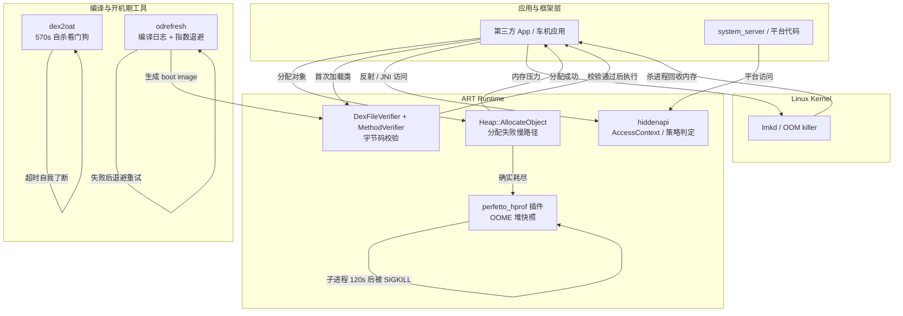
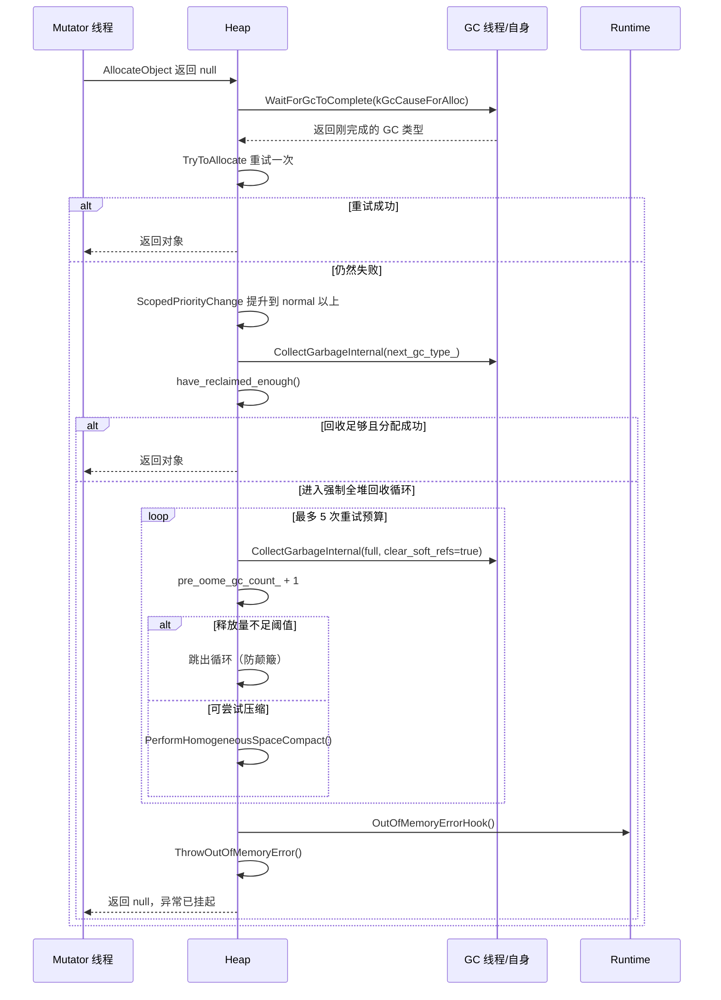
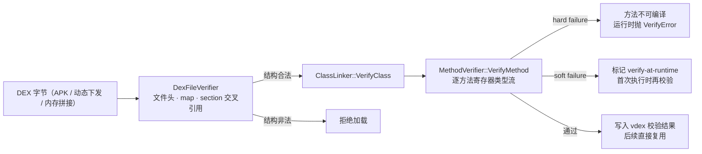
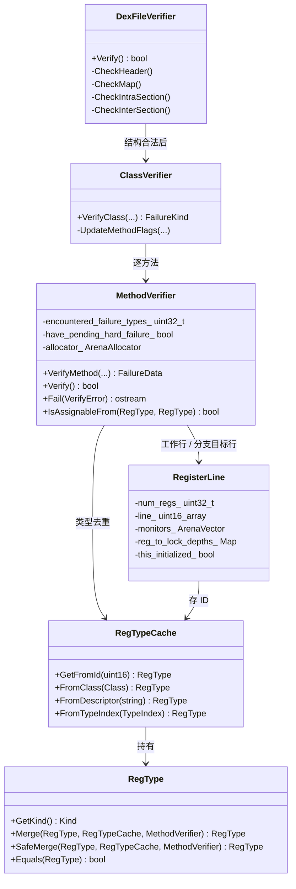
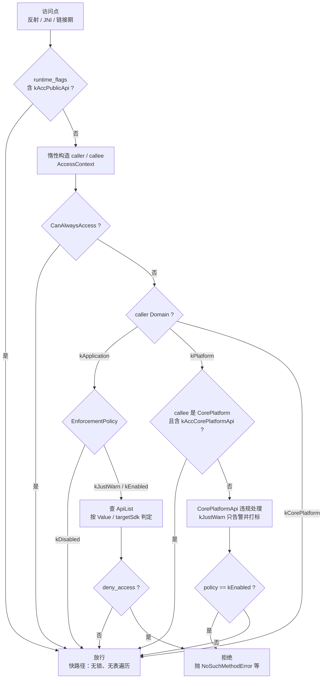
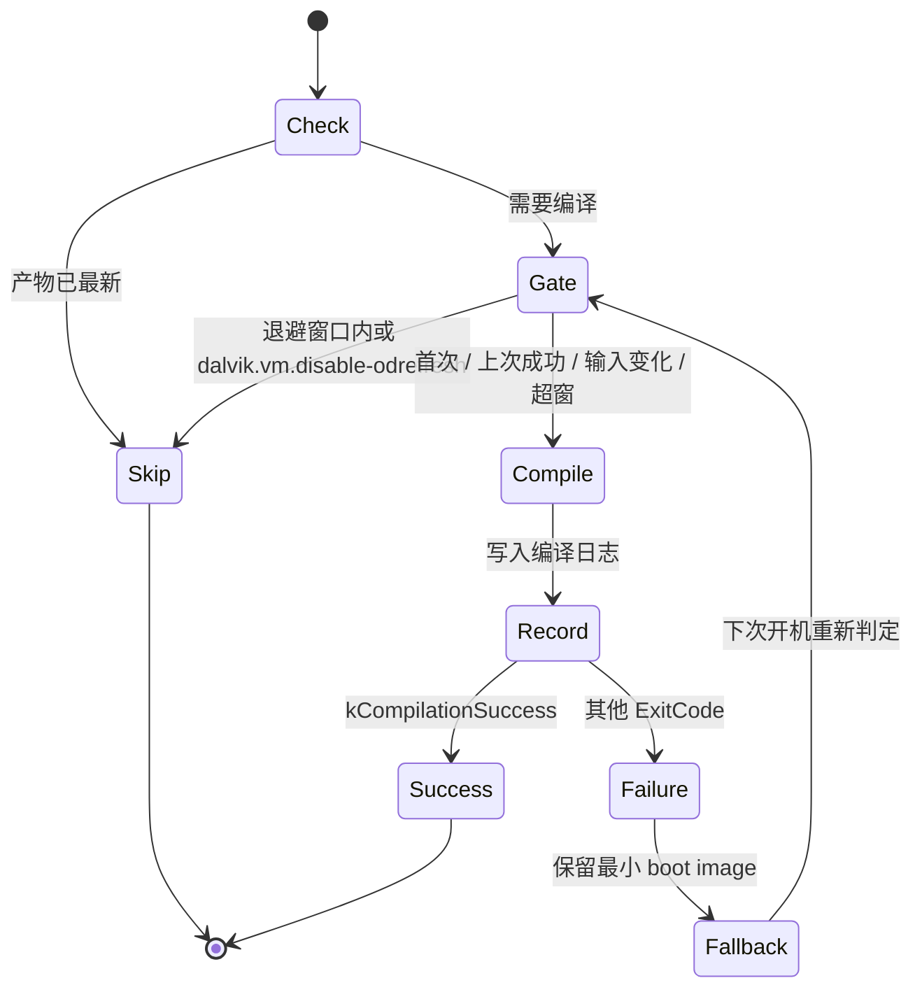

# 16 · OOM 抓堆、字节码校验、Hidden API 管控与防变砖看门狗

> [!IMPORTANT]
> **一句话核心结论**：本篇四个机制守的不是「跑得快」，而是「跑不死」——`Heap` 在分配失败后用「最多 5 次重试预算 + 5% 产出阈值」的全堆回收把能救的都救一遍，回收产出不足就立刻收手避免 GC 颠簸；真救不回来时通过 `OutOfMemoryErrorHook` 让 perfetto_hprof 在 120 秒 `SIGKILL` 看门狗保护下抓一份 OOME 堆快照；`MethodVerifier` 与 `hiddenapi` 在代码执行之前把不可信字节码与越域调用挡住；dex2oat 在 9.5 分钟内没干完就自杀、odrefresh 用 12 小时起的指数退避，避免编译进程拖垮 system_server 或让设备陷入开机死循环。

| 项目 | 内容 |
| :--- | :--- |
| **机制定位** | 系统级兜底防线：OOM 前的最后回收、OOM 现场取证、字节码安全校验、隐藏 API 域管控、编译进程看门狗与开机退避 |
| **源码模块（相对 `qssi/art/`）** | `runtime/gc/heap.cc`、`runtime/gc/heap.h`、`perfetto_hprof/perfetto_hprof.cc`、`runtime/verifier/method_verifier.cc`、`runtime/verifier/class_verifier.cc`、`runtime/hidden_api.cc`、`runtime/hidden_api.h`、`dex2oat/dex2oat.cc`、`odrefresh/odr_compilation_log.cc` |
| **核心类 / 入口** | `art::gc::Heap`、`perfetto_hprof::DumpPerfettoOutOfMemory`、`art::verifier::MethodVerifier` / `ClassVerifier`、`art::hiddenapi::AccessContext` / `ApiList`、`art::dex2oat::WatchDog`、`art::odrefresh::OdrCompilationLog` |
| **关键函数** | `Heap::AllocateObject`、`Heap::ThrowOutOfMemoryError`、`MethodVerifier::VerifyMethod`、`ClassVerifier::VerifyClass`、`hiddenapi::ShouldDenyAccessToMember`、`WatchDog::Wait`、`OdrCompilationLog::ShouldAttemptCompile` |
| **关键系统属性** | `traced.oome_heap_session.count`、`dalvik.vm.disable-odrefresh` |
| **关键启动参数** | `-Xhidden-api-policy={disabled,just-warn,enabled}`、`-Xcore-platform-api-policy`、`-Xverifier-logging-threshold=<ms>`、`-Xverify:{none,remote,all,softfail}`、`--watch-dog` / `--no-watch-dog`、`--watchdog-timeout=<ms>` |
| **源码基线** | `/home/voyah/workspace/8397/qssi/art`（Android 15/16 主线级 QSSI，只读） |

## 1. What：机制是什么？

### 1.1 职责边界：四条防线，各自守一个「不可恢复点」

ART 里绝大多数机制在优化吞吐与延迟，本篇四个机制只在系统接近失败时才登场。它们分布在四个不同的「不可恢复点」上：

1. **防线 A（OOM 前后）**——分配器已经拿不到内存。此时先判断「再 GC 一次有没有意义」，有意义就用全堆回收把软引用、可压缩垃圾都清掉；没有意义就停止，避免把 CPU 全烧在必然失败的回收上。若最终还是分配失败，通过 `Runtime::OutOfMemoryErrorHook()` 把控制权交给 perfetto_hprof 抓一份 OOME 堆快照，给事后定位留下证据。
2. **防线 B（字节码校验）**——DEX 字节码来自不可信输入。`DexFileVerifier` 先做结构校验（文件头、map、section 交叉引用），`MethodVerifier` 再做方法级的类型与寄存器流校验。没有它，一条伪造的 `invoke-virtual` 就可能在运行时把 `int` 当对象指针用，直接造成内存踩踏。
3. **防线 C（隐藏 API 域管控）**——应用与平台代码的信任级别不同。`hiddenapi` 用「Dex 文件的 Domain + 类加载器是否为空」判定调用方和被调方属于 `kApplication` / `kPlatform` / `kCorePlatform` 哪一层，再结合 targetSdkVersion 与兼容性开关决定放行、告警还是拒绝。
4. **防线 D（防变砖看门狗）**——编译是开机链路上的单点。dex2oat 自己带一个 9.5 分钟的定时器，超时就 `exit`，抢在 PackageManagerService 的 10 分钟看门狗触发前主动退出，避免 system_server 被连带打死；odrefresh 则把每次编译结果写进持久化日志，失败后按 `12h × 2^n` 退避，防止「编译失败 → 重启 → 再编译失败」的开机死循环。

它**不负责**：内核 OOM killer 与 lmkd 的杀进程策略、Java 层 `OutOfMemoryError` 的语义与栈展开、PackageManager 的 dexopt 调度、以及 SELinux 的强制访问控制。这些属于 ART 之外的系统层，本篇只在边界处提及。

> [!NOTE]
> 卡面研究要点里的「DCL」在 ART 源码中没有同名符号。本篇按源码实际实现，把它落到 **Dex / ClassLoader 的 Domain 判定与动态类加载管控**上：`DetermineDomainFromDexLocation` + `InitializeDexFileDomain` + `AccessContext` 三个函数/类就是这套管控的全部落点。下文不再使用「DCL」这个缩写，直接讲 Domain。

### 1.2 核心术语表

| 术语 | 含义 | 源码锚点 |
| :--- | :--- | :--- |
| pre-OOME GC | 分配失败慢路径中执行的强制回收；每轮计入 `pre_oome_gc_count_`，可在堆转储里看到总数 | [heap.cc](file:///home/voyah/workspace/8397/qssi/art/runtime/gc/heap.cc#L2093-L2101) |
| 防颠簸阈值 | 一轮全堆 GC 释放的字节必须超过 `5% × growth_limit + alloc_size` 才值得再来一轮 | [heap.cc](file:///home/voyah/workspace/8397/qssi/art/runtime/gc/heap.cc#L2080-L2087) |
| `have_reclaimed_enough` | 判定「这轮 GC 是否算有效产出」：空闲比例 ≥ 1%，或新释放比例 ≥ 5% | [heap.cc](file:///home/voyah/workspace/8397/qssi/art/runtime/gc/heap.cc#L2024-L2033) |
| Homogeneous Space Compact | 针对 RosAlloc/DlMalloc 的同构空间压缩，把零散空闲页整理成连续块；OOM 慢路径中的最后一张「碎片牌」 | [heap.cc](file:///home/voyah/workspace/8397/qssi/art/runtime/gc/heap.cc#L2107-L2136) |
| OOME 钩子 | `Runtime::SetOutOfMemoryErrorHook` 注册的单函数指针，只在 `ThrowOutOfMemoryError` 中被调用 | [runtime.h](file:///home/voyah/workspace/8397/qssi/art/runtime/runtime.h#L1140-L1147) |
| `traced.oome_heap_session.count` | 当前有多少个 Perfetto 会话在等待 `android.java_hprof.oom` 数据源；为 0 时抓堆直接返回 | [perfetto_hprof.cc](file:///home/voyah/workspace/8397/qssi/art/perfetto_hprof/perfetto_hprof.cc#L1209-L1214) |
| OOME 看门狗 | 抓堆子进程启动的 `CLOCK_MONOTONIC` 定时器，120 秒后向自己发 `SIGKILL` | [perfetto_hprof.cc](file:///home/voyah/workspace/8397/qssi/art/perfetto_hprof/perfetto_hprof.cc#L111-L133) |
| hard failure | 字节码确定非法，方法不可编译，运行时抛 `VerifyError` 一类错误 | [verifier_enums.h](file:///home/voyah/workspace/8397/qssi/art/runtime/verifier/verifier_enums.h#L74-L86) |
| soft failure | 因类型/方法不可解析等暂时性问题导致的失败，推迟到运行时再校验 | [method_verifier.cc](file:///home/voyah/workspace/8397/qssi/art/runtime/verifier/method_verifier.cc#L5663-L5674) |
| `RegType` | 寄存器类型格上的一个元素（整数、浮点、zero、null、引用、unresolved、conflict 等） | [reg_type.h](file:///home/voyah/workspace/8397/qssi/art/runtime/verifier/reg_type.h#L55-L100) |
| `ApiList` | 编码在 DEX hiddenapi flags 里的「成员可见性」：低 4 位是 Value，bit4/bit5 是 core-platform-api / test-api | [hiddenapi_flags.h](file:///home/voyah/workspace/8397/qssi/art/libartbase/base/hiddenapi_flags.h#L81-L130) |
| `AccessContext` | 一次访问的调用方/被调方上下文：类、Dex 文件、原生调用地址、Domain | [hidden_api.h](file:///home/voyah/workspace/8397/qssi/art/runtime/hidden_api.h#L85-L189) |
| `EnforcementPolicy` | 隐藏 API 执行策略：`kDisabled` / `kJustWarn` / `kEnabled` | [hidden_api.h](file:///home/voyah/workspace/8397/qssi/art/runtime/hidden_api.h#L42-L47) |
| 编译日志 | `/data/misc/odrefresh/compilation-log.txt`，版本 `CompilationLog/1.0`，最多保留 4 条 | [odr_compilation_log.h](file:///home/voyah/workspace/8397/qssi/art/odrefresh/odr_compilation_log.h#L51-L68) |
| 指数退避 | 连续失败 n 次后，距上次尝试需等待 `12h × 2^n` 才允许再编译 | [odr_compilation_log.cc](file:///home/voyah/workspace/8397/qssi/art/odrefresh/odr_compilation_log.cc#L200-L217) |

### 1.3 架构定位



### 1.4 四条防线对照

| 防线 | 触发时机 | 决策依据 | 失败后的后果 | 可观测产物 |
| :--- | :--- | :--- | :--- | :--- |
| A OOM 回收 | 分配器返回失败 | 回收产出比例、碎片情况 | 抛 `OutOfMemoryError`，进程可能被杀 | GC 日志、`Total pre-OOME GC count`、OOME 消息 |
| A OOM 抓堆 | `ThrowOutOfMemoryError` | Perfetto 会话数 + 权限闸门 | 拿不到堆图，但进程照常崩溃 | `.pftrace` 中的 OOME 堆快照 |
| B 校验 | 类首次加载 / dex2oat 编译 | 字节码结构与类型流 | `VerifyError`，方法退化为解释执行或不可编译 | `Verification error in ...`、慢校验告警 |
| C 域管控 | 反射 / JNI / 链接期访问 | Domain + targetSdk + 兼容开关 | 访问被拒绝，抛 `NoSuchMethodError` 等 | `hiddenapi:` 日志、EventLog 采样 |
| D dex2oat | 编译进程运行超时 | 单调时钟 570s | dex2oat 退出，PM 收到失败 | `dex2oat did not finish after ...` |
| D odrefresh | 开机检查发现需编译 | 编译日志中的连续失败次数 | 跳过本次编译，沿用现有产物 | `Compilation skipped because it was attempted recently` |

## 2. Why：为什么需要它？

### 2.1 分配失败不等于内存已经耗尽

最朴素的实现是「`malloc` 失败就抛 OOME」。这在 ART 里会错得很难看，原因有三：

1. **并发分配的时序差**：A 线程分配失败时，B 线程可能刚触发了一次 GC 并把内存还回来了。此时直接抛异常等于让 A 线程替 B 线程的时序买单。`WaitForGcToComplete(kGcCauseForAlloc)` 就是用来「搭车」的：等正在跑的 GC 结束再重试一次分配。
2. **软引用还没清**：Java 规范要求抛 OOME 前必须清理所有软引用。很多缓存对象只有在这一步才会被释放，不试一次就抛异常会白白浪费可回收内存。
3. **碎片不是总量**：`total_bytes_free >= byte_count` 却分配失败，说明空闲页不连续。这时做一次同构空间压缩（Homogeneous Space Compact）往往能救回来。源码在 OOME 消息里专门区分了这两种情况：如果失败并非碎片造成（GC 后空闲不足 1%），会打印 `giving up on allocation because <1% of heap free after GC.`

另一方面，如果每轮 GC 都只释放一点点，继续循环只会让 CPU 长期占满、其他线程全部堵在分配点上——这就是 **GC thrashing（GC 颠簸）**。所以「什么时候该停」和「什么时候该再试一次」同样重要。

### 2.2 OOM 现场只有一次取证窗口

OOME 抛出后，进程通常很快退出。系统检测到进程死亡后会清理整个 cgroup，连刚刚 fork 出来的诊断子进程也可能一起被杀。如果不在父进程死之前把堆写完，事后就只剩一条 `Failed to allocate ...` 日志，完全无法回答「是谁占着内存」。

因此 OOME 抓堆必须满足三个约束：

- **只抓一次**：OOME 可能重入（异常构造、日志、字符串分配都可能再触发 OOME），必须有 `g_oome_triggered` 这样的去重闸门。
- **父进程按住不放**：`ResumeParentPolicy::DEFERRED` 让父进程等子进程写完再继续退出，避免与 cgroup 清理赛跑。
- **子进程必须自己能死**：如果抓堆本身卡住（比如 atfork handler 死锁），120 秒的 `SIGKILL` 定时器保证不会留下一个永远不退的僵尸诊断进程。

### 2.3 不可信字节码的破坏面

DEX 可以来自 APK、动态下发、甚至内存中拼出来的字节数组。没有校验，至少有三类攻击面：

1. **结构破坏**：非法的 map/section 偏移让解析器越界读，直接把进程读挂。
2. **类型混淆**：把引用寄存器当整数用、把 `int` 当对象指针传给 `iget`，造成任意地址读写。
3. **锁语义破坏**：`monitor-enter`/`monitor-exit` 不配对，导致 monitor 永久泄漏或解锁他人持有的锁。

`DexFileVerifier` 负责第 1 类，`MethodVerifier` 负责第 2、3 类。两者都不追求「证明程序正确」，只追求「保证解释器/编译器不会因为输入非法而崩溃」。

### 2.4 隐藏 API 是兼容性契约，不是安全边界

Hidden API 的初衷不是阻止逆向，而是**限制应用对非 SDK 接口的依赖**：一旦应用用了 `@hide` 方法，平台升级时就可能破坏它。所以策略是分级的——`kJustWarn` 只记日志、`kEnabled` 才真正拒绝。理解这一点很重要：不要把它当成沙箱，它挡不住刻意绕过（比如反射 + 自己实现），它只是让「不小心用了内部 API」这件事变得可见、可控。

### 2.5 编译进程卡死会引发系统级雪崩

dex2oat 是 system_server 通过 PackageManagerService 同步等待的子进程。如果它挂死：

- PackageManagerService 自己的看门狗（10 分钟）会触发，进而把 system_server 打死，设备重启；
- 重启后如果触发条件还在，又会重新编译、再次挂死，形成**开机死循环**。

所以 dex2oat 必须在 PM 看门狗之前自己先死（9.5 分钟 < 10 分钟），把「一个编译任务失败」降级成「一次 dexopt 失败」，而不是「system_server 崩溃」。

odrefresh 面对的是同一类问题的另一个面：编译失败本身不可怕，可怕的是每次开机都重试。持久化编译日志 + 指数退避让设备即使编译一直失败，也能用最小 boot image 正常开机，把重试间隔从「每次开机」拉长到「最多 8 天一次」。

### 2.6 方案演进对比矩阵

| 问题 | 朴素方案 | ART 的实现 | 代价 / 权衡 |
| :--- | :--- | :--- | :--- |
| 分配失败 | 立即抛 OOME | 先等 GC、再分级回收、再压缩、最后才抛 | 最坏情况多花几轮 GC 的时间，换回一次「其实还能救」的机会 |
| 回收策略 | 无限循环 GC 直到成功 | 产出低于 5% 立即放弃 | 可能过早放弃，但避免了整机 CPU 被 GC 占满 |
| OOM 取证 | 只打一条日志 | fork 子进程写 Perfetto 堆快照，父进程按住 | 崩溃路径变长、诊断进程有 120s 上限 |
| 字节码安全 | 信任 DEX，靠解释器容错 | 两级校验 + hard/soft 分级 | 首次加载变慢；用 vdex 缓存校验结果 |
| 隐藏 API | 全部开放或全部禁止 | 按 Domain + targetSdk 分级 | 判定需要构造上下文，用 runtime flags 做快路径 |
| 编译卡死 | 依赖 PM 看门狗 | dex2oat 自带 9.5 分钟自杀定时器 | 极端慢机器上可能误杀，故 debug 构建放大 5 倍 |
| 开机编译失败 | 每次开机重试 | 持久化日志 + 12h×2^n 退避 | 修复版本到达后最多延迟一次退避窗口才生效 |

## 3. How：源码级实现原理深度剖析

### 3.1 防线 A-1：分配失败慢路径与 pre-OOME GC

#### 3.1.1 核心数据结构

`Heap` 中与 OOM 判定直接相关的状态如下（字段声明见 [heap.h](file:///home/voyah/workspace/8397/qssi/art/runtime/gc/heap.h#L1690-L1795)）：

```text
Heap 的 OOM 相关状态
┌──────────────────────────────────────────────────────────────────────┐
│ growth_limit_                 本次进程允许增长到的硬上限（字节）        │
│                               GetFreeMemoryUntilOOME = growth_limit_   │
│                                                        - allocated     │
├──────────────────────────────────────────────────────────────────────┤
│ target_footprint_             期望驻留目标，随前后台/内存压力动态调整   │
│ num_bytes_allocated_          当前已分配字节（原子）                    │
├──────────────────────────────────────────────────────────────────────┤
│ pre_oome_gc_count_            进入 OOM 慢路径后执行的强制 GC 次数       │
│                               （Atomic<uint64_t>，堆转储可见）          │
├──────────────────────────────────────────────────────────────────────┤
│ use_homogeneous_space_compaction_for_oom_   是否允许 OOM 时做压缩       │
│ last_time_homogeneous_space_compaction_by_oom_   上次压缩时间戳         │
│ min_interval_homogeneous_space_compaction_by_oom_  最小间隔（防抖）     │
│ count_delayed_oom_            靠压缩才避免 OOM 的累计次数               │
└──────────────────────────────────────────────────────────────────────┘
```

两个阈值常量定义在文件头（[heap.cc](file:///home/voyah/workspace/8397/qssi/art/runtime/gc/heap.cc#L182-L189)）：

```cpp
// 如果两条约束都被违反，就抛 OOME（两条都违反是因为存在并发分配）
static constexpr double kMinFreedHeapAfterGcForAlloc = 0.05;  // 至少释放 5% 堆
static constexpr double kMinFreeHeapAfterGcForAlloc  = 0.01;  // 或至少空闲 1% 堆
```

#### 3.1.2 端到端控制流

分配失败后真正的重试逻辑在 `Heap::AllocateObject` 的尾部（[heap.cc](file:///home/voyah/workspace/8397/qssi/art/runtime/gc/heap.cc#L1992-L2161)）。完整路径如下：



第一次 GC 用的是 `next_gc_type_`——这是 `GrowForUtilization` 根据近期分配速率选出的「本次最划算」类型，可能是 sticky（只收年轻代）、partial 或 full。只有这一次失败后，才会升级到「无条件全堆 + 清软引用」。

#### 3.1.3 两个判定函数与防颠簸

```cpp
auto have_reclaimed_enough = [&]() {
  size_t curr_bytes_allocated = GetBytesAllocated();
  size_t free_heap = UnsignedDifference(growth_limit_, curr_bytes_allocated);
  int64_t newly_freed = GetBytesFreedEver() - bytes_freed_before;
  double free_heap_ratio = static_cast<double>(free_heap) / growth_limit_;
  double newly_freed_ratio = static_cast<double>(newly_freed) / growth_limit_;
  return free_heap_ratio >= kMinFreeHeapAfterGcForAlloc ||      // 空闲 ≥ 1%
         newly_freed_ratio >= kMinFreedHeapAfterGcForAlloc;     // 或新释放 ≥ 5%
};
```

这段代码在 [heap.cc](file:///home/voyah/workspace/8397/qssi/art/runtime/gc/heap.cc#L2024-L2033)。注意它是「或」的关系：只要堆里已有 1% 空闲，或者这次 GC 释放了 5%，都认为「还有救」，值得再试一次分配。

真正决定是否继续循环的条件在 [heap.cc](file:///home/voyah/workspace/8397/qssi/art/runtime/gc/heap.cc#L2080-L2154)：

```cpp
int64_t min_freed_to_continue =
    static_cast<int64_t>(kMinFreedHeapAfterGcForAlloc * growth_limit_ + alloc_size);
bool gc_ran;
int gc_attempts = 0;
static constexpr int kMaxGcAttempts = 5;
do {
  bytes_freed_before = GetBytesFreedEver();
  pre_oome_gc_count_.fetch_add(1, std::memory_order_relaxed);
  starting_gc_num = GetCurrentGcNum();
  gc_ran = PERFORM_SUSPENDING_OPERATION(
      CollectGarbageInternal(gc_plan_.back(), kGcCauseForAlloc, true, starting_gc_num + 1) !=
      collector::kGcTypeNone);
  ++gc_attempts;
  // ... 压缩兜底与分配重试 ...
} while ((!gc_ran && gc_attempts < kMaxGcAttempts) ||
         GetBytesFreedEver() - bytes_freed_before > min_freed_to_continue);
```

这里有两个容易读错的点：

1. **`kMaxGcAttempts = 5` 是「GC 没真正跑起来」的重试预算，不是总轮次上限。** 条件 `(!gc_ran && gc_attempts < 5)` 只在 GC 因并发原因没能执行时才继续；如果 GC 正常执行了，是否继续完全由 `GetBytesFreedEver() - bytes_freed_before > min_freed_to_continue` 决定。也就是说：**回收产出足够多时可以超过 5 轮，产出不足时第一轮之后就停**。
2. **`min_freed_to_continue` 包含 `alloc_size`。** 阈值不是纯比例，而是「5% 堆 + 这次请求的大小」——一次 50 MB 的大对象分配，本来就需要释放更多内存才值得继续。

`gc_plan_.back()` 是当前收集器方案中最彻底的收集类型：[heap.cc](file:///home/voyah/workspace/8397/qssi/art/runtime/gc/heap.cc#L2330-L2395) 为 CC 配 `[sticky?, full]`、为 CMS/MS 配 `[sticky, partial, full]`、为 SS 配 `[full]`。所以 OOM 慢路径执行的是全堆回收；对并发复制型收集器而言，这轮回收本身就包含存活对象的晋升/搬迁。

#### 3.1.4 碎片兜底：同构空间压缩

全堆 GC 之后如果仍然「总量够但分配不出」，代码会尝试压缩（[heap.cc](file:///home/voyah/workspace/8397/qssi/art/runtime/gc/heap.cc#L2107-L2147)）：

```cpp
if (!immediately_reclaimed_enough) {
  const uint64_t current_time = NanoTime();
  if (allocator == kAllocatorTypeRosAlloc || allocator == kAllocatorTypeDlMalloc) {
    if (use_homogeneous_space_compaction_for_oom_ &&
        current_time - last_time_homogeneous_space_compaction_by_oom_ >
        min_interval_homogeneous_space_compaction_by_oom_) {
      last_time_homogeneous_space_compaction_by_oom_ = current_time;
      ran_homogeneous_space_compaction =
          (PERFORM_SUSPENDING_OPERATION(PerformHomogeneousSpaceCompact()) ==
           HomogeneousSpaceCompactResult::kSuccess);
    }
  }
}
```

三个限制条件缺一不可：分配器必须是 RosAlloc 或 DlMalloc（区域式分配器不需要同构压缩）、构建时允许 OOM 压缩、且距上次压缩超过最小间隔（防止频繁压缩导致卡顿）。压缩成功并完成分配后，`count_delayed_oom_` 加一——这个计数就是「本来要 OOM、靠压缩救回来」的次数。

#### 3.1.5 最后一步：`ThrowOutOfMemoryError`

到了这里说明确实没救了。`ThrowOutOfMemoryError`（[heap.cc](file:///home/voyah/workspace/8397/qssi/art/runtime/gc/heap.cc#L1522-L1576)）做四件事：

1. **栈溢出特判**：如果当前正在处理 native 栈溢出，不去构造新的异常（构造函数本身还要用栈），直接取预分配的 OOME。
2. **调用 OOM 钩子**：`Runtime::Current()->OutOfMemoryErrorHook();`——这是 perfetto_hprof 抓堆的唯一入口（[heap.cc](file:///home/voyah/workspace/8397/qssi/art/runtime/gc/heap.cc#L1532-L1534)）。
3. **拼装可诊断的消息**：字节数、当前空闲、距 OOM 的余量、target footprint、growth limit。
4. **区分碎片与总量不足**：如果 `total_bytes_free >= byte_count`，调用 `space->LogFragmentationAllocFailure()`；返回 false 表示不是碎片问题，而是 GC 后空闲不足 1%，消息里追加 `giving up on allocation because <1% of heap free after GC.`

这条消息的字段顺序在实战排障里非常有用，后文 §4.7 会逐字段解读。

### 3.2 防线 A-2：OOM 钩子与 120 秒抓堆看门狗

#### 3.2.1 钩子的注册与生命周期

`Runtime` 只保存一个函数指针（[runtime.h](file:///home/voyah/workspace/8397/qssi/art/runtime/runtime.h#L1140-L1147)）：

```cpp
void SetOutOfMemoryErrorHook(void (*hook)()) { out_of_memory_error_hook_ = hook; }
void OutOfMemoryErrorHook() {
  if (out_of_memory_error_hook_ != nullptr) { out_of_memory_error_hook_(); }
}
```

perfetto_hprof 作为 ART 插件，在 `ArtPlugin_Initialize` 里注册，在反初始化时清空（[perfetto_hprof.cc](file:///home/voyah/workspace/8397/qssi/art/perfetto_hprof/perfetto_hprof.cc#L1350-L1366)）：

```cpp
art::Runtime::Current()->SetOutOfMemoryErrorHook(perfetto_hprof::DumpPerfettoOutOfMemory);
// ...
art::Runtime::Current()->SetOutOfMemoryErrorHook(nullptr);
```

因为是单指针，**同一时刻只能有一个 OOM 钩子**。这也是为什么 perfetto_hprof 的 OOME 路径必须自己完成全部工作，不能假设有其他组件兜底。

#### 3.2.2 四道闸门

`DumpPerfettoOutOfMemory`（[perfetto_hprof.cc](file:///home/voyah/workspace/8397/qssi/art/perfetto_hprof/perfetto_hprof.cc#L1202-L1268)）不是无条件抓堆，它要连续过四道闸门：

| # | 闸门 | 判断 | 不过闸的后果 |
| :--- | :--- | :--- | :--- |
| 1 | 有没有人在等 | 读系统属性 `traced.oome_heap_session.count`，为 0 直接返回 | 无开销，直接走崩溃流程 |
| 2 | 是否已经抓过 | 全局 `g_oome_triggered` + `GetStateMutex()` 保护 | OOME 可重入，第二次直接返回 |
| 3 | 会话是否有权抓 | `IsOomeHeapDumpAllowed`：debuggable / debug build 直接允许；可信 system initiator 要求 profileable 或 system_server；其他要求 profileableFromShell | 数据源 `enabled_ = false`，子进程写完也拿不到数据 |
| 4 | 目标进程是否匹配 | `IsOomeDumpEnabled` 用 `fnmatch` 匹配 `/proc/self/cmdline` 与配置里的 `process_cmdline` 模式 | 同上 |

第 3 道闸门的完整逻辑见 [perfetto_hprof.cc](file:///home/voyah/workspace/8397/qssi/art/perfetto_hprof/perfetto_hprof.cc#L173-L184)：

```cpp
bool IsOomeHeapDumpAllowed(const perfetto::DataSourceConfig& ds_config) {
  if (art::Runtime::Current()->IsJavaDebuggable() || IsDebugBuild()) return true;
  if (ds_config.session_initiator() ==
      perfetto::DataSourceConfig::SESSION_INITIATOR_TRUSTED_SYSTEM) {
    return art::Runtime::Current()->IsProfileable() || art::Runtime::Current()->IsSystemServer();
  } else {
    return art::Runtime::Current()->IsProfileableFromShell();
  }
}
```

这条策略的含义：**OOME 堆快照包含全量对象图，属于高敏感数据**，生产设备上默认只允许系统可信会话或 profileable 应用抓取。想在量产车机上抓第三方应用的 OOME 堆，靠的不是 adb，而是预置的 Perfetto 配置与 profileable 标记。

#### 3.2.3 子进程看门狗：120 秒必死

父进程按住不放是对的，但「按住」本身需要上限。子进程启动后的第一件事就是给自己套上绞索（[perfetto_hprof.cc](file:///home/voyah/workspace/8397/qssi/art/perfetto_hprof/perfetto_hprof.cc#L111-L133)）：

```cpp
constexpr time_t kWatchdogTimeoutSec = 120;

void ArmWatchdogOrDie() {
  timer_t timerid{};
  struct sigevent sev {};
  sev.sigev_notify = SIGEV_SIGNAL;
  sev.sigev_signo = SIGKILL;      // 到点直接杀，不给清理机会

  if (timer_create(CLOCK_MONOTONIC, &sev, &timerid) == -1) {
    PLOG(FATAL) << "failed to create watchdog timer";
  }
  struct itimerspec its {};
  its.it_value.tv_sec = kWatchdogTimeoutSec;
  if (timer_settime(timerid, 0, &its, nullptr) == -1) {
    PLOG(FATAL) << "failed to arm watchdog timer";
  }
}
```

几个设计细节值得注意：

- **`SIGKILL` 而不是 `SIGTERM`**：抓堆进程可能卡在 atfork handler 或 Perfetto 内部锁里，只有不可捕获的信号能保证它真的死掉。
- **`CLOCK_MONOTONIC`**：不受系统时间调整影响；设备改时间不会提前或延后触发。
- **父进程的 `BusyWaitpid(child, 120000)` 与子进程定时器等长**：即使子进程的 watchdog 因为极端原因没装上，父进程也只会等 120 秒就继续退出（[perfetto_hprof.cc](file:///home/voyah/workspace/8397/qssi/art/perfetto_hprof/perfetto_hprof.cc#L1239-L1246)）。

#### 3.2.4 与第 11 篇的边界

本节只讲「什么时候触发、谁有权触发、触发后多久必须结束」。关于 `ForkAndRun` 如何冻结其他线程、为什么要 `daemon()`、`TimedWaitForDataSource(1000)` 的多会话同步，本知识库第 11 篇《Java 堆采样与 HPROF》§3.8 已逐行拆解，这里不重复。两篇的分工是：**第 11 篇讲「怎么抓」，本篇讲「为什么必须抓、抓不到时谁来兜底」**。

### 3.3 防线 B：字节码校验（MethodVerifier）

#### 3.3.1 两级校验与职责边界



`DexFileVerifier::Verify()`（[dex_file_verifier.cc](file:///home/voyah/workspace/8397/qssi/art/libdexfile/dex/dex_file_verifier.cc#L3541-L3567)）只做结构层面的检查：

```cpp
bool DexFileVerifier::Verify() {
  if (!CheckHeader()) return false;       // 魔数、版本、各 section 大小/偏移
  if (!CheckMap()) return false;          // map_list 与实际 section 是否一致
  verified_type_descriptors_.resize(header_->type_ids_size_, 0);
  defined_class_indexes_.resize(header_->type_ids_size_);
  if (!CheckIntraSection()) return false; // section 内部条目自洽
  if (!CheckInterSection()) return false; // section 之间引用有效
  CHECK(todo_.empty());
  return true;
}
```

它不关心「方法体里的寄存器用得对不对」，那是 `MethodVerifier` 的事。这种分层让结构校验可以高度优化（一次线性扫描），而昂贵的类型流分析只在结构可信的前提下进行。

#### 3.3.2 RegisterLine 内存布局

方法校验的核心状态是「每个 dex 寄存器当前是什么类型」。这由 `RegisterLine` 保存（[register_line.h](file:///home/voyah/workspace/8397/qssi/art/runtime/verifier/register_line.h#L305-L327)）：

```text
RegisterLine（每个方法一条工作行，Arena 分配）
┌─────────────────────────────────────────────────────────────────────┐
│ num_regs_       : uint32_t   code item 的 registers_size            │
│ result_[2]      : uint16_t   调用返回值的类型 id（宽值占两格）       │
│ allocation_dex_pcs_ : uint32_t*  new-instance 结果的分配点（用于溯源）│
├─────────────────────────────────────────────────────────────────────┤
│ line_[1]        : uint16_t[] 变长数组，每个 vreg 一个 RegType ID     │
│                                                                     │
│   v0  v1  v2  v3  v4  v5  v6  v7                                    │
│  ┌───┬───┬───┬───┬───┬───┬───┬───┐                                  │
│  │ 3 │ 3 │17 │17 │ 0 │ 9 │ 9 │ 5 │  ← ID 由 RegTypeCache 统一分配   │
│  └───┴───┴───┴───┴───┴───┴───┴───┘                                  │
├─────────────────────────────────────────────────────────────────────┤
│ monitors_            : ArenaVector<uint32_t>  monitor-enter 的 dex_pc │
│ reg_to_lock_depths_  : Map<vreg, uint32_t>    vreg → monitor 位图     │
│                        （最多 32 层，kMaxMonitorStackDepth）          │
│ this_initialized_    : bool                   构造函数 supercall 是否 │
│                                                已完成                 │
└─────────────────────────────────────────────────────────────────────┘
```

注意 `line_` 存的是 **`RegType` 的缓存 ID（uint16）**，不是指针。所有 `RegType` 由 `RegTypeCache` 去重后统一持有，合并两个寄存器类型时只需比较 ID 或在缓存里查合并结果。这既省内存，也让「类型相等」变成一次整数比较。

校验器的静态结构关系如下：



`MethodVerifier` 为每个分支目标保存一条 `RegisterLine`（`reg_table_`），工作行 `work_line_` 只在沿指令流前进时更新；遇到分支目标时从表中 `CopyFromLine` 恢复，这就是「流敏感」的实现基础（[method_verifier.cc](file:///home/voyah/workspace/8397/qssi/art/runtime/verifier/method_verifier.cc#L2661-L2680)）。

#### 3.3.3 类型格与合并

`RegType` 的 Kind 枚举覆盖了 Dalvik 校验器需要的全部抽象类型（[reg_type.h](file:///home/voyah/workspace/8397/qssi/art/runtime/verifier/reg_type.h#L55-L100)）：

```text
                 ┌──────────────┐
                 │  Undefined   │  尚未写入
                 └──────┬───────┘
                        │ 写入
     ┌──────────────────┼───────────────────┐
     ▼                  ▼                   ▼
┌─────────┐      ┌─────────────┐      ┌──────────────┐
│ 基本类型 │      │  常量类型   │      │   引用类型   │
│ int/long│      │ Zero/Null   │      │ String/Obj/  │
│ float/..│      │ 各宽度常量  │      │ Unresolved/  │
└────┬────┘      └──────┬──────┘      │ Uninitialized│
     │                  │             └──────┬───────┘
     └────────┬─────────┴────────────────────┘
              ▼  两条控制流汇合，类型不一致
        ┌──────────┐
        │ Conflict │  任何操作都非法，后续路径作废
        └──────────┘
```

合并规则（`RegType::Merge` / `SafeMerge`）遵循「取最小上界」：`int` 与 `int` 合并仍是 `int`；`int` 与 `float` 合并为 `Conflict`；`String` 与 `Object` 合并为 `Object`；`Zero` 与任意引用类型合并为该引用类型（`null` 可赋值给任何引用）。一旦某个寄存器变成 `Conflict`，后续任何读取它的指令都会被判 hard failure。

这套格结构的价值在于：它是**流敏感的**。同一个寄存器在方法的不同位置可以有不同的类型，只要所有到达该点的路径合并后不冲突即可。这比「全方法一个类型」精确得多，也是它能同时兼顾安全与兼容性的原因。

#### 3.3.4 失败分级：hard 与 soft

`MethodVerifier::Fail`（[method_verifier.cc](file:///home/voyah/workspace/8397/qssi/art/runtime/verifier/method_verifier.cc#L5873-L5922)）把失败分成两类：

```cpp
switch (error) {
  case VERIFY_ERROR_NO_CLASS:
  case VERIFY_ERROR_UNRESOLVED_TYPE_CHECK:
  case VERIFY_ERROR_NO_METHOD:
  case VERIFY_ERROR_NO_FIELD:
  case VERIFY_ERROR_ACCESS_CLASS:
  // ...
    PotentiallyMarkRuntimeThrow();   // 可能是「类还没加载」，推迟到运行时
    break;
  case VERIFY_ERROR_LOCKING:
    PotentiallyMarkRuntimeThrow();   // 锁校验失败 → 解释器慢路径
    break;
  case VERIFY_ERROR_BAD_CLASS_HARD:
    flags_.have_pending_hard_failure_ = true;  // 确定非法
    break;
}
```

分级的实际后果：

- **hard failure**：方法被标记为不可编译，类在 vdex 里标记为 verify-at-runtime；真正执行到时会抛 `VerifyError`（或 `NoClassDefFoundError` 等具体子类）。dex2oat 侧按 `HardFailLogMode` 决定日志级别（VERBOSE / WARNING / FATAL_WITHOUT_ABORT）。
- **soft failure**：编译器能处理的失败类型（未解析类型、访问检查）会被记录为 `kTypeChecksFailure` 或 `kAccessChecksFailure`，方法仍可编译，但运行时要做补充检查。
- **编译器无法处理的 soft failure**：`CanCompilerHandleVerificationFailure`（[verifier_compiler_binding.h](file:///home/voyah/workspace/8397/qssi/art/runtime/verifier/verifier_compiler_binding.h#L28-L37)）只允许 `VERIFY_ERROR_RUNTIME_THROW` 和 `VERIFY_ERROR_LOCKING` 留在「可编译」集合里；其他情况强制降级为 `kSoftFailure`，并把方法加入 `AddUncompilableMethod`、设置 `SetDontCompile()`（[class_verifier.cc](file:///home/voyah/workspace/8397/qssi/art/runtime/verifier/class_verifier.cc#L50-L82)）。

锁校验失败还有一条专门的告警（[class_verifier.cc](file:///home/voyah/workspace/8397/qssi/art/runtime/verifier/class_verifier.cc#L154-L169)）：

```text
Method <sig> failed lock verification and will run slower.
Common causes for lock verification issues are non-optimized dex code
and incorrect proguard optimizations.
```

这段话在线上非常有辨识度：看到它基本可以断定「某个方法里有不配对的 monitor 操作」，而最常见的原因是 dex 被非标准工具优化过（例如老版本 dx 的 `--no-optimize`，或激进的 proguard 规则）。

#### 3.3.5 慢校验日志

校验本身可能很慢，尤其是巨型方法。ART 在非 debug 构建里默认开启计时（[method_verifier.cc](file:///home/voyah/workspace/8397/qssi/art/runtime/verifier/method_verifier.cc#L76)）：

```cpp
static constexpr bool kTimeVerifyMethod = !kIsDebugBuild;
```

计时结果超过阈值时打印告警（[method_verifier.cc](file:///home/voyah/workspace/8397/qssi/art/runtime/verifier/method_verifier.cc#L5723-L5733)）：

```cpp
if (kTimeVerifyMethod) {
  uint64_t duration_ns = NanoTime() - start_ns;
  if (duration_ns > MsToNs(Runtime::Current()->GetVerifierLoggingThresholdMs())) {
    double bytecodes_per_second =
        verifier.code_item_accessor_.InsnsSizeInCodeUnits() / (duration_ns * 1e-9);
    LOG(WARNING) << "Verification of " << reg_types->GetDexFile()->PrettyMethod(method_idx)
                 << " took " << PrettyDuration(duration_ns)
                 << (impl::IsLargeMethod(verifier.CodeItem()) ? " (large method)" : "")
                 << " (" << StringPrintf("%.2f", bytecodes_per_second) << " bytecodes/s)"
                 << " (" << verifier.allocator_.BytesAllocated() << "B arena alloc)";
  }
}
```

阈值默认 **100 ms**（[runtime.cc](file:///home/voyah/workspace/8397/qssi/art/runtime/runtime.cc#L327)），可通过 `-Xverifier-logging-threshold=<ms>` 覆盖（[parsed_options.cc](file:///home/voyah/workspace/8397/qssi/art/runtime/parsed_options.cc#L447-L450)）。

「大方法」的判定是 `registers_size × insns_size > 4 × 1024 × 1024`（[method_verifier.cc](file:///home/voyah/workspace/8397/qssi/art/runtime/verifier/method_verifier.cc#L1542-L1552)）。这个乘积近似代表寄存器流分析的最坏工作量——两个维度各自不大、乘起来很大的方法，往往就是校验器的性能黑洞。

### 3.4 防线 C：hidden API 域管控

#### 3.4.1 两个 32 位字：dex flags 与 runtime flags

理解 hidden API 先要分清两个不同的 32 位字段。

**第一层：DEX 里的 hiddenapi flags（`ApiList::dex_flags_`）**，布局见 [hiddenapi_flags.h](file:///home/voyah/workspace/8397/qssi/art/libartbase/base/hiddenapi_flags.h#L81-L130)：

```text
ApiList::dex_flags_（每个成员一个 32 位值）
 bit31                            6    5      4        3 .. 0
┌─────────────────────────────────┬────┬──────┬──────────────────┐
│            保留（0）             │test│ core │      Value       │
│                                 │api │ plat │      4 bit       │
└─────────────────────────────────┴────┴──────┴──────────────────┘
                                   bit5  bit4       枚举值：
                                                    0 = sdk
                                                    1 = unsupported
                                                    2 = blocked
                                                    3 = max-target-o
                                                    4 = max-target-p
                                                    5 = max-target-q
                                                    6 = max-target-r
                                                    7 = max-target-s
```

`Value` 与「允许访问的最大 SDK」的映射表在 [hiddenapi_flags.h](file:///home/voyah/workspace/8397/qssi/art/libartbase/base/hiddenapi_flags.h#L174-L184)：`sdk`/`unsupported` 对应 `kMax`（永不被 targetSdk 拒绝），`blocked` 对应 `kMin`（谁都不许用），`max-target-o` 到 `max-target-s` 分别对应 O_MR1 / P / Q / R / S。

**第二层：运行时的 access_flags（`kAccPublicApi` / `kAccCorePlatformApi`）**，定义见 [modifiers.h](file:///home/voyah/workspace/8397/qssi/art/libdexfile/dex/modifiers.h#L114-L132)：

```text
ArtField / ArtMethod 的 access_flags（32 位，只标出 hiddenapi 相关的两位）
  31 .. 30         29                    28                 27 .. 0
┌─────────────┬────────────────────┬────────────────────┬──────────────┐
│ 其它运行时位 │ kAccCorePlatformApi│ kAccPublicApi      │ 既有标志位   │
│             │ 0x20000000         │ 0x10000000         │              │
└─────────────┴────────────────────┴────────────────────┴──────────────┘
```

`CreateRuntimeFlags`（[hidden_api.h](file:///home/voyah/workspace/8397/qssi/art/runtime/hidden_api.h#L296-L330)）把 DEX flags 翻译成运行时 flags：**只要 `Value` 是 `sdk`，就设 `kAccPublicApi`；否则如果带 `core-platform-api` 位，就设 `kAccCorePlatformApi`。** 这两个 bit 是后续所有快路径的判据。

#### 3.4.2 域判定

`AccessContext` 在构造时就把「调用方/被调方属于哪个域」算好（[hidden_api.h](file:///home/voyah/workspace/8397/qssi/art/runtime/hidden_api.h#L85-L173)）。三个域的信任顺序是 `kCorePlatform` ≥ `kPlatform` ≥ `kApplication`（枚举序号越小越可信，见 [hiddenapi_domain.h](file:///home/voyah/workspace/8397/qssi/art/libartbase/base/hiddenapi_domain.h#L23-L35)）。`CanAlwaysAccess` 只要「调用方域不弱于被调方域」就直接放行，连签名比对都省了。

Dex 文件的域由 `InitializeDexFileDomain` 在注册时确定（[hidden_api.cc](file:///home/voyah/workspace/8397/qssi/art/runtime/hidden_api.cc#L276-L284)），底层是 `DetermineDomainFromDexLocation`（[hidden_api.cc](file:///home/voyah/workspace/8397/qssi/art/runtime/hidden_api.cc#L218-L239)）：

| 条件 | Domain |
| :--- | :--- |
| 位于 ART / Conscrypt APEX 模块内 | `kCorePlatform` |
| 位于其他 APEX 内 | `kPlatform` |
| 位于 system framework / system_ext framework | `kPlatform` |
| 在 boot class path 上但类加载器为空（位置未知） | `kPlatform`，并打一条 `DexFile ... is in boot class path but is not in a known location` 告警 |
| 其余（应用类加载器加载） | `kApplication` |

这里就是「动态类加载管控」的落点：域是**按 Dex 文件对象**确定的，而不是按包名或进程。一个位于 `/data/app/...` 的 DEX，只有在类加载器为空（也就是它被当作 boot class path 的一部分）时才被判为 `kPlatform`；被应用自己的 `DexClassLoader` 加载时一律是 `kApplication`。域一旦确定，该 Dex 内的所有类都继承这个判定。源码还特意加了「只允许向更宽松方向覆盖」的保护（[hidden_api.cc](file:///home/voyah/workspace/8397/qssi/art/runtime/hidden_api.cc#L279-L283)），避免后续调用把已被标记为 trusted 的 Dex 降级。

有一个特例：debuggable 应用中被标记 `ShouldSkipHiddenApiChecks` 的类，会在 `IsJavaDebuggableAtInit()` 成立时被提升为可信域（[hidden_api.h](file:///home/voyah/workspace/8397/qssi/art/runtime/hidden_api.h#L160-L173)）。这是给调试器/测试框架留的口子。

#### 3.4.3 决策路径



对应的代码入口是 `ShouldDenyAccessToMember`（[hidden_api.cc](file:///home/voyah/workspace/8397/qssi/art/runtime/hidden_api.cc#L1024-L1153)），快路径只有三行（[hidden_api.cc](file:///home/voyah/workspace/8397/qssi/art/runtime/hidden_api.cc#L1047-L1056)）：

```cpp
const uint32_t runtime_flags = GetRuntimeFlags(member);
// 提前退出：public API 直接放行（对非 boot class path 成员也成立）
if ((runtime_flags & kAccPublicApi) != 0) {
  return false;
}
```

这就是为什么 `CreateRuntimeFlags` 要在方法/字段的 access_flags 里塞一个 bit：**把「是不是 SDK」的判定成本从「每次访问遍历 DEX hiddenapi 表」降到「一次位与」**。源码注释明确说，构造 `AccessContext` 和遍历 DEX flags 都是昂贵操作，所以 `ShouldDenyAccessToMember` 用 lambda 惰性求值，只有在快路径失败后才真正去算（[hidden_api.cc](file:///home/voyah/workspace/8397/qssi/art/runtime/hidden_api.cc#L1058-L1066)）。

慢路径里，应用域的处理见 `ShouldDenyAccessToMemberImpl`（[hidden_api.cc](file:///home/voyah/workspace/8397/qssi/art/runtime/hidden_api.cc#L900-L990)）：

```cpp
bool deny_access = false;
if (hiddenApiPolicy == EnforcementPolicy::kEnabled) {
  if (api_list.IsTestApi() && (testApiPolicy == EnforcementPolicy::kDisabled ||
                               compatFramework.IsChangeEnabled(kAllowTestApiAccess))) {
    deny_access = false;
  } else {
    switch (api_list.GetMaxAllowedSdkVersion()) {
      case SdkVersion::kP:
        deny_access = compatFramework.IsChangeEnabled(kHideMaxtargetsdkPHiddenApis);
        break;
      case SdkVersion::kQ:
        deny_access = compatFramework.IsChangeEnabled(kHideMaxtargetsdkQHiddenApis);
        break;
      default:
        deny_access = IsSdkVersionSetAndMoreThan(runtime->GetTargetSdkVersion(),
                                                 api_list.GetMaxAllowedSdkVersion());
    }
  }
}
```

三个兼容性开关的 ID 写在文件头（[hidden_api.cc](file:///home/voyah/workspace/8397/qssi/art/runtime/hidden_api.cc#L47-L56)）：`kHideMaxtargetsdkPHiddenApis = 149997251`、`kHideMaxtargetsdkQHiddenApis = 149994052`、`kAllowTestApiAccess = 166236554`。注释特别说明，这些数值必须与 `dalvik.system.VMRuntime` 里的常量保持一致。

策略本身来自启动参数（[parsed_options.cc](file:///home/voyah/workspace/8397/qssi/art/runtime/parsed_options.cc#L432-L440)）：`-Xhidden-api-policy={disabled,just-warn,enabled}` 与 `-Xcore-platform-api-policy`。Runtime 初始化时还有两条必须遵守的前提（debug 构建会用 DCHECK 检查，见 [runtime.cc](file:///home/voyah/workspace/8397/qssi/art/runtime/runtime.cc#L1733-L1768)）：

- **zygote 必须是 `kDisabled`**（`DCHECK_IMPLIES(is_zygote_, policy == kDisabled)`）——策略是按应用设置的，不能把 zygote 的状态带进所有子进程；
- core platform 策略在 `hiddenapi_platform_enforcement` flag 打开时强制 `kEnabled`，忽略命令行参数。

#### 3.4.4 日志与采样

告警不是无限打印的。`kMaxLogAccessesToLogcat = 100`（[hidden_api.cc](file:///home/voyah/workspace/8397/qssi/art/runtime/hidden_api.cc#L52)）限制每个进程最多 100 条 hiddenapi 日志，超过后只在 `gLogVerbosity.hiddenapi` 打开时继续打印（[hidden_api.cc](file:///home/voyah/workspace/8397/qssi/art/runtime/hidden_api.cc#L637-L657)）。日志内容包含：成员签名、runtime_flags、被调方域、ApiList、调用方上下文、targetSdkVersion、访问方式（reflection / JNI / linking）、是否拒绝。

除了 logcat，还有两条旁路：

1. **StrictMode 监听器**：`NotifyHiddenApiListener` 只对反射和 JNI 生效（链接期调用无法上溯到 Java），通过 `VMRuntime.nonSdkApiUsageConsumer` 回调（[hidden_api.cc](file:///home/voyah/workspace/8397/qssi/art/runtime/hidden_api.cc#L721-L753)）。
2. **EventLog 采样**：`GetHiddenApiEventLogSampleRate()` 非零时，用 `rand() & 0xffff` 与采样率比较，命中才回调 `VMRuntime.hiddenApiUsed`（[hidden_api.cc](file:///home/voyah/workspace/8397/qssi/art/runtime/hidden_api.cc#L968-L979)）。采样率由 Java 层 `VMRuntime.setHiddenApiAccessLogSamplingRate` 设置（[dalvik_system_VMRuntime.cc](file:///home/voyah/workspace/8397/qssi/art/runtime/native/dalvik_system_VMRuntime.cc#L98-L100)）。

还有一个容易被忽略的优化：非拒绝的访问在 debuggable 应用里会被 `MaybeUpdateAccessFlags(member, kAccPublicApi)` 打标，下次直接走快路径（[hidden_api.cc](file:///home/voyah/workspace/8397/qssi/art/runtime/hidden_api.cc#L981-L986)）。注释说明非 debuggable 应用不做这件事，因为会带来额外的内存开销。

#### 3.4.5 JNI 原生调用方检查

反射调用可以顺着 Java 栈找到调用类，但从 native 代码发起的 JNI 调用没有 Java 栈帧。ART 的处理是：用返回地址反查 DSO（`dladdr`），再按 DSO 路径判定域（[hidden_api.cc](file:///home/voyah/workspace/8397/qssi/art/runtime/hidden_api.cc#L241-L274)）：

```text
native_caller_addr
      │ dladdr
      ▼
dli_fname（libfoo.so 的完整路径）
      │
      ├─ 在 ART / Conscrypt APEX → kCorePlatform
      ├─ 在 system / system_ext → kPlatform
      └─ 其他（/data/app/...）  → kApplication
```

`ShouldDenyJniAccessToMember`（[hidden_api.cc](file:///home/voyah/workspace/8397/qssi/art/runtime/hidden_api.cc#L313-L445)）还处理了一个很现实的兼容性问题：平台 Java 代码调用到 app 的 native 库，再由 native 库回调隐藏 API——此时「顶层 Java 帧在平台」会误判为平台访问。代码用 `hiddenapi_jni_api_callers` flag 与「targetSdk > 36（Android 16）」两个条件决定是否启用原生调用方检查（[hidden_api.cc](file:///home/voyah/workspace/8397/qssi/art/runtime/hidden_api.cc#L306-L311)），并为旧应用保留了一条特殊放行路径。

> [!WARNING]
> 不要用 hidden API 策略做安全隔离。它是**兼容性工具**：`kJustWarn` 下所有访问都会放行，`kDisabled` 下连检查都不做；而且 `VMRuntime.setHiddenApiExemptions` 可以被平台代码批量加白。真正需要隔离的能力（文件、IPC、权限）必须走 SELinux 与权限模型。

### 3.5 防线 D-1：dex2oat 9.5 分钟自杀看门狗

`WatchDog` 是一个只做一件事的线程：睡够时间就杀整个进程。它的全部逻辑约 120 行（[dex2oat.cc](file:///home/voyah/workspace/8397/qssi/art/dex2oat/dex2oat.cc#L280-L403)）。

**超时怎么算**（[dex2oat.cc](file:///home/voyah/workspace/8397/qssi/art/dex2oat/dex2oat.cc#L335-L350)）：

```cpp
// 只有开启更严格对象校验（kVerifyObjectModeAll）的构建才会 ×100
static constexpr int64_t kWatchdogVerifyMultiplier =
    kVerifyObjectSupport > kVerifyObjectModeFast ? 100 : 1;

// debug 构建整体放大 5 倍
static constexpr int64_t kWatchdogSlowdownFactor = kIsDebugBuild ? 5U : 1U;

// 9.5 分钟 × 倍数：略小于 PackageManagerService 的 10 分钟看门狗
static constexpr int64_t kWatchDogTimeoutSeconds = kWatchdogSlowdownFactor * (9 * 60 + 30);

static constexpr int64_t kDefaultWatchdogTimeoutInMS =
    kWatchdogVerifyMultiplier * kWatchDogTimeoutSeconds * 1000;
```

源码注释把设计意图写得很直白：**「略小于 Package Manager 看门狗（10 分钟），这样 dex2oat 会在那个看门狗拖垮 system_server 之前先自己中止」**（[dex2oat.cc](file:///home/voyah/workspace/8397/qssi/art/dex2oat/dex2oat.cc#L344-L346)）。

```text
t = 0                      dex2oat 启动，WatchDog 线程 pthread_create
 │
 ├── 主线程：加载 dex、校验、编译、写 oat/vdex
 │            （WatchDog 在 CLOCK_MONOTONIC 上 pthread_cond_timedwait）
 │
 ├── 正常完成：主线程析构 WatchDog
 │            → shutting_down_ = true
 │            → pthread_cond_signal
 │            → pthread_join
 │            （定时器被取消，进程正常退出）
 │
 └── t = 570s（默认 release）/ 2850s（debug）仍未完成
        │
        ▼
   pthread_cond_timedwait 返回 ETIMEDOUT
        │
        ▼
   Fatal("dex2oat did not finish after <N> milliseconds")
        ├─ LogHelper::LogLineLowStack：不碰 ART 日志锁
        ├─ host 构建：AttachCurrentThread + DumpForSigQuit
        └─ exit(ReturnCode::kOther)
```

三个实现细节决定了它「死了也安全」：

1. **不使用 `LOG()`**。`WatchDog` 自己定义了一套 `CHECK_WATCH_DOG_PTHREAD_CALL`，并调用 `LogHelper::LogLineLowStack`——因为触发看门狗时，ART 的日志锁很可能正被某个卡死的线程持有。用 `LOG(FATAL)` 会直接死锁（[dex2oat.cc](file:///home/voyah/workspace/8397/qssi/art/dex2oat/dex2oat.cc#L360-L379)）。
2. **host 构建才 dump 线程**。`if (!kIsTargetBuild && runtime != nullptr)` 时才 `DumpForSigQuit`；设备上 dump 本身也可能卡住，所以只在编译机/开发机上启用。
3. **析构即解除**。正常路径靠析构函数把 `shutting_down_` 置位并 `join`，不需要显式 stop 接口——对象生命周期就是看门狗的生命周期（[dex2oat.cc](file:///home/voyah/workspace/8397/qssi/art/dex2oat/dex2oat.cc#L315-L326)）。

默认是开启的（`bool watch_dog_enabled = true;`，[dex2oat.cc](file:///home/voyah/workspace/8397/qssi/art/dex2oat/dex2oat.cc#L575-L582)），可用 `--no-watch-dog` 关闭、`--watchdog-timeout=<ms>` 改超时（[dex2oat_options.cc](file:///home/voyah/workspace/8397/qssi/art/dex2oat/dex2oat_options.cc#L316-L325)）。

### 3.6 防线 D-2：odrefresh 指数退避

#### 3.6.1 编译日志的格式

`OdrCompilationLog` 是一个「最多 4 条记录、退出时整体重写」的文本文件（[odr_compilation_log.h](file:///home/voyah/workspace/8397/qssi/art/odrefresh/odr_compilation_log.h#L51-L68)）：

```text
/data/misc/odrefresh/compilation-log.txt
┌─────────────────────────────────────────────────────────────────────┐
│ CompilationLog/1.0                        ← 版本行，不匹配则整份丢弃 │
├─────────────────────────────────────────────────────────────────────┤
│ <apex_version> <last_update_millis> <trigger> <when> <exit_code>    │
│ 341710000      1699999999000        1         1700000000  80        │
│ ...                                                                 │
└─────────────────────────────────────────────────────────────────────┘
最多保留 kMaxLoggedEntries = 4 条，超出时从头部删除最旧的
退出码：80 = kCompilationSuccess（EX__MAX+2），81 = kCompilationFailed
```

结构体字段见 [odr_compilation_log.h](file:///home/voyah/workspace/8397/qssi/art/odrefresh/odr_compilation_log.h#L32-L39)，序列化/反序列化见 [odr_compilation_log.cc](file:///home/voyah/workspace/8397/qssi/art/odrefresh/odr_compilation_log.cc#L39-L77)。注意析构函数会无条件 `Write()`（[odr_compilation_log.cc](file:///home/voyah/workspace/8397/qssi/art/odrefresh/odr_compilation_log.cc#L92-L96)），所以只要对象被创建，文件就会被重写并截断到 4 条。

#### 3.6.2 退避判定

```cpp
bool OdrCompilationLog::ShouldAttemptCompile(OdrMetrics::Trigger trigger, time_t now) const {
  if (entries_.size() == 0) return true;                       // 没有历史，试一次
  if (entries_.back().exit_code == ExitCode::kCompilationSuccess) return true;  // 上次成功

  if (trigger == OdrMetrics::Trigger::kApexVersionMismatch ||
      trigger == OdrMetrics::Trigger::kDexFilesChanged) {
    return true;                                               // 输入变了，跳过退避
  }

  // 连续失败 n 次 → 等 12h × 2^n
  static const int kSecondsPerDay = 86'400;
  time_t backoff = kSecondsPerDay / 2;
  for (auto it = entries_.crbegin(); it != entries_.crend(); ++it, backoff *= 2) {
    if (it->exit_code == ExitCode::kCompilationSuccess) break;
  }

  if (now == 0) time(&now);
  const time_t last_attempt = entries_.back().when;
  return now >= last_attempt + backoff;
}
```

代码在 [odr_compilation_log.cc](file:///home/voyah/workspace/8397/qssi/art/odrefresh/odr_compilation_log.cc#L182-L218)。退避曲线如下：

```text
连续失败次数 n   下次允许编译的时间
     1           上次尝试 + 24h
     2           上次尝试 + 48h
     3           上次尝试 + 96h
     4           上次尝试 + 192h（8 天）
```

因为日志最多只保留 4 条，所以**可见的最大退避就是 8 天**。这不是缺陷：96 小时/8 天的间隔已经足以让设备完成正常启动、让上层修复版本有机会下发；继续放大只会让修复生效更慢。

两个「绕过退避」的例外很关键：`kApexVersionMismatch`（ART APEX 被更新）与 `kDexFilesChanged`（boot classpath 的 dex 变了）意味着「输入变了，之前失败的原因可能已经不存在」，必须立即重试。`kMissingArtifacts` 则不走例外，仍然受退避约束——产物丢了不代表编译会成功。

#### 3.6.3 与开机流程的配合



`odrefresh_main.cc` 的 `--compile` 分支把顺序写得很清楚（[odrefresh_main.cc](file:///home/voyah/workspace/8397/qssi/art/odrefresh/odrefresh_main.cc#L295-L319)）：

```cpp
} else if (action == "--compile") {
  ExitCode exit_code = odr.CheckArtifactsAreUpToDate(metrics, &compilation_options);
  if (exit_code != ExitCode::kCompilationRequired) { /* 不需要编译 */ }

  if (config.GetSystemProperties().GetBool("dalvik.vm.disable-odrefresh", false)) {
    LOG(INFO) << "Compilation skipped because it's disabled by system property";
    return ExitCode::kOkay;
  }
  OdrCompilationLog compilation_log;
  if (!compilation_log.ShouldAttemptCompile(metrics.GetTrigger())) {
    LOG(INFO) << "Compilation skipped because it was attempted recently";
    return ExitCode::kOkay;
  }
  metrics.SetEnabled(true);
  ExitCode compile_result = odr.Compile(metrics, compilation_options);
  compilation_log.Log(metrics.GetArtApexVersion(), metrics.GetArtApexLastUpdateMillis(),
                      metrics.GetTrigger(), compile_result);
  return compile_result;
}
```

注意 `compilation_log` 是局部对象：编译成功或失败时，`Log()` 追加的新记录会在析构时随整份日志一起写盘；即使因退避/禁用属性提前返回，文件也会被重写（内容不变）。这是退避能跨重启生效的前提。

还有一个关键的降级设计（[odrefresh.cc](file:///home/voyah/workspace/8397/qssi/art/odrefresh/odrefresh.cc#L2024-L2047)）：完整 boot image 编译失败时，回退到「最小 boot image」——已有就直接沿用，没有就现场生成一份；完整编译留到后续开机按退避重试。这样即使编译一直失败，设备也能以「启动慢一点」而不是「开不了机」的状态工作。

### 3.7 常量与开关速查

| 机制 | 常量 / 开关 | 值 | 源码 |
| :--- | :--- | :--- | :--- |
| pre-OOM GC | `kMinFreedHeapAfterGcForAlloc` | 0.05 | [heap.cc](file:///home/voyah/workspace/8397/qssi/art/runtime/gc/heap.cc#L182-L189) |
| pre-OOM GC | `kMinFreeHeapAfterGcForAlloc` | 0.01 | [heap.cc](file:///home/voyah/workspace/8397/qssi/art/runtime/gc/heap.cc#L182-L189) |
| pre-OOM GC | `kMaxGcAttempts` | 5 | [heap.cc](file:///home/voyah/workspace/8397/qssi/art/runtime/gc/heap.cc#L2088-L2092) |
| OOM 抓堆 | `kWatchdogTimeoutSec` | 120 s | [perfetto_hprof.cc](file:///home/voyah/workspace/8397/qssi/art/perfetto_hprof/perfetto_hprof.cc#L74-L76) |
| 校验 | `kTimeVerifyMethod` | `!kIsDebugBuild` | [method_verifier.cc](file:///home/voyah/workspace/8397/qssi/art/runtime/verifier/method_verifier.cc#L76) |
| 校验 | 慢校验阈值默认 | 100 ms | [runtime.cc](file:///home/voyah/workspace/8397/qssi/art/runtime/runtime.cc#L327) |
| 校验 | 大方法判定 | `regs × insns > 4 Mi` | [method_verifier.cc](file:///home/voyah/workspace/8397/qssi/art/runtime/verifier/method_verifier.cc#L1542-L1552) |
| 校验 | monitor 栈深 | 32 | [register_line.h](file:///home/voyah/workspace/8397/qssi/art/runtime/verifier/register_line.h#L73-L78) |
| hiddenapi | logcat 上限 | 100 条/进程 | [hidden_api.cc](file:///home/voyah/workspace/8397/qssi/art/runtime/hidden_api.cc#L52) |
| hiddenapi | `kAccPublicApi` | 0x10000000 | [modifiers.h](file:///home/voyah/workspace/8397/qssi/art/libdexfile/dex/modifiers.h#L114-L132) |
| hiddenapi | `kAccCorePlatformApi` | 0x20000000 | [modifiers.h](file:///home/voyah/workspace/8397/qssi/art/libdexfile/dex/modifiers.h#L114-L132) |
| dex2oat | `kWatchDogTimeoutSeconds` | 570 s（debug ×5） | [dex2oat.cc](file:///home/voyah/workspace/8397/qssi/art/dex2oat/dex2oat.cc#L335-L350) |
| odrefresh | `kMaxLoggedEntries` | 4 | [odr_compilation_log.h](file:///home/voyah/workspace/8397/qssi/art/odrefresh/odr_compilation_log.h#L58-L62) |
| odrefresh | 退避基数 | 12 h | [odr_compilation_log.cc](file:///home/voyah/workspace/8397/qssi/art/odrefresh/odr_compilation_log.cc#L200-L209) |

## 4. 能利用这个机制做什么？

### 4.1 场景一：判定 OOM 到底是泄漏、碎片还是上限

OOME 消息里的每个字段都对应一个判断方向（消息构造见 [heap.cc](file:///home/voyah/workspace/8397/qssi/art/runtime/gc/heap.cc#L1534-L1576)）：

```text
Failed to allocate a 1048576 byte allocation with 8388608 free bytes and 2097152 until OOM,
target footprint 268435456, growth limit 268435456; giving up on allocation because
<1% of heap free after GC.
```

| 字段 | 含义 | 怎么用 |
| :--- | :--- | :--- |
| `1048576 byte allocation` | 本次请求大小 | 特别大的单次分配（图片、Bitmap、数组）往往是一次性的，不是泄漏 |
| `8388608 free bytes` | 当前总空闲 | 与请求大小对比；空闲远大于请求却失败 → 碎片 |
| `2097152 until OOM` | 距 `growth_limit_` 的余量 | 接近 0 说明真的顶到上限 |
| `target footprint` | 期望驻留目标 | 与 growth limit 接近说明运行时已不再扩容 |
| `growth limit` | 硬上限 | 对照 `dumpsys meminfo` 的 Dalvik Heap 上限 |
| `giving up ... <1%` | GC 后空闲不足 1% | 说明不是碎片，是存活对象太多 → 查泄漏/大缓存 |

如果消息里没有 `giving up` 而是打印了「largest continuous allocation」，那基本可以确定是碎片问题，下一步应该看同构空间压缩是否被关闭（`use_homogeneous_space_compaction_for_oom_`），以及分配器是不是 RosAlloc/DlMalloc。

堆转储里还能看到累计的 pre-OOME GC 次数（[heap.cc](file:///home/voyah/workspace/8397/qssi/art/runtime/gc/heap.cc#L1318-L1330)）：

```text
Free memory until OOME 2MB
Total pre-OOME GC count: 12
```

这个数字持续增长但进程没崩，说明应用长期在 OOM 边缘反复挣扎——比一次性崩溃更值得关注，因为它意味着每次前台操作都在触发全堆 GC。

### 4.2 场景二：抓一份 OOME 堆快照

前置条件有两个：设备上有 Perfetto 会话在等 OOME 数据源，且目标进程满足 profileable 条件。配置模板：

```text
# /data/misc/perfetto-configs/oome.cfg
buffers: {
  size_kb: 131072
  fill_policy: RING_BUFFER
}
data_sources: {
  config {
    name: "android.java_hprof.oom"
    java_hprof_config {
      process_cmdline: "com.example.carapp"
      dump_smaps: true
    }
  }
}
duration_ms: 30000
```

```bash
# 1) 推送配置并以「可信系统会话」身份抓取（需 root / userdebug）
adb push oome.cfg /data/misc/perfetto-configs/oome.cfg
adb shell perfetto --txt -c /data/misc/perfetto-configs/oome.cfg -o /data/misc/perfetto-traces/oome.pftrace

# 2) 确认会话已被登记（值 > 0 才会触发抓堆）
adb shell getprop traced.oome_heap_session.count

# 3) 复现 OOM 后拉取
adb pull /data/misc/perfetto-traces/oome.pftrace .
```

如果 `traced.oome_heap_session.count` 一直是 0，说明没有会话注册成功——先检查数据源名是否拼错、进程是否 profileable、config 里的 `process_cmdline` 是否与 `/proc/<pid>/cmdline` 的 argv[0] 匹配。注意匹配用的是 `fnmatch`（[perfetto_hprof.cc](file:///home/voyah/workspace/8397/qssi/art/perfetto_hprof/perfetto_hprof.cc#L285-L299)），支持通配符，但匹配的是整串：要写 `com.example.carapp` 或 `com.example.*` 这样的完整模式，只写前缀不会命中。

### 4.3 场景三：校验失败的定位与分级

看到 `Verification error in` 时，先分清是哪种失败：

```bash
# 1) 只看校验相关日志（消息里带 Verification / hiddenapi 前缀）
adb logcat -v threadtime | grep -E "Verification (error|of)|failed lock verification"

# 2) 打开 verifier 详细日志（会非常吵，仅复现时使用）
#    通过 Runtime 启动参数传入 -Xverify:all（需重启 zygote/应用进程）

# 3) 把慢校验阈值调到 10ms，找出校验黑洞方法
#    通过 Runtime 启动参数传入 -Xverifier-logging-threshold=10
```

`hard failure` 的处理方式是「让方法不可编译、运行时抛错」；`soft failure` 则可能只是「类还没加载」。区分方法：hard failure 的日志里会带具体的 `VerifyError` 描述，且类会被标记为 rejected；soft failure 往往随着类加载完成而消失。如果某个方法每次冷启动都报 soft failure 但热启动正常，基本可以判定是加载顺序问题，而不是字节码本身有问题。

`failed lock verification and will run slower` 是另一类：它不是错误，只是性能告警。处理方法见 §3.3.4——检查 dex 是否被非标准工具处理过、proguard 是否把 monitor 相关的代码优化坏了。

### 4.4 场景四：hidden API 违规治理

排查步骤：

```bash
# 1) 抓 hiddenapi 日志（每个进程最多 100 条，够用）
adb logcat -v brief | grep "hiddenapi:"

# 2) 典型输出逐字段拆解
#    hiddenapi: Accessing hidden method Lcom/foo/Bar;->baz()V
#      (runtime_flags=0, domain=core-platform, api=unsupported)
#      from Lcom/example/app/Main; (domain=application, TargetSdkVersion=34)
#      using reflection: denied
```

| 字段 | 含义 | 处理方向 |
| :--- | :--- | :--- |
| `runtime_flags=0` | 没有 `kAccPublicApi`/`kAccCorePlatformApi` | 说明不是 SDK API |
| `domain=core-platform` | 被调方在 ART/Conscrypt APEX 内 | 平台内部 API，应用不应依赖 |
| `api=unsupported` | `@UnsupportedAppUsage` 标记 | 可能仍可用，但随时可能被移除 |
| `api=blocked` | 黑名单 | 任何 targetSdk 都不允许 |
| `TargetSdkVersion=34` | 应用的 targetSdk | 决定 max-target-* 是否放行 |
| `using reflection: denied` | 反射访问且被拒绝 | 需要改代码或申请豁免 |

治理优先级：`blocked` > `max-target-*` > `unsupported`。`blocked` 必须改；`max-target-*` 只要 targetSdk 不超过对应版本就还能用，但升级 targetSdk 前必须清理；`unsupported` 属于「现在能用，未来不保证」。

调试期可以用 `-Xhidden-api-policy=just-warn` 把拒绝降级为告警，快速摸清全量依赖面；但**不要把这个参数带进量产**——它会让所有 hidden API 访问无条件放行。

### 4.5 场景五：编译看门狗与开机防变砖

```bash
# 1) 确认 dex2oat 是否触发过看门狗（abort message 会进 tombstone / logcat）
adb logcat -b crash | grep "dex2oat did not finish"
adb shell ls -lt /data/tombstones/ | head

# 2) 看 odrefresh 的编译历史（4 条记录，字段：apex 版本、更新时间、trigger、时间戳、退出码）
adb shell cat /data/misc/odrefresh/compilation-log.txt

# 3) 临时跳过 odrefresh（调试用；量产慎用，会让 boot image 长期停留在旧版本）
adb shell setprop dalvik.vm.disable-odrefresh true

# 4) 手动触发一次强制编译（会清空产物目录，仅 userdebug）
adb shell odrefresh --force-compile
```

`compilation-log.txt` 的读法：如果最后一条 `exit_code` 非 0 且时间戳距今不到退避窗口，那么「跳过编译」是**预期行为**，不是故障。若要立刻重试，只能让 trigger 变成 `kApexVersionMismatch` / `kDexFilesChanged`（例如重装 ART APEX），或者删掉日志文件（会丢失历史，谨慎）。

### 4.6 实操命令与配置模板

```bash
# ── OOM 现场 ──────────────────────────────────────────────
# 抓 Java 堆（主动触发，不等 OOM）
adb shell am dumpheap <pid> /data/local/tmp/app.hprof
adb pull /data/local/tmp/app.hprof .

# 看进程内存分项（Java Heap / Native Heap / Graphics）
adb shell dumpsys meminfo <pkg>

# 看 ART 堆的 OOM 余量与 pre-OOME GC 次数（部分版本在 dumpsys meminfo 的 ART 段）
adb shell dumpsys meminfo <pkg> | grep -iE "pre-OOME|until OOM|growth limit"

# ── 校验 ──────────────────────────────────────────────────
# 打开 ART 日志详细度（具体 tag 由构建决定，可先用 logcat 确认）
# adb shell setprop log.tag.art VERBOSE      # 常见 tag 为 art
# 慢校验阈值（Runtime 启动参数，需重启 zygote/应用进程）
#   -Xverifier-logging-threshold=10

# ── hidden API ────────────────────────────────────────────
# 观察违规访问
adb logcat -v brief | grep "hiddenapi:"
# 调试期降级为只告警（不要进量产）
#   -Xhidden-api-policy=just-warn

# ── 编译 / 开机 ───────────────────────────────────────────
# 看 odrefresh 的最近 4 次编译
adb shell cat /data/misc/odrefresh/compilation-log.txt
# 看 dex2oat 看门狗是否触发
adb logcat -b all | grep -i "dex2oat did not finish"
# 手动跑一次 dexopt job，观察耗时是否逼近 9.5 分钟
adb shell cmd package bg-dexopt-job
```

### 4.7 产物解读与避坑

**坑一：把 `Total pre-OOME GC count` 当成 GC 次数。** 它只统计「分配失败后被迫执行的强制 GC」，不包含常规的 sticky/partial GC。这个数字高说明应用经常在 OOM 边缘，而不是 GC 频繁。

**坑二：看到 `free bytes` 大于请求大小就断定是内存充足。** `free bytes` 是总空闲，分配失败可能只是因为找不到连续区间。必须结合 `giving up ... <1%` 或 fragmentation 日志判断。

**坑三：以为 hidden API 拒绝一定会打日志。** 非 debuggable 应用只在「被拒绝」或「命中 `kLogAllAccesses`」时才打；`kJustWarn` 下虽然放行但会打印 WARNING。如果日志里什么都没有，可能是策略为 `kDisabled`，或者访问走的是快路径（成员被标记为 public）。

**坑四：把 odrefresh 的「跳过」当成 bug。** `Compilation skipped because it was attempted recently` 是退避机制在正常工作。真要确认，去读 `compilation-log.txt` 的时间戳。

**坑五：用 `--no-watch-dog` 解决 dex2oat 超时。** 这只会把「dex2oat 自己死」变成「system_server 被 PM 看门狗打死」。正确做法是查为什么编译超过 9.5 分钟（通常是巨型方法、校验器黑洞或 IO 抖动）。

**坑六：在量产上打开 `-Xverify:all`。** 它会把校验从「按需」变成「全量」，冷启动时间显著上升。`-Xverify:softfail` 也不是「更安全」，只是「失败不阻断」。

## 5. 核心源码对照索引表

| 源码文件 | 核心符号 | 行号区间 | 职责 |
| :--- | :--- | :--- | :--- |
| [heap.cc](file:///home/voyah/workspace/8397/qssi/art/runtime/gc/heap.cc) | `AllocateObject` 尾部慢路径 | [L1992-L2161](file:///home/voyah/workspace/8397/qssi/art/runtime/gc/heap.cc#L1992-L2161) | 分配失败后的等待、分级 GC、压缩、抛 OOME |
| [heap.cc](file:///home/voyah/workspace/8397/qssi/art/runtime/gc/heap.cc) | `ThrowOutOfMemoryError` | [L1522-L1576](file:///home/voyah/workspace/8397/qssi/art/runtime/gc/heap.cc#L1522-L1576) | 调用 OOM 钩子、拼装诊断消息 |
| [heap.cc](file:///home/voyah/workspace/8397/qssi/art/runtime/gc/heap.cc) | `pre_oome_gc_count_` | [L2093-L2101](file:///home/voyah/workspace/8397/qssi/art/runtime/gc/heap.cc#L2093-L2101) | 统计强制 GC 次数 |
| [heap.h](file:///home/voyah/workspace/8397/qssi/art/runtime/gc/heap.h) | `GetFreeMemoryUntilOOME` | [L622-L624](file:///home/voyah/workspace/8397/qssi/art/runtime/gc/heap.h#L622-L624) | `growth_limit_ - allocated` |
| [perfetto_hprof.cc](file:///home/voyah/workspace/8397/qssi/art/perfetto_hprof/perfetto_hprof.cc) | `DumpPerfettoOutOfMemory` | [L1202-L1268](file:///home/voyah/workspace/8397/qssi/art/perfetto_hprof/perfetto_hprof.cc#L1202-L1268) | OOME 钩子的主体 |
| [perfetto_hprof.cc](file:///home/voyah/workspace/8397/qssi/art/perfetto_hprof/perfetto_hprof.cc) | `ArmWatchdogOrDie` | [L111-L133](file:///home/voyah/workspace/8397/qssi/art/perfetto_hprof/perfetto_hprof.cc#L111-L133) | 120 s SIGKILL 定时器 |
| [perfetto_hprof.cc](file:///home/voyah/workspace/8397/qssi/art/perfetto_hprof/perfetto_hprof.cc) | `IsOomeHeapDumpAllowed` | [L173-L184](file:///home/voyah/workspace/8397/qssi/art/perfetto_hprof/perfetto_hprof.cc#L173-L184) | OOME 堆快照权限闸门 |
| [runtime.h](file:///home/voyah/workspace/8397/qssi/art/runtime/runtime.h) | `SetOutOfMemoryErrorHook` | [L1140-L1147](file:///home/voyah/workspace/8397/qssi/art/runtime/runtime.h#L1140-L1147) | 单函数指针钩子 |
| [dex_file_verifier.cc](file:///home/voyah/workspace/8397/qssi/art/libdexfile/dex/dex_file_verifier.cc) | `DexFileVerifier::Verify` | [L3541-L3567](file:///home/voyah/workspace/8397/qssi/art/libdexfile/dex/dex_file_verifier.cc#L3541-L3567) | DEX 结构校验 |
| [class_verifier.cc](file:///home/voyah/workspace/8397/qssi/art/runtime/verifier/class_verifier.cc) | `VerifyClass` | [L84-L190](file:///home/voyah/workspace/8397/qssi/art/runtime/verifier/class_verifier.cc#L84-L190) | 类级校验编排与计时 |
| [class_verifier.cc](file:///home/voyah/workspace/8397/qssi/art/runtime/verifier/class_verifier.cc) | `UpdateMethodFlags` | [L50-L82](file:///home/voyah/workspace/8397/qssi/art/runtime/verifier/class_verifier.cc#L50-L82) | 标记不可编译 / 必须计锁 |
| [method_verifier.cc](file:///home/voyah/workspace/8397/qssi/art/runtime/verifier/method_verifier.cc) | `VerifyMethod` | [L5620-L5737](file:///home/voyah/workspace/8397/qssi/art/runtime/verifier/method_verifier.cc#L5620-L5737) | 方法级校验与慢校验告警 |
| [method_verifier.cc](file:///home/voyah/workspace/8397/qssi/art/runtime/verifier/method_verifier.cc) | `Fail` | [L5873-L5922](file:///home/voyah/workspace/8397/qssi/art/runtime/verifier/method_verifier.cc#L5873-L5922) | hard/soft failure 分级 |
| [verifier_enums.h](file:///home/voyah/workspace/8397/qssi/art/runtime/verifier/verifier_enums.h) | `VerifyError` / `HardFailLogMode` | [L45-L90](file:///home/voyah/workspace/8397/qssi/art/runtime/verifier/verifier_enums.h#L45-L90) | 失败类型与日志级别枚举 |
| [register_line.h](file:///home/voyah/workspace/8397/qssi/art/runtime/verifier/register_line.h) | `RegisterLine` 字段 | [L305-L327](file:///home/voyah/workspace/8397/qssi/art/runtime/verifier/register_line.h#L305-L327) | 寄存器状态行布局 |
| [reg_type.h](file:///home/voyah/workspace/8397/qssi/art/runtime/verifier/reg_type.h) | `RegType::Kind` 集合 | [L55-L100](file:///home/voyah/workspace/8397/qssi/art/runtime/verifier/reg_type.h#L55-L100) | 类型格定义 |
| [hiddenapi_flags.h](file:///home/voyah/workspace/8397/qssi/art/libartbase/base/hiddenapi_flags.h) | `ApiList` 位布局 | [L81-L130](file:///home/voyah/workspace/8397/qssi/art/libartbase/base/hiddenapi_flags.h#L81-L130) | dex flags 编码 |
| [hiddenapi_domain.h](file:///home/voyah/workspace/8397/qssi/art/libartbase/base/hiddenapi_domain.h) | `Domain` / `IsDomainAtLeastAsTrustedAs` | [L23-L35](file:///home/voyah/workspace/8397/qssi/art/libartbase/base/hiddenapi_domain.h#L23-L35) | 三域信任顺序 |
| [modifiers.h](file:///home/voyah/workspace/8397/qssi/art/libdexfile/dex/modifiers.h) | `kAccPublicApi` / `kAccCorePlatformApi` | [L114-L132](file:///home/voyah/workspace/8397/qssi/art/libdexfile/dex/modifiers.h#L114-L132) | 运行时标志位 |
| [hidden_api.cc](file:///home/voyah/workspace/8397/qssi/art/runtime/hidden_api.cc) | `ShouldDenyAccessToMember` | [L1024-L1153](file:///home/voyah/workspace/8397/qssi/art/runtime/hidden_api.cc#L1024-L1153) | 域判定总入口 |
| [hidden_api.cc](file:///home/voyah/workspace/8397/qssi/art/runtime/hidden_api.cc) | `ShouldDenyAccessToMemberImpl` | [L900-L990](file:///home/voyah/workspace/8397/qssi/art/runtime/hidden_api.cc#L900-L990) | 策略与兼容开关判定 |
| [hidden_api.cc](file:///home/voyah/workspace/8397/qssi/art/runtime/hidden_api.cc) | `InitializeDexFileDomain` | [L276-L284](file:///home/voyah/workspace/8397/qssi/art/runtime/hidden_api.cc#L276-L284) | 动态加载 DEX 的域归属 |
| [hidden_api.cc](file:///home/voyah/workspace/8397/qssi/art/runtime/hidden_api.cc) | `LogAccessToLogcat` | [L627-L658](file:///home/voyah/workspace/8397/qssi/art/runtime/hidden_api.cc#L627-L658) | 限流日志 |
| [jni_internal.cc](file:///home/voyah/workspace/8397/qssi/art/runtime/jni/jni_internal.cc) | JNI 方法解析处的 hiddenapi 检查 | [L485-L515](file:///home/voyah/workspace/8397/qssi/art/runtime/jni/jni_internal.cc#L485-L515) | JNI 访问拦截 |
| [dex2oat.cc](file:///home/voyah/workspace/8397/qssi/art/dex2oat/dex2oat.cc) | `WatchDog` 常量 | [L335-L350](file:///home/voyah/workspace/8397/qssi/art/dex2oat/dex2oat.cc#L335-L350) | 570 s 超时与倍率 |
| [dex2oat.cc](file:///home/voyah/workspace/8397/qssi/art/dex2oat/dex2oat.cc) | `WatchDog::Wait` / `Fatal` | [L352-L403](file:///home/voyah/workspace/8397/qssi/art/dex2oat/dex2oat.cc#L352-L403) | 超时自杀路径 |
| [dex2oat_options.cc](file:///home/voyah/workspace/8397/qssi/art/dex2oat/dex2oat_options.cc) | `--watch-dog` / `--watchdog-timeout` | [L316-L325](file:///home/voyah/workspace/8397/qssi/art/dex2oat/dex2oat_options.cc#L316-L325) | 命令行开关 |
| [odr_compilation_log.cc](file:///home/voyah/workspace/8397/qssi/art/odrefresh/odr_compilation_log.cc) | `ShouldAttemptCompile` | [L182-L218](file:///home/voyah/workspace/8397/qssi/art/odrefresh/odr_compilation_log.cc#L182-L218) | 指数退避判定 |
| [odr_compilation_log.h](file:///home/voyah/workspace/8397/qssi/art/odrefresh/odr_compilation_log.h) | 日志路径 / 版本 / 上限 | [L51-L68](file:///home/voyah/workspace/8397/qssi/art/odrefresh/odr_compilation_log.h#L51-L68) | 持久化格式 |
| [odrefresh_main.cc](file:///home/voyah/workspace/8397/qssi/art/odrefresh/odrefresh_main.cc) | `--compile` 分支 | [L295-L319](file:///home/voyah/workspace/8397/qssi/art/odrefresh/odrefresh_main.cc#L295-L319) | 退避与禁用属性的落点 |
| [odrefresh.cc](file:///home/voyah/workspace/8397/qssi/art/odrefresh/odrefresh.cc) | 最小 boot image 降级 | [L2024-L2047](file:///home/voyah/workspace/8397/qssi/art/odrefresh/odrefresh.cc#L2024-L2047) | 编译失败后的可用性兜底 |