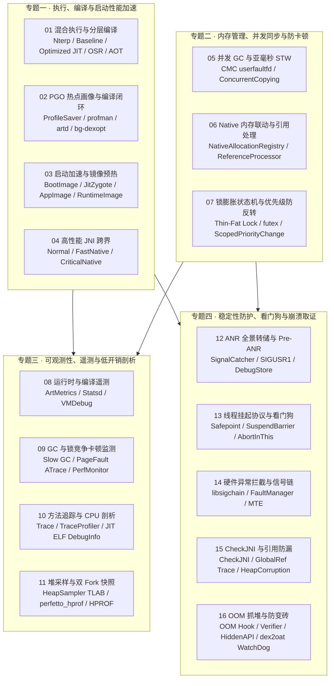
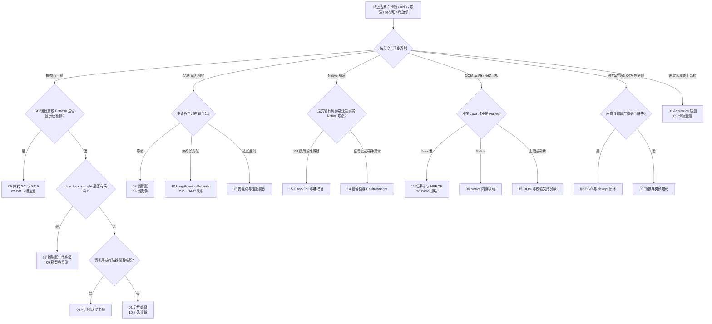

# ART「App 性能与稳定性机制」知识库 · 总入口 README

| 项目 | 内容 |
| :--- | :--- |
| 知识库定位 | ART 运行时「App 性能 / 稳定性」机制的源码级技术 Wiki 总入口，面向车机座舱与 Android 系统工程师 |
| 覆盖范围 | 4 大专题、16 条核心机制（Task 01–16）+ 本篇总入口（Task 17） |
| 源码基线 | `/home/voyah/workspace/8397/qssi/art`，commit `9a380e425f1270a51e0d7bf14363aa66b49509c2`（2026-01-30，只读） |
| 文档形态 | 单文件自包含 Markdown；Mermaid 架构/时序/状态/类图 + ASCII/Unicode 内存布局 + 行号级源码锚点 |
| 语料规模 | 16 篇合计 13,229 行、87 张 Mermaid 图、123 个 ASCII/Unicode 结构框、1,981 处 `file://` 链接（其中 1,901 处带行号锚点），覆盖 260 个去重源文件 |
| 质量门 | `verify_art_wikis.py` 全量校验 17 份文档 0 issue（2026-10-26） |
| 目标读者 | Android Runtime / Framework 工程师、车机性能与稳定性工程师、APM 与功耗团队 |

> [!IMPORTANT]
> 本知识库的主线只有一句：**ART 把「执行快」和「不崩」拆成了 16 条可以单独观测、单独调参、单独取证的机制**。排障时不要从"ART 很神秘"出发，而要从"这次属于哪条机制、它的证据在哪、它的阈值与开关是什么"出发——下面第 4 节的症状决策树就是为此而写。

## 1. What：这套知识库是什么？

### 1.1 定位与边界

这是一套**源码实证型**机制手册，不是 API 文档，也不是调优经验合集。每篇 Wiki 都回答四个固定问题：

1. **What**：该机制在 ART 栈里的职责边界、输入输出与核心术语；
2. **Why**：缺失它或采用朴素实现会带来什么性能劣化或稳定性事故；
3. **How**：数据结构与内存布局、端到端控制流、关键算法与阈值，全部带行号级源码锚点；
4. **实战**：可直接复制的命令、真实产物逐字段解读、避坑清单。

**覆盖边界**：ART 运行时（`runtime/`）、编译器（`compiler/`）、编译服务（`artd/`、`libartservice/`、`profman/`、`dex2oat/`、`odrefresh/`）、调试与剖析（`perfetto_hprof/`、`openjdkjvmti/`、`sigchainlib/`）以及它们与 Framework / Perfetto / Linux 内核的配合面。

**不覆盖**：应用层代码优化技巧、非 ART 的 Native 性能问题（如 GPU 驱动、HAL 实现）、设备实测数据（本知识库不附目标机数据，命令模板需要现场执行）。

### 1.2 全景架构图：4 大专题与 16 条机制



四个专题不是并列目录，而是两条正交的依赖：**执行/内存两条性能线向下沉到可观测性（专题三）取证**，同时**两条性能线向上暴露为稳定性事故（专题四）**。因此排障常见路径是"先在第 4 节定位症状 → 进专题三取证据 → 回专题一/二改参数或代码 → 必要时用专题四解释为什么最终表现为崩溃/ANR"。

### 1.3 知识库的四层结构

```text
┌──────────────────────────────────────────────────────────────────────┐
│  症状层   掉帧 / 卡顿 / ANR / OOM / Native Crash / 启动慢 / OTA 变砖   │
│           入口：第 4 节「症状 → 机制决策树」与速查表                    │
├──────────────────────────────────────────────────────────────────────┤
│  机制层   16 篇专题 Wiki（本 README 是唯一索引与导航）                  │
│           每篇自带 元信息卡 / What / Why / How / 实战 / 源码索引         │
├──────────────────────────────────────────────────────────────────────┤
│  证据层   GC 日志 / Perfetto 切片 / SIGQUIT Trace / Tombstone /        │
│           ArtMetrics / EventLog / lockprof 采样                        │
│           入口：第 3.3–3.4 节属性与参数总表 + 各篇「产物解读」           │
├──────────────────────────────────────────────────────────────────────┤
│  源码层   qssi/art @ 9a380e42（行号级 file:// 锚点，只读）              │
│           入口：第 3.5 节源码锚点速查                                   │
└──────────────────────────────────────────────────────────────────────┘
```

### 1.4 核心术语速查

| 术语 | 一句话含义 | 主篇 |
| :--- | :--- | :--- |
| Nterp | 用汇编实现的快速解释器，直接复用编译代码的 Quick 栈帧，实现"零转换" | 01 |
| Baseline / Optimized | 两级 JIT：前者低预算编译并采集画像，后者做激进内联与去虚化 | 01 |
| OSR | 循环回边处把解释器栈帧原地替换为编译栈帧，避免长循环一直解释执行 | 01 |
| `.prof` / `.dm` | 运行期采样画像 / 预置的 Baseline Profile，决定 `speed-profile` 编译效果 | 02 |
| AppImage / RuntimeImage | 编译期产出的应用镜像 / 运行期自动生成的共享镜像，加速类加载 | 03 |
| `@FastNative` / `@CriticalNative` | 两类 JNI 加速注解，后者连线程状态切换都省掉，但禁止触碰 Java 对象 | 04 |
| CMC / CC | `ConcurrentMarkCompact`（userfaultfd 缺页代偿）与 `ConcurrentCopying`（区域拷贝+读屏障） | 05 |
| STW | Stop-The-World，全部 mutator 停在安全点的独占窗口 | 05 |
| `gc_urgency` | 由 Native 分配量与 `mallinfo` 水位算出的 GC 紧迫度 | 06 |
| Thin / Fat Lock | 32 位 `LockWord` 上的自旋轻量锁与膨胀后的 `Monitor` | 07 |
| ArtMetrics | ART 内置的 48 项指标采集框架，可经 statsd 上报 | 08 |
| PerfMonitor | 阻塞超时后转储持锁者栈的监测器（`-XX:MonitorTimeoutEnable`） | 07 / 09 |
| TraceProfiler | 编译进代码的 2048 槽环形缓冲，捕获超长方法调用 | 10 |
| HeapSampler | 按泊松分布收缩 TLAB，对接 heapprofd 的分配采样器 | 11 |
| Pre-ANR | ANR 前用 `SIGUSR1` 预触发慢方法抓取 | 12 |
| SuspendBarrier | 线程协作挂起的四阶段屏障，超时可定向击杀肇事线程 | 13 |
| libsigchain | 通过符号劫持串起信号处理链，保证 ART 的 fault handler 不被绕过 | 14 |
| CheckJNI | Debug 构建或 `debug.checkjni` 下开启的 JNI 契约校验层 | 15 |
| odrefresh / dex2oat WatchDog | OTA 后编译产物的校验与超时自杀保护，防止开机变砖 | 16 |

## 2. Why：为什么需要这套知识库？

### 2.1 痛点模型：没有索引时会发生什么

| 现场现象 | 无知识库时的典型做法 | 代价 | 有本知识库后 |
| :--- | :--- | :--- | :--- |
| 应用周期性掉帧 | 直接怀疑业务代码，反复加日志 | 数天定位，往往误判 | 先用 09 的慢 GC 日志与 Perfetto 切片判定是否 GC，再决定查 05/06/07 |
| ANR Trace 看不懂 | 只看主线程栈顶一行 | 漏掉锁等待链与 Pre-ANR 慢方法 | 12 给出 `kMain → kBlocked → kLocked` 排序规则与逐字段解读 |
| 偶发 Native 崩溃 | 归因"系统不稳定"，重启了事 | 同一事故反复发生 | 14 判定信号归属，15 用 `adjacent_ram`/引用表直方图取证 |
| 内存持续上涨 | 只抓 Java HPROF | Native 上涨被误判为"没泄漏" | 06 用 `gc_urgency`/heapprofd 分离 Java 与 Native；11 分清采样与同步抓堆 |
| OTA 后开机卡顿或变砖 | 回滚版本 | 问题被掩盖，下次复现 | 02 查画像与 bg-dexopt 闭环，16 查 odrefresh 退避与编译看门狗 |
| 想建线上 APM | 自研 hook，开销不可控 | 埋点本身成为卡顿源 | 08 的 ArtMetrics + 09 的概率采样给出低开销方案 |

### 2.2 组织原则（也是阅读时的可信度依据）

1. **Zero Hallucination**：所有类名、函数签名、常量值、系统属性、启动参数与行号都经过源码核对；源码基线固定为 `9a380e42`，换基线需重新校验。
2. **单篇自包含**：一篇机制一个文件，不依赖外部私有路径；跨篇只做引用，不要求读者先读别篇。
3. **可操作优先**：每篇的实战章节给的是可复制命令与真实产物字段，而不是"建议关注 XX"。
4. **边界清晰**：明确区分 ART 原生实现的机制与 Framework/Perfetto/内核的配合边界，避免把上层行为误记为 ART 行为。

## 3. How：16 篇导航与全局速查

### 3.1 导航矩阵（按专题与任务号）

| # | 机制 | Wiki 文件 | 一句话用途 | 行数 |
| :--- | :--- | :--- | :--- | ---: |
| 01 | 混合执行引擎与分层编译 | [01-tiered-execution-and-jit-aot.md](01-tiered-execution-and-jit-aot.md) | 解释/JIT/AOT 五级执行形态如何升级，热点为何没被编译 | 788 |
| 02 | PGO 热点画像与编译治理 | [02-pgo-profile-and-dexopt-pipeline.md](02-pgo-profile-and-dexopt-pipeline.md) | `.prof` 怎么采、`profman` 何时合并、`artd` 何时后台编译 | 467 |
| 03 | App 启动加速与镜像预热 | [03-app-startup-and-image-caching.md](03-app-startup-and-image-caching.md) | 冷启动耗时拆解，BootImage/AppImage/RuntimeImage 到底用了哪个 | 518 |
| 04 | 高性能 JNI 跨界调用 | [04-fast-jni-transition-optimization.md](04-fast-jni-transition-optimization.md) | 标准 JNI 的状态切换开销与 Fast/Critical 的收益和风险边界 | 858 |
| 05 | 并发 GC 与亚毫秒 STW | [05-concurrent-gc-cmc-and-cc.md](05-concurrent-gc-cmc-and-cc.md) | CMC 与 CC 的差异、STW 究竟停在哪几步、堆增长策略 | 652 |
| 06 | Native 内存联动与引用处理 | [06-native-gc-trigger-and-ref-processing.md](06-native-gc-trigger-and-ref-processing.md) | 内存到底涨在 Java 还是 Native，弱引用/终结器为何卡顿 | 839 |
| 07 | 锁膨胀与优先级防反转 | [07-monitor-lock-inflation-and-priority.md](07-monitor-lock-inflation-and-priority.md) | Thin→Fat 膨胀条件、futex 等待、RT 线程优先级反转避坑 | 742 |
| 08 | 运行时与编译服务遥测 | [08-art-telemetry-metrics-and-statsd.md](08-art-telemetry-metrics-and-statsd.md) | 48 项 ArtMetrics 采集与上报，云端 APM 大盘接入 | 840 |
| 09 | GC 与锁竞争卡顿监测 | [09-gc-and-lock-jank-observability.md](09-gc-and-lock-jank-observability.md) | 慢 GC 日志、锁竞争概率采样、PerfMonitor 实时抓栈 | 809 |
| 10 | 方法追踪与 CPU 剖析 | [10-method-tracing-and-cpu-profiling.md](10-method-tracing-and-cpu-profiling.md) | 全量插桩 vs 低开销环形缓冲，JIT 地址如何还原成 Java 方法 | 884 |
| 11 | 堆采样与双 Fork 快照 | [11-java-heap-sampling-and-hprof.md](11-java-heap-sampling-and-hprof.md) | heapprofd 分配热点、perfetto_hprof 毫秒级抓堆、OOME 现场 | 1,337 |
| 12 | ANR 全景转储与 Pre-ANR | [12-anr-sigquit-dump-and-diagnostics.md](12-anr-sigquit-dump-and-diagnostics.md) | SIGQUIT/ANR Trace 逐字段解读，ANR 前慢方法录制 | 934 |
| 13 | 线程挂起与超时看门狗 | [13-thread-suspension-and-watchdog.md](13-thread-suspension-and-watchdog.md) | `SuspendAll timeout` 如何归因，谁拖住了安全点 | 682 |
| 14 | 硬件异常拦截与信号链 | [14-signal-chaining-and-fault-handler.md](14-signal-chaining-and-fault-handler.md) | 受管代码 SIGSEGV 如何变成 Java 异常，真实崩溃如何透传 | 697 |
| 15 | CheckJNI、引用防漏与堆取证 | [15-checkjni-ref-leak-and-heap-verify.md](15-checkjni-ref-leak-and-heap-verify.md) | JNI 误用、GlobalRef 泄漏、野指针踩踏的取证方法 | 1,021 |
| 16 | OOM 抓堆与防变砖看门狗 | [16-oom-verifier-hiddenapi-and-watchdogs.md](16-oom-verifier-hiddenapi-and-watchdogs.md) | OOM 是泄漏/碎片/上限，校验失败分级，dex2oat 看门狗 | 1,161 |

### 3.2 专题导读

**专题一 · 执行、编译与启动性能加速（01–04）**
- 01 解决"代码以什么形态执行"：Nterp、Fast、Baseline、Optimized、AOT 五级，以及 OSR 与反优化。
- 02 解决"热点代码能否被正确编译"：画像采集、增量合并、后台 dexopt、OTA 重启前 chroot 预编译。
- 03 解决"启动时类与镜像从哪来"：BootImage/JitZygote 共享内存、AppImage 与 RuntimeImage、并行解压与预读。
- 04 解决"跨语言调用贵不贵"：`kRunnable ↔ kNative` 切换、`@FastNative`/`@CriticalNative` 的适用与禁用边界。

**专题二 · 内存管理、并发同步与防卡顿（05–07）**
- 05 解决"回收要停多久"：CMC 与 CC 两条并发路线，以及亚毫秒 STW 的组成。
- 06 解决"Native 分配与弱引用如何影响 GC"：`gc_urgency`、`Heap::Trim`、`ReferenceProcessor` 状态机。
- 07 解决"锁会不会把线程拖死"：`LockWord` 布局、膨胀、futex、优先级提升。

**专题三 · 可观测性、遥测与低开销剖析（08–11）**
- 08 提供"长期、低开销、可上报"的指标口径，适合建 APM 大盘。
- 09 提供"卡顿现场"的实时证据：慢 GC、缺页、锁竞争采样与阻塞抓栈。
- 10 提供"方法级 CPU 归因"：全量 Trace 与环形缓冲 TraceProfiler 的取舍。
- 11 提供"内存归因"：分配采样、无感抓堆、OOME 现场三套链路。

**专题四 · 稳定性防护、看门狗与崩溃取证（12–16）**
- 12 提供"ANR 现场怎么读"，13 提供"挂起超时怎么归因"。
- 14 提供"信号与硬件异常怎么分流"，15 提供"JNI 与堆内存事故怎么取证"。
- 16 提供"OOM 与编译/校验失败的最后防线"，以及防变砖看门狗。

### 3.3 全局系统属性总表

> 生效规则（来自 Task 08 的实测结论）：`dalvik.vm.*` 只影响**新启动**的进程，改完需重启目标进程或 zygote；`persist.device_config.runtime_native.*` 优先级高于同名 `dalvik.vm.*`，改之前先 `getprop` 看有没有设备配置覆盖。

| 属性 | 作用 | 生效边界 | 详见 |
| :--- | :--- | :--- | :--- |
| `dalvik.vm.extra-opts` | 追加 ART 启动参数，如 `-Xjitwarmupthreshold:2048` | 新进程 / zygote 重启 | 01 / 07 / 09 |
| `dalvik.vm.dex2oat-flags` | 为 AOT 追加 dex2oat 参数（如 `--allow-profile-code`） | 编译任务 | 10 |
| `dalvik.vm.allow_profile_code` | 低开销追踪的总闸 | 须在 zygote 启动前生效 | 10 / 12 |
| `pm.dexopt.bg-dexopt` | 后台编译使用的编译器过滤器 | 后台任务 | 02 |
| `pm.dexopt.bg-dexopt.concurrency` | 后台编译并发度 | 后台任务 | 02 |
| `pm.dexopt.disable_bg_dexopt` | 为真时直接拒绝后台 dexopt 调度 | 后台任务 | 02 |
| `dalvik.vm.bgdexopt.new-classes-percent` | 增量合并门限：新增类占比 | 后台编译 | 02 |
| `dalvik.vm.bgdexopt.new-methods-percent` | 增量合并门限：新增方法占比 | 后台编译 | 02 |
| `dalvik.vm.enable_pr_dexopt` | 重启前 dexopt 开关 | OTA 重启前 | 02 |
| `dalvik.vm.pr_dexopt_retention` | 重启前编译结果的保留策略 | OTA 重启前 | 02 |
| `dalvik.vm.appimageformat` | AppImage 格式；非空即开启 AppImage 生成 | 编译期 | 03 |
| `dalvik.vm.parallel-image-loading` | 并行镜像解压，默认关闭 | 启动期 | 03 |
| `dalvik.vm.gctype` | 默认 GC 类型（如 `CMC` / `CC`） | 新进程 | 05 / 06 |
| `dalvik.vm.heapgrowthlimit` | 堆增长上限 | 新进程 | 05 |
| `dalvik.vm.heapmaxfree` | 堆空闲区间上限 | 新进程 | 06 |
| `dalvik.vm.heapminfree` | 堆空闲区间下限 | 新进程 | 06 |
| `dalvik.vm.foreground-heap-growth-multiplier` | 前台堆增长倍率 | 新进程 | 06 |
| `persist.device_config.runtime_native_boot.enable_uffd_gc_2` | 开启 CMC 的 userfaultfd 读屏障 | 新进程 | 05 |
| `persist.device_config.runtime_native_boot.force_disable_uffd_gc` | 强制关闭 uffd GC | 新进程 | 05 |
| `persist.device_config.runtime_native_boot.use_generational_gc` | 分代 GC 开关 | 新进程 | 05 |
| `persist.device_config.runtime_native_boot.use_uffd_move_ioctl` | uffd 移动 ioctl 开关 | 新进程 | 05 |
| `ro.dalvik.vm.enable_uffd_gc` | uffd GC 的只读默认值 | 只读 | 05 |
| `dalvik.vm.lockprof.threshold` | 锁竞争采样阈值 | 新进程 | 07 / 09 |
| `debug.art.monitor.app` | 允许非 `system_server` 进程启用 PerfMonitor | 新进程 | 07 / 09 |
| `dalvik.vm.metrics.reporting-spec` | ArtMetrics 上报规格 | 新进程 | 08 |
| `dalvik.vm.metrics.reporting-mods` | 指标模数（降低上报抖动） | 新进程 | 08 |
| `dalvik.vm.metrics.reporting-num-mods` | 指标采样模数总数 | 新进程 | 08 |
| `dalvik.vm.metrics.write-to-statsd` | 是否写入 statsd | 新进程 | 08 |
| `persist.device_config.runtime_native.metrics.reporting-spec` | 设备配置版的 metrics 规格，优先级更高 | 新进程 | 08 |
| `debug.checkjni` | Framework 驱动 Zygote 延后开启 CheckJNI | Zygote / 进程启动 | 15 |
| `ro.build.type` | release/debug 影响 CheckJNI 与挂起超时基准 | 只读 | 13 / 15 |
| `ro.hw_timeout_multiplier` | 硬件超时倍率，影响挂起超时 | 只读 | 13 |
| `traced.oome_heap_session.count` | 等待 OOME 抓堆的 Perfetto 会话数，为 0 时抓堆直接返回 | 运行期（由 Perfetto 写入） | 11 / 16 |
| `dalvik.vm.disable-odrefresh` | 关闭 odrefresh | 开机 / 编译期 | 16 |
| `libc.debug.malloc.options` | malloc_debug 选项（Native 分配归因） | 仅 userdebug/eng | 06 |
| `libc.debug.malloc.program` | malloc_debug 作用的进程名 | 仅 userdebug/eng | 06 |

### 3.4 全局启动参数总表

| 参数 | 作用 | 详见 |
| :--- | :--- | :--- |
| `-Xusejit` / `-Xusejit:false` | JIT 总开关，用于对照实验 | 01 |
| `-Xjitwarmupthreshold` | 进入 Baseline 编译的热度阈值（默认 `0xffff`） | 01 |
| `-Xjitthreshold` | 进入 Optimized 编译的阈值；设为 0 表示首次使用即编译 | 01 |
| `-Xjitinitialsize` / `-Xjitmaxsize` | JIT 代码缓存初始 / 最大尺寸 | 01 |
| `-Xjitprithreadweight` / `-Xjittransitionweight` | JIT 权重参数；本基线仍会解析，误配会 `LOG(FATAL)` | 01 |
| `-XX:DumpJITInfoOnShutdown` | 进程退出时转储 JIT 信息 | 01 / 02 |
| `--compiler-filter` | AOT 编译过滤器（如 `speed-profile` / `speed` / `verify`） | 01 |
| `-Xps-*` | ProfileSaver 运行期参数族（保存周期、最小方法数等） | 02 |
| `-XMadviseWillNeedArtFileSize` / `-XMadviseWillNeedOdexFileSize` | 镜像预读上限，默认 0 表示不预读 | 03 |
| `-Ximage-dex2oat` | 镜像相关 dex2oat 路径 | 03 |
| `-Xgc:CMC` / `-Xgc:SS` | 选择 GC 类型 | 05 / 06 |
| `-Xmx` / `-Xms` | 堆最大值 / 初始值 | 05 |
| `-XX:HeapGrowthLimit` | 堆增长上限 | 05 |
| `-XX:HeapTargetUtilization` | 触发 GC 的目标堆利用率 | 05 |
| `-XX:EnableTimeBasedGcTrigger` | 时间驱动的 GC 触发，默认关闭 | 05 |
| `-XX:UseTLAB` | TLAB 分配开关 | 05 |
| `-XX:ForegroundHeapGrowthMultiplier` | 前台堆增长倍率 | 06 |
| `-XX:HeapMaxFree` | 堆空闲上限 | 06 |
| `-XX:StopForNativeAllocs` | Native 分配达到该阈值时阻塞分配逼 GC（默认 1 GB） | 06 |
| `-Xlockprofthreshold` | 锁竞争采样阈值 | 07 / 09 |
| `-Xstackdumplockprofthreshold` | 锁竞争超阈值时转储栈的门限 | 07 / 09 |
| `-XX:MaxSpinsBeforeThinLockInflation` | Thin Lock 自旋上限，超过即膨胀为 Fat Lock | 07 |
| `-XX:MonitorTimeoutEnable` / `-XX:MonitorTimeout` | PerfMonitor：阻塞超时后转储持锁者栈 | 07 / 09 |
| `-XX:LongPauseLogThreshold` | 慢暂停日志阈值（默认 5 ms） | 09 |
| `-XX:LongGCLogThreshold` | 慢 GC 日志阈值（默认 100 ms） | 09 |
| `-XX:AlwaysLogExplicitGcs` | 显式 GC 无条件打印 | 09 |
| `-XX:DumpGCPerformanceOnShutdown` | 退出时打印整场 GC 账单 | 09 |
| `-Xmetrics-reporting-spec:` / `-Xmetrics-write-to-logcat:true` | metrics 上报规格与 logcat 输出 | 08 |
| `-Xmetrics-write-to-file:` / `-Xmetrics-format:xml` | metrics 落文件与 XML 格式 | 08 |
| `-Xmethod-trace` / `-Xmethod-trace-file` / `-Xmethod-trace-clock` | 全量方法追踪与时钟选择 | 10 |
| `-XX:PerfettoHprof=true` | 加载 perfetto_hprof 的 fork 快照插件 | 11 |
| `-XX:PerfettoJavaHeapStackProf=true` | 注册 Java 堆并启用分配采样 | 11 |
| `-XX:DumpNativeStackOnSigQuit` | SIGQUIT 时是否转储 Native 栈（默认 true） | 12 |
| `-XX:ThreadSuspendTimeout` | 线程挂起超时（ms），覆盖默认 4 s / debug 2 s | 04 / 13 |
| `-Xcheck:jni` | 开启 CheckJNI 契约校验 | 04 / 15 |
| `-Xjnitrace:<substring>` | 按方法名子串追踪 JNI 调用 | 04 / 15 |
| `-Xjniopts:forcecopy` | 强制拷贝数组，暴露越界/悬垂访问 | 15 |
| `-XX:GlobalRefAllocStackTraceLimit` | GlobalRef 分配栈记录上限，用于提前预警泄漏 | 15 |
| `-Xverify:all` / `-Xverify:softfail` | 字节码校验级别；量产开 `all` 会显著拖慢冷启动 | 16 |
| `-Xhidden-api-policy` / `-Xcore-platform-api-policy` | Hidden API 与 core platform API 策略 | 16 |
| `--watch-dog` / `--watchdog-timeout` | dex2oat 看门狗开关与超时 | 16 |

> 表中参数的具体默认值、适用版本与风险边界以对应 Wiki 的正文为准；此处只做跨篇索引，不重复推导。

### 3.5 核心源码锚点速查

| # | 核心入口 | 定位 |
| :--- | :--- | :--- |
| 01 | [`jit.cc`](file:///home/voyah/workspace/8397/qssi/art/runtime/jit/jit.cc) | JIT 编译队列与热度升级 |
| 02 | [`profile_assistant.cc`](file:///home/voyah/workspace/8397/qssi/art/profman/profile_assistant.cc) | 画像合并与判定 |
| 03 | [`image_space.cc`](file:///home/voyah/workspace/8397/qssi/art/runtime/gc/space/image_space.cc) | 镜像加载与并行解压 |
| 04 | [`jni_compiler.cc`](file:///home/voyah/workspace/8397/qssi/art/compiler/jni/quick/jni_compiler.cc) | Fast/Critical JNI stub 生成 |
| 05 | [`mark_compact.cc`](file:///home/voyah/workspace/8397/qssi/art/runtime/gc/collector/mark_compact.cc) | CMC 并发标记与压缩 |
| 06 | [`reference_processor.cc`](file:///home/voyah/workspace/8397/qssi/art/runtime/gc/reference_processor.cc) | 弱引用/终结器处理状态机 |
| 07 | [`monitor.cc`](file:///home/voyah/workspace/8397/qssi/art/runtime/monitor.cc) | 锁膨胀与 futex 等待 |
| 08 | [`metrics.h`](file:///home/voyah/workspace/8397/qssi/art/libartbase/base/metrics/metrics.h) | ArtMetrics 指标定义 |
| 09 | [`timing_logger.cc`](file:///home/voyah/workspace/8397/qssi/art/runtime/base/timing_logger.cc) | 慢 GC / 慢暂停日志 |
| 10 | [`trace_profile.cc`](file:///home/voyah/workspace/8397/qssi/art/runtime/trace_profile.cc) | 环形缓冲方法剖析 |
| 11 | [`perfetto_hprof.cc`](file:///home/voyah/workspace/8397/qssi/art/perfetto_hprof/perfetto_hprof.cc) | 双 fork 无感抓堆 |
| 12 | [`signal_catcher.cc`](file:///home/voyah/workspace/8397/qssi/art/runtime/signal_catcher.cc) | SIGQUIT/ANR 转储 |
| 13 | [`thread_list.cc`](file:///home/voyah/workspace/8397/qssi/art/runtime/thread_list.cc) | 挂起屏障与超时处理 |
| 14 | [`sigchain.cc`](file:///home/voyah/workspace/8397/qssi/art/sigchainlib/sigchain.cc) | 信号链劫持 |
| 15 | [`check_jni.cc`](file:///home/voyah/workspace/8397/qssi/art/runtime/jni/check_jni.cc) | CheckJNI 契约校验 |
| 16 | [`method_verifier.cc`](file:///home/voyah/workspace/8397/qssi/art/runtime/verifier/method_verifier.cc) | 字节码校验与失败分级 |

### 3.6 推荐阅读路径

| 目标 | 建议顺序 |
| :--- | :--- |
| 新接手 ART 性能问题 | 01 → 05 → 09 → 12（先懂执行与回收，再学取证） |
| 专攻卡顿/掉帧 | 09 → 05 → 07 → 06 → 10 |
| 专攻稳定性/事故 | 12 → 13 → 14 → 15 → 16 |
| 专攻启动与编译 | 01 → 02 → 03 → 08 |
| 建线上 APM | 08 → 09 → 11 → 10 |

## 4. 能利用这套知识库做什么？（症状 → 机制决策树）

### 4.1 总决策树



### 4.2 症状速查表

| 症状 | 首选入口 | 第一批命令 / 证据 | 判读要点 |
| :--- | :--- | :--- | :--- |
| 周期性掉帧 | 09 → 05 | `logcat -b main \| grep "Background concurrent copying GC"`、Perfetto `atrace` GC 切片 | 单次暂停超过 5 ms 先看 `LongPauseLogThreshold`；`Majflt` 高说明是缺页而非标记 |
| 前台频繁 GC | 05 / 06 | `dumpsys meminfo <pkg>`、GC 日志里的 `target_footprint` | 先分离 Java 与 Native 增长，再决定调堆还是查泄漏 |
| 主线程卡死/ANR | 12 → 07/09 | `kill -3 <pid>` 或等待 ANR，读 `main` 线程状态与 `kBlocked` 链 | 主线程 `native` 等锁时，用 `dvm_lock_sample` 与 PerfMonitor 找持锁者 |
| ANR 前有慢方法 | 12 → 10 | Pre-ANR 的 `LongRunningMethods`（`>341 ms`） | 慢方法若在 Binder 调用内，继续看服务端线程 |
| `SuspendAll timeout` | 13 | 挂起直方图、`/proc/<tid>/stat`、`-XX:ThreadSuspendTimeout` | 先找"安全点荒漠"（长 native 循环、不可中断等待），不是先怪 GC |
| JNI 偶发崩溃 | 15 | `-Xcheck:jni`、`-Xjnitrace`、引用表直方图 | 先区分 Local/Global/WeakGlobal 哪张表溢出 |
| GlobalRef 泄漏 | 15 | `-XX:GlobalRefAllocStackTraceLimit` + 溢出 dump 的 `Allocated at` | 51200 槽打满即 `LOG(FATAL)`，没有 Java 异常 |
| 堆踩踏/野指针 | 15 → 14 | `Verification::LogHeapCorruption`、`adjacent_ram` hex dump | 踩踏现场看邻近内存形态，反推越界方向 |
| Native 崩溃被吞/误判 | 14 | `logcat` 的 `signals` 日志、tombstone | 受管代码的 `SIGSEGV` 应转成 Java 异常；透传 debuggerd 的才是真崩溃 |
| Java OOM | 16 → 11 | `traced.oome_heap_session.count`、`android.java_hprof.oom` | 无 Perfetto 会话时抓堆逻辑直接返回，先确认有人在等 |
| Native 内存涨 | 06 | `heapprofd`、`libc.debug.malloc.options="backtrace=8"` | `malloc_debug` 仅限 userdebug/eng，量产禁止长期开启 |
| 冷启动慢 | 03 → 01/02 | `-verbose:image`、镜像文件与 `.prof` 是否存在 | 先确认用了哪种镜像，再判断是编译不足还是加载慢 |
| OTA 后卡顿/变砖 | 02 → 16 | `pm.dexopt.*`、odrefresh 日志、编译看门狗 | 看是编译未完成、校验失败，还是退避窗口内反复重启 |
| 想量化线上开销 | 08 | `-Xmetrics-reporting-spec`、`Debug.getRuntimeStat()` | 先算清采样模数与上报周期，再评估卡顿影响 |

### 4.3 车机 8397 长稳 playbook（多屏高负载场景）

1. **长稳掉帧**：先用 09 的概率采样确认是 GC 还是锁；GC 侧按 05 调 `target_footprint` 与时间驱动触发，锁侧按 07 查临界区与优先级反转。
2. **多屏视频 + 导航并发**：关注 06 的 Native 分配（解码器/图形缓冲）如何推高 `gc_urgency`，避免把 Native 压力误判成 Java 泄漏。
3. **冷启动压测**：按 03 的镜像链路拆解，再用 01/02 的画像与编译过滤器判断"编译不足"还是"镜像未命中"。
4. **OTA 后首启**：按 02 检查 bg-dexopt 是否被 idle/充电条件卡住，按 16 检查 odrefresh 退避与编译看门狗，避免"反复重编-重启"。
5. **线上 APM**：按 08 的三层指标模型接入，配合 09 的慢日志形成"指标发现异常 → 日志定位阶段"的闭环。

### 4.4 使用避坑

- 不要把 `adb shell setprop dalvik.vm.*` 当成即时生效：它只影响新进程，且可能被 `persist.device_config.*` 覆盖。
- 不要在量产版本长期打开 `-Xcheck:jni`、`-Xverify:all`、`malloc_debug` 或全量方法追踪：它们是取证工具，不是运行时配置。
- 不要用单次 GC 日志的绝对耗时下结论：先看堆大小、进程前后台状态与设备负载，再比较同口径样本。
- 不要把 ART 的机制与 Framework/Perfetto 的行为混为一谈：本知识库每篇都标了边界，跨层结论需要跨层证据。

## 5. 质量门与维护

### 5.1 校验口径

`verify_art_wikis.py` 对产出目录全部 Markdown 做 6 类检查：

1. 机制篇长度不少于 250 行（README 豁免）；
2. 机制篇必须含 `What` / `Why` / `How` / `能利用这个机制做什么` 四个章节关键词（README 豁免）；
3. 必须含 Mermaid 图与 ASCII/Unicode 结构框（README 豁免）；
4. `file://` 源码链接不少于 5 条，且路径必须真实存在（README 同样适用）；
5. 链接带行号时，行号区间必须落在文件实际行数内；
6. Mermaid 首行必须是受支持图类型；flowchart 节点标签含特殊字符必须加引号；GitHub Alert 不得相邻或嵌套。

### 5.2 复跑命令与当前结果

```bash
python3 /home/voyah/ethenslab/work/art-wiki/_materials/verify_art_wikis.py
```

2026-10-26 全量结果（17 份文档）：

| 文档 | 行数 | 结果 |
| :--- | ---: | :--- |
| README.md（本篇） | 403 | PASS |
| 01–16 机制篇 | 467–1,337 | 全部 PASS |
| 合计 issue | — | 0 |

### 5.3 统计与更新约定

| 指标 | 当前值 |
| :--- | :--- |
| 机制篇数量 | 16 |
| 机制篇总行数 | 13,229 |
| Mermaid 图 | 87 |
| ASCII/Unicode 结构框 | 123 |
| `file://` 链接 | 1,981 处（1,901 处带行号锚点） |
| 去重源文件 | 260 |
| 源码基线 | `9a380e425f1270a51e0d7bf14363aa66b49509c2` |

更新约定：新增/修改机制篇后必须重跑质量门；基线 commit 变更时，所有行号链接需要重新核对，不能沿用旧锚点。本 README 只做索引与口径汇总，机制细节一律以各专题篇正文为准。
