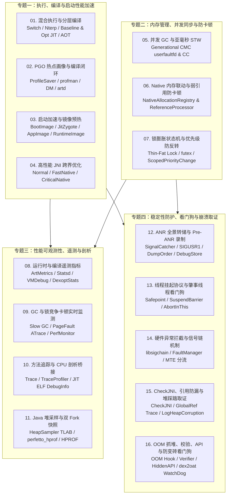

# ART “App 性能与稳定性机制”全景源码研究与系列技术 Wiki 实施计划

> [!IMPORTANT]
> **研究基线与目标产物**
> - **源码根路径**：[art](file:///home/ethen/workspace/voyah/projects/8397/code/qssi/art)（Android 15/16 主线级 QSSI 仓库，`libartpalette` SDK 36.1）
> - **知识库输出目录**：`/home/ethen/workspace/github/ethenslab/work/art-wiki/`
> - **图表与排版规范**：纯 Markdown 自包含文档（内置 **Mermaid** 架构图/时序图/状态机图/类图 + **ASCII/Unicode 内存与数据结构框图** + **结构化对比矩阵** + **精确到行号的源码链接**）。

---

## 一、 基于 ART 源码确立的“App 性能与稳定性”机制全景图

通过对 [art](file:///home/ethen/workspace/voyah/projects/8397/code/qssi/art) 下 `runtime/`、`compiler/`、`dex2oat/`、`odrefresh/`、`artd/`、`libartservice/`、`libprofile/`、`profman/`、`perfetto_hprof/`、`sigchainlib/`、`openjdkjvmti/`、`libartpalette/`、`libartbase/` 等全部核心子目录的源码审计，ART 围绕 **App 性能** 与 **App 稳定性** 共实现了 **4 大领域、16 条核心机制**：

---

## 二、 16 个研究 Task 与产出技术 Wiki 详细拆解

每一条机制均建立一个独立研究 Task，产出一份高信息密度技术 Wiki：

### 专题一：App 执行、编译与启动性能加速机制

| Task ID | 机制名称 | 目标 Wiki 文件 | 核心研读源码范围（相对于 `qssi/art/`） | 核心研究点与实战价值 |
| :--- | :--- | :--- | :--- | :--- |
| **Task 01** | **混合执行引擎与分层编译机制** | `01-tiered-execution-and-jit-aot.md` | [nterp.cc](file:///home/ethen/workspace/voyah/projects/8397/code/qssi/art/runtime/interpreter/mterp/nterp.cc)、`runtime/interpreter/mterp/arm64ng/`、[jit.cc](file:///home/ethen/workspace/voyah/projects/8397/code/qssi/art/runtime/jit/jit.cc)、[jit_code_cache.cc](file:///home/ethen/workspace/voyah/projects/8397/code/qssi/art/runtime/jit/jit_code_cache.cc)、[fast_compiler_arm64.cc](file:///home/ethen/workspace/voyah/projects/8397/code/qssi/art/compiler/optimizing/fast_compiler_arm64.cc)、[optimizing_compiler.cc](file:///home/ethen/workspace/voyah/projects/8397/code/qssi/art/compiler/optimizing/optimizing_compiler.cc)、[cha.cc](file:///home/ethen/workspace/voyah/projects/8397/code/qssi/art/runtime/cha.cc)、[escape.cc](file:///home/ethen/workspace/voyah/projects/8397/code/qssi/art/compiler/optimizing/escape.cc) | Nterp 零转换栈帧设计、热度阈值递减、ARM64 快速基线编译器、基于 Inline Cache 与 CHA 的激进内联/去虚化/逃逸分析、OSR 栈上替换与反优化回退；指导编译过滤器选型与 CPU 热点优化。 |
| **Task 02** | **PGO 热点画像采集与编译治理闭环** | `02-pgo-profile-and-dexopt-pipeline.md` | [profile_saver.cc](file:///home/ethen/workspace/voyah/projects/8397/code/qssi/art/runtime/jit/profile_saver.cc)、[profile_assistant.cc](file:///home/ethen/workspace/voyah/projects/8397/code/qssi/art/profman/profile_assistant.cc)、[ArtManagerLocal.java](file:///home/ethen/workspace/voyah/projects/8397/code/qssi/art/libartservice/service/java/com/android/server/art/ArtManagerLocal.java)、[BackgroundDexoptJob.java](file:///home/ethen/workspace/voyah/projects/8397/code/qssi/art/libartservice/service/java/com/android/server/art/BackgroundDexoptJob.java)、[PreRebootDexoptJob.java](file:///home/ethen/workspace/voyah/projects/8397/code/qssi/art/libartservice/service/java/com/android/server/art/PreRebootDexoptJob.java)、[artd.cc](file:///home/ethen/workspace/voyah/projects/8397/code/qssi/art/artd/artd.cc) | `.cur.prof` 采样条件、`profman` 增量合并阈值、`.dm`/`.sdm` 预置画像、`artd` 守护进程、闲时 `bg-dexopt` 与 OTA 重启前 chroot 预编译；指导车机核心应用 Baseline Profile 固化与 OTA 后防卡顿。 |
| **Task 03** | **App 启动加速与类/镜像预热机制** | `03-app-startup-and-image-caching.md` | [image_space.cc](file:///home/ethen/workspace/voyah/projects/8397/code/qssi/art/runtime/gc/space/image_space.cc)、[runtime_image.cc](file:///home/ethen/workspace/voyah/projects/8397/code/qssi/art/runtime/runtime_image.cc)、[startup_completed_task.cc](file:///home/ethen/workspace/voyah/projects/8397/code/qssi/art/runtime/startup_completed_task.cc)、[class_linker.cc](file:///home/ethen/workspace/voyah/projects/8397/code/qssi/art/runtime/class_linker.cc)、[dalvik_system_ZygoteHooks.cc](file:///home/ethen/workspace/voyah/projects/8397/code/qssi/art/runtime/native/dalvik_system_ZygoteHooks.cc) | BootImage / JitZygote 共享内存、编译期 `.art` AppImage 与运行期自动生成 `RuntimeImage`、启动期专属 `LinearAlloc` 回收、并行镜像加载与 `madvise` 预读；指导车机大应用冷启动耗时拆解与优化。 |
| **Task 04** | **高性能 JNI 跨界调用优化机制** | `04-fast-jni-transition-optimization.md` | [quick_jni_entrypoints.cc](file:///home/ethen/workspace/voyah/projects/8397/code/qssi/art/runtime/entrypoints/quick/quick_jni_entrypoints.cc)、`compiler/jni/quick/`、[jni_internal.cc](file:///home/ethen/workspace/voyah/projects/8397/code/qssi/art/runtime/jni/jni_internal.cc)、[scoped_fast_native_object_access-inl.h](file:///home/ethen/workspace/voyah/projects/8397/code/qssi/art/runtime/native/scoped_fast_native_object_access-inl.h) | 标准 JNI 跨界状态切换（`kRunnable` ↔ `kNative`）与句柄包装开销，`@FastNative` 与 `@CriticalNative` 机器码 Stub 加速原理及死锁/挂起超时风险边界；指导高频车载信号/图形/音频 JNI 接口优化。 |

### 专题二：App 内存管理、并发同步与防卡顿（Anti-Jank）机制

| Task ID | 机制名称 | 目标 Wiki 文件 | 核心研读源码范围（相对于 `qssi/art/`） | 核心研究点与实战价值 |
| :--- | :--- | :--- | :--- | :--- |
| **Task 05** | **并发垃圾回收与亚毫秒级 STW 机制** | `05-concurrent-gc-cmc-and-cc.md` | [mark_compact.cc](file:///home/ethen/workspace/voyah/projects/8397/code/qssi/art/runtime/gc/collector/mark_compact.cc)、[concurrent_copying.cc](file:///home/ethen/workspace/voyah/projects/8397/code/qssi/art/runtime/gc/collector/concurrent_copying.cc)、[garbage_collector.cc](file:///home/ethen/workspace/voyah/projects/8397/code/qssi/art/runtime/gc/collector/garbage_collector.cc)、[heap.cc](file:///home/ethen/workspace/voyah/projects/8397/code/qssi/art/runtime/gc/heap.cc)、[read_barrier-inl.h](file:///home/ethen/workspace/voyah/projects/8397/code/qssi/art/runtime/read_barrier-inl.h) | TLAB 无锁分配、分代 `MarkCompact`（基于 `userfaultfd` 消除读屏障并原地压缩抗碎片）对比 `ConcurrentCopying`、`ScopedPause` STW 控制、前后台 `ProcessState` 堆增长策略与时间驱动 GC；指导内存与掉帧平衡调优。 |
| **Task 06** | **Native 内存压力联动与引用处理防卡顿** | `06-native-gc-trigger-and-ref-processing.md` | [heap.cc](file:///home/ethen/workspace/voyah/projects/8397/code/qssi/art/runtime/gc/heap.cc)、[native_gc_triggering.md](file:///home/ethen/workspace/voyah/projects/8397/code/qssi/art/runtime/native_gc_triggering.md)、[reference_processor.cc](file:///home/ethen/workspace/voyah/projects/8397/code/qssi/art/runtime/gc/reference_processor.cc)、[reference_processing_jank.md](file:///home/ethen/workspace/voyah/projects/8397/code/qssi/art/runtime/reference_processing_jank.md) | `NativeAllocationRegistry` + `mallinfo` 的 `gc_urgency` 水位计算与 20 轮睡眠节流、后台 `Heap::Trim` 物理页释放、`ReferenceProcessor` 并发状态机与 `FinalizerReference` 阻塞根因；指导 Native 内存暴涨与弱引用卡顿治理。 |
| **Task 07** | **Java 锁膨胀状态机与优先级防反转机制** | `07-monitor-lock-inflation-and-priority.md` | [lock_word.h](file:///home/ethen/workspace/voyah/projects/8397/code/qssi/art/runtime/lock_word.h)、[monitor.cc](file:///home/ethen/workspace/voyah/projects/8397/code/qssi/art/runtime/monitor.cc)、[monitor_inflation.md](file:///home/ethen/workspace/voyah/projects/8397/code/qssi/art/runtime/monitor_inflation.md)、[mutex.cc](file:///home/ethen/workspace/voyah/projects/8397/code/qssi/art/runtime/base/mutex.cc)、[scoped_thread_priority_change.cc](file:///home/ethen/workspace/voyah/projects/8397/code/qssi/art/runtime/scoped_thread_priority_change.cc)、[thread_priorities.md](file:///home/ethen/workspace/voyah/projects/8397/code/qssi/art/runtime/thread_priorities.md) | 32 位 `LockWord` 布局、Thin Lock 自旋/让出与挂起膨胀为 Fat `Monitor`、GC 锁收缩、`futex` 等待队列、三层线程优先级映射与 `ScopedPriorityChange` 临时提权；指导高并发锁设计与 RT 线程避坑。 |

### 专题三：App 性能可观测性、指标遥测与低开销剖析机制

| Task ID | 机制名称 | 目标 Wiki 文件 | 核心研读源码范围（相对于 `qssi/art/`） | 核心研究点与实战价值 |
| :--- | :--- | :--- | :--- | :--- |
| **Task 08** | **ART 运行时与编译服务遥测指标体系** | `08-art-telemetry-metrics-and-statsd.md` | [metrics.h](file:///home/ethen/workspace/voyah/projects/8397/code/qssi/art/libartbase/base/metrics/metrics.h)、[reporter.cc](file:///home/ethen/workspace/voyah/projects/8397/code/qssi/art/runtime/metrics/reporter.cc)、[statsd.cc](file:///home/ethen/workspace/voyah/projects/8397/code/qssi/art/runtime/metrics/statsd.cc)、[flags.h](file:///home/ethen/workspace/voyah/projects/8397/code/qssi/art/libartbase/base/flags.h)、[dalvik_system_VMDebug.cc](file:///home/ethen/workspace/voyah/projects/8397/code/qssi/art/runtime/native/dalvik_system_VMDebug.cc)、[Dex2OatStatsReporter.java](file:///home/ethen/workspace/voyah/projects/8397/code/qssi/art/libartservice/service/java/com/android/server/art/Dex2OatStatsReporter.java)、[odr_metrics.h](file:///home/ethen/workspace/voyah/projects/8397/code/qssi/art/odrefresh/odr_metrics.h)、[DexUseManagerLocal.java](file:///home/ethen/workspace/voyah/projects/8397/code/qssi/art/libartservice/service/java/com/android/server/art/DexUseManagerLocal.java) | 48 项 `ArtMetrics` 采集点与抽样上报策略、`Debug.getRuntimeStat()` 进程内线上自监控（含 `pre-oome-gc-count`）、Dex2Oat/BgDexopt/PreReboot/Odrefresh 全链路遥测及插件 Dex 监控；支撑车机云端 APM 大盘建设。 |
| **Task 09** | **GC 与锁竞争卡顿实时监测体系** | `09-gc-and-lock-jank-observability.md` | [heap.cc](file:///home/ethen/workspace/voyah/projects/8397/code/qssi/art/runtime/gc/heap.cc)、[timing_logger.cc](file:///home/ethen/workspace/voyah/projects/8397/code/qssi/art/runtime/base/timing_logger.cc)、[monitor.cc](file:///home/ethen/workspace/voyah/projects/8397/code/qssi/art/runtime/monitor.cc)、[monitor_android.cc](file:///home/ethen/workspace/voyah/projects/8397/code/qssi/art/runtime/monitor_android.cc)、[mutex.cc](file:///home/ethen/workspace/voyah/projects/8397/code/qssi/art/runtime/base/mutex.cc) | 5ms STW / 100ms 慢 GC / 10ms 弱引用告警、Systrace 阶段切片与 `Majflt-GC` 主缺页计数器；`dvm_lock_sample` 概率采样、双栈同步 Checkpoint 转储以及 `MonitorTimeoutEnable`（`PerfMonitor`）阻塞中实时抓栈；支撑掉帧与假死定位。 |
| **Task 10** | **方法追踪、低开销环形缓冲与符号桥接** | `10-method-tracing-and-cpu-profiling.md` | [trace.cc](file:///home/ethen/workspace/voyah/projects/8397/code/qssi/art/runtime/trace.cc)、[trace_profile.cc](file:///home/ethen/workspace/voyah/projects/8397/code/qssi/art/runtime/trace_profile.cc)、[instrumentation.cc](file:///home/ethen/workspace/voyah/projects/8397/code/qssi/art/runtime/instrumentation.cc)、[debugger_interface.cc](file:///home/ethen/workspace/voyah/projects/8397/code/qssi/art/runtime/jit/debugger_interface.cc)、[events.h](file:///home/ethen/workspace/voyah/projects/8397/code/qssi/art/openjdkjvmti/events.h) | 全量插桩/采样 `Trace`、编译内联 2048 槽环形缓冲 `TraceProfiler`（捕获 `>341ms` 长方法）、`__jit_debug_register_code` Seqlock 内存 ELF 符号表、可执行方法文件偏移（eBPF `uprobe`）及 JVMTI 剖析扩展；指导生产级低开销 CPU 剖析。 |
| **Task 11** | **Java 堆采样剖析与双 Fork 快照机制** | `11-java-heap-sampling-and-hprof.md` | [javaheapsampler.cc](file:///home/ethen/workspace/voyah/projects/8397/code/qssi/art/runtime/javaheapprof/javaheapsampler.cc)、[perfetto_hprof.cc](file:///home/ethen/workspace/voyah/projects/8397/code/qssi/art/perfetto_hprof/perfetto_hprof.cc)、[allocation_record.cc](file:///home/ethen/workspace/voyah/projects/8397/code/qssi/art/runtime/gc/allocation_record.cc)、[hprof.cc](file:///home/ethen/workspace/voyah/projects/8397/code/qssi/art/runtime/hprof/hprof.cc) | `HeapSampler` 泊松指数分布收缩 TLAB 对接 `heapprofd`、信号 `__SIGRTMIN + 6` 触发 `perfetto_hprof` 双 `fork` 写时复制毫秒级无感抓堆（含 120s 看门狗与 `smaps`）、对比同步 `hprof::DumpHeap`；指导长稳运行内存泄漏排查。 |

### 专题四：App 稳定性防护、超时看门狗与崩溃取证机制

| Task ID | 机制名称 | 目标 Wiki 文件 | 核心研读源码范围（相对于 `qssi/art/`） | 核心研究点与实战价值 |
| :--- | :--- | :--- | :--- | :--- |
| **Task 12** | **ANR 全景诊断转储与 Pre-ANR 录制机制** | `12-anr-sigquit-dump-and-diagnostics.md` | [signal_catcher.cc](file:///home/ethen/workspace/voyah/projects/8397/code/qssi/art/runtime/signal_catcher.cc)、[runtime.cc](file:///home/ethen/workspace/voyah/projects/8397/code/qssi/art/runtime/runtime.cc)、[thread_list.cc](file:///home/ethen/workspace/voyah/projects/8397/code/qssi/art/runtime/thread_list.cc)、[thread.h](file:///home/ethen/workspace/voyah/projects/8397/code/qssi/art/runtime/thread.h)、[native_stack_dump.cc](file:///home/ethen/workspace/voyah/projects/8397/code/qssi/art/runtime/native_stack_dump.cc)、[debugstore.h](file:///home/ethen/workspace/voyah/projects/8397/code/qssi/art/libartbase/base/debugstore.h) | `sigqueue(SIGUSR1)` 预触发 `TraceProfiler` 抓取 ANR 前慢方法、`SIGQUIT` 并发 `DumpCheckpoint`、`kMain -> kBlocked -> kLocked -> kDefault` 防截断排序、`DebugStore` 与全维状态快照；提供深度解读 ANR Trace 的权威手册。 |
| **Task 13** | **线程安全点挂起机制与超时精准看门狗** | `13-thread-suspension-and-watchdog.md` | [thread_list.cc](file:///home/ethen/workspace/voyah/projects/8397/code/qssi/art/runtime/thread_list.cc)、[thread.cc](file:///home/ethen/workspace/voyah/projects/8397/code/qssi/art/runtime/thread.cc)、[mutator_gc_coord.md](file:///home/ethen/workspace/voyah/projects/8397/code/qssi/art/runtime/mutator_gc_coord.md)、[thread_suspension_timeouts.md](file:///home/ethen/workspace/voyah/projects/8397/code/qssi/art/runtime/thread_suspension_timeouts.md) | `mutator_lock_` 读写锁与协作式安全点/隐式挂起触发页、4 阶段 `WaitForSuspendBarrier` 超时与动态豁免策略、`/proc/<tid>/stat` + 磁盘状态采集及 `AbortInThis` 定向击杀肇事线程；解决线上 `SuspendAll timeout` 疑难崩溃。 |
| **Task 14** | **硬件异常拦截与 Native Crash 信号链** | `14-signal-chaining-and-fault-handler.md` | [sigchain.cc](file:///home/ethen/workspace/voyah/projects/8397/code/qssi/art/sigchainlib/sigchain.cc)、[fault_handler.cc](file:///home/ethen/workspace/voyah/projects/8397/code/qssi/art/runtime/fault_handler.cc)、[fault_handler.h](file:///home/ethen/workspace/voyah/projects/8397/code/qssi/art/runtime/fault_handler.h)、`runtime/arch/arm64/fault_handler_arm64.cc` | `libsigchain` 符号劫持保障信号链顺序、`FaultManager` 将受管代码 `SIGSEGV`/`SIGBUS` 转为隐式 `NPE`/`StackOverflowError`/挂起或 `userfaultfd` 缺页，并将真实 Native 崩溃（含 MTE）透传 `debuggerd`；指导 Native Crash 捕集 SDK 集成避坑。 |
| **Task 15** | **CheckJNI、引用表防漏与堆踩踏取证** | `15-checkjni-ref-leak-and-heap-verify.md` | [check_jni.cc](file:///home/ethen/workspace/voyah/projects/8397/code/qssi/art/runtime/jni/check_jni.cc)、[java_vm_ext.cc](file:///home/ethen/workspace/voyah/projects/8397/code/qssi/art/runtime/jni/java_vm_ext.cc)、[indirect_reference_table.cc](file:///home/ethen/workspace/voyah/projects/8397/code/qssi/art/runtime/jni/indirect_reference_table.cc)、[verification.cc](file:///home/ethen/workspace/voyah/projects/8397/code/qssi/art/runtime/gc/verification.cc)、[verify_object.cc](file:///home/ethen/workspace/voyah/projects/8397/code/qssi/art/runtime/verify_object.cc) | `CheckJNI` 契约校验与 `>16ms` Critical 慢锁告警、Local/Global/WeakGlobal 溢出直方图与 `-XX:GlobalRefAllocStackTraceLimit` 泄漏栈记录、`Verification::LogHeapCorruption` 野指针内存踩踏邻近 RAM Hex Dump 取证；指导 JNI 稳定性治理。 |
| **Task 16** | **OOM 抓堆、校验、API 管控与防变砖看门狗** | `16-oom-verifier-hiddenapi-and-watchdogs.md` | [heap.cc](file:///home/ethen/workspace/voyah/projects/8397/code/qssi/art/runtime/gc/heap.cc)、[perfetto_hprof.cc](file:///home/ethen/workspace/voyah/projects/8397/code/qssi/art/perfetto_hprof/perfetto_hprof.cc)、[method_verifier.cc](file:///home/ethen/workspace/voyah/projects/8397/code/qssi/art/runtime/verifier/method_verifier.cc)、[hidden_api.cc](file:///home/ethen/workspace/voyah/projects/8397/code/qssi/art/runtime/hidden_api.cc)、[dex2oat.cc](file:///home/ethen/workspace/voyah/projects/8397/code/qssi/art/dex2oat/dex2oat.cc)、[odr_compilation_log.cc](file:///home/ethen/workspace/voyah/projects/8397/code/qssi/art/odrefresh/odr_compilation_log.cc) | OOM 前 5 轮晋升回收、防颠簸放弃机制与 `"android.java_hprof.oom"` 阻塞抓堆、`MethodVerifier` 字节码安全与慢校验日志、`hidden_api`/DCL 管控、`dex2oat` 9.5 分钟自杀看门狗与 `odrefresh` 指数退避防无限重启；全面覆盖系统级兜底防线。 |

此外，设立 **Task 17** 产出总入口 `/home/ethen/workspace/github/ethenslab/work/art-wiki/README.md`，汇总 ART 架构全景图、16 篇专题导航、全局系统属性/启动参数总表，以及面向车载/Android 工程师的**问题症状 -> 机制定位决策树**。

---

## 三、 单篇技术 Wiki 统一编写规范（What / Why / How / Actionable Playbook）

每篇专题技术 Wiki 均严格遵循单文件自包含、图文并茂、源码实证的统一模板，至少包含以下 6 个核心章节：

1. **文档元信息与核心结论卡片**
   - 标明关联源码路径、核心类/结构体、关键系统属性（`dalvik.vm.*` / `debug.*` / `persist.device_config.*`）及一句话机制摘要。
2. **What：机制是什么？（概念界定与架构位置）**
   - 清晰定义该机制的职责边界、输入输出与核心术语表。
   - 配套 **Mermaid 分层架构定位图（`flowchart`）**，展示该机制在 App / Framework / ART Runtime / Linux Kernel 之间的交互关系。
3. **Why：为什么需要它？（痛点模型与设计动机）**
   - 剖析若缺失该机制或采用朴素方案会导致什么性能劣化（如帧率抖动、冷启动慢、内存膨胀）或稳定性事故（如死锁无日志、GC 误回收、无限重启）。
   - 配套 **方案演进对比表** 或 **痛点根因示意图**。
4. **How：源码级实现原理深度剖析（图文并茂核心区）**
   - **核心数据结构与内存布局**：配套 **ASCII/Unicode 内存位域/结构框图**（如 `LockWord` 32 位布局、`TraceProfiler` 环形槽位、`JITDescriptor` Seqlock 结构）与 **Mermaid 类关系图（`classDiagram`）**。
   - **端到端控制流与状态演进**：配套 **Mermaid 时序图（`sequenceDiagram`）** 及 **状态机图（`stateDiagram-v2`）**。
   - **关键算法、阈值常量与源码精读**：结合精确到行号的 `[符号名](file:///home/ethen/workspace/voyah/projects/8397/code/qssi/art/...)` 链接，拆解快慢路径分支、采样公式、并发同步与边界条件。
5. **能利用这个机制做什么？（工程实战指南与排障手册）**
   - **典型应用场景**：性能压测基准、卡顿/掉帧归因、线上低开销监控接入、疑难 ANR/Crash/OOM 破案、车机座舱定制优化。
   - **实操命令与配置模板**：可直接复制执行的 `adb shell setprop`、信号触发命令、Perfetto `pbtx` 抓取配置或 Java API 调用方式。
   - **产物解读与避坑指南**：真实格式的 Logcat / EventLog / Systrace Slice / ANR & Tombstone 关键段落逐字段解读及常见误用陷阱。
6. **核心源码对照索引表**
   - 汇总本专题涉及的所有核心源文件、核心类/函数、行号区间与职责说明，方便读者一键跳转阅读。

---

## 四、 执行编排与质量保障策略

获批进入执行阶段后，将按 **4 个批次（每批次 4 个并行 Subagent 深入对应源码并撰写 Wiki）+ 最终总览整合与校验** 推进：
1. **Batch 1（执行与启动性能）**：并行完成 `Task 01 ~ Task 04`，同步更新 [task.md](file:///home/ethen/.gemini/antigravity/brain/db260ba4-b7ce-4b54-9228-5adc342f0f21/task.md)。
2. **Batch 2（内存并发与指标监测）**：并行完成 `Task 05 ~ Task 08`，同步更新 [task.md](file:///home/ethen/.gemini/antigravity/brain/db260ba4-b7ce-4b54-9228-5adc342f0f21/task.md)。
3. **Batch 3（剖析采样与 ANR/挂起稳定性）**：并行完成 `Task 09 ~ Task 12`，同步更新 [task.md](file:///home/ethen/.gemini/antigravity/brain/db260ba4-b7ce-4b54-9228-5adc342f0f21/task.md)。
4. **Batch 4（看门狗、信号链、JNI 与系统级兜底）**：并行完成 `Task 13 ~ Task 16`，同步更新 [task.md](file:///home/ethen/.gemini/antigravity/brain/db260ba4-b7ce-4b54-9228-5adc342f0f21/task.md)。
5. **Final（总入口与全量质检）**：完成 `Task 17`（`README.md`），运行脚本自动化校验全部 17 份文档的章节完整性（What/Why/How/实战应用）、Mermaid 图表语法合规性、源码文件链接存在性及公式/符号转义正确性。
